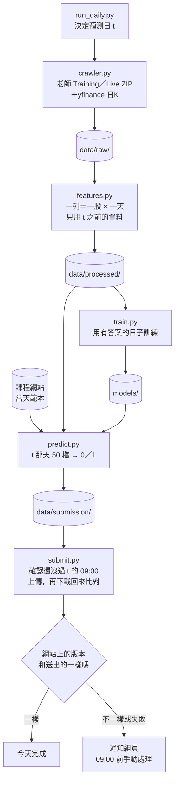

# stock-market-challenger

每個台股交易日的台北時間 09:00 前，預測 50 檔股票當天會不會「收盤高於開盤」，把 0/1 寫成 CSV 上傳到競賽網站。

這個分支目前只有骨架。每個檔案的用途、輸入和輸出都寫好了，函式本體還是空的（呼叫會丟出 `NotImplementedError`）。結構確認後，再一個檔案一個檔案補程式。

## 名詞

- 預測日 t：這次要交預測的台股交易日。檔名 `submission_YYYY-MM-DD.csv` 的日期就是 t。哪些日子是交易日，以課程網站 `/api/state` 的 `phase2Days` 為準，不自己用星期幾推算。
- y：t 當天 `adj_close > adj_open` 為 1，否則為 0。`adj_close`、`adj_open` 是調整過除權息的收盤價和開盤價，老師資料裡的欄名是 `etl:adj_close`、`etl:adj_open`。
- 官方分數：每格 (2 × 預測 − 1) × 當天盤中報酬（`adj_close / adj_open − 1`），再取平均。猜對漲的股票，漲越多分數越高。
- Phase 2：比賽的第二階段，每個交易日 09:00 前交當天 50 檔的預測。這個分支只處理 Phase 2（Phase 1 是一次交完的固定回測，已經交過）。
- 老師資料：課程提供的資料，分兩份。
  - Training ZIP 從課程網站下載，是 2020-01-02～2026-08-31 的歷史資料：100 檔股票各一個 CSV、一張 global 市場表、一個 `info.json`。之後不會再變。
  - Live ZIP 從 2026-09-01 開始，放在另一台伺服器，一天更新不只一次。預測日 t 那天早上的版本已經有 t 的一列，但值先填 `-1`（還沒收盤）。
- global 表：老師資料裡一天一列的市場數字，例如 `^TWII`（台灣加權指數）、`^KS11`（韓國綜合指數）、`TX_OI`（台指期未平倉口數）、`^VIX`、`^IXIC`、`^GSPC`。
- `Top50@Y`：`info.json` 裡要預測的 50 檔股票清單（老師資料共有 100 檔，`Top100@Y`）。每天實際交哪幾檔、照什麼順序，以課程網站當天的範本為準。
- 範本：課程網站每天給的空白提交檔，定出 50 檔股票的順序。
- lag k：t 那列放的是「到 t 的前一個台股交易日為止、往回 k 個交易日」的報酬。`ret_lag2` 是 2 日報酬，不是兩天前的報酬。
- manifest：下載紀錄，記每個檔案的下載時間、sha256 指紋（由內容算出的編號，內容一變就不同）和成功或失敗。

## 檔案樹

```text
ml-final-2026-fall/        （clone 下來的資料夾；分支 claude/stock-market-challenger）
├── README.md              這份說明
├── CLAUDE.md              給 Claude Code 的規則摘要
├── requirements.txt       套件和鎖定的版本
├── .gitignore             哪些檔案不進 Git
├── .env.example           帳號密碼的範例；真的值放 .env（不進 Git）
├── run_daily.py           一個指令跑完一天：爬蟲 → 特徵 → 訓練 → 預測 → 上傳
├── configs/
│   └── config.yaml        網站網址、yfinance 代號、特徵、模型參數、截止時間
├── data/
│   ├── raw/               爬蟲抓下來的原始資料，原樣保存
│   │   ├── teacher/       老師 Training ZIP 解開的檔案
│   │   ├── teacher_live/  老師 Live ZIP 解開的檔案（每次下載覆蓋）
│   │   ├── yfinance/      19 個額外指標，一個序列一個 CSV
│   │   └── manifest.json  下載紀錄
│   ├── processed/         features.py 算出來的 features.csv.gz（可以重算，不進 Git）
│   └── submission/        submission_YYYY-MM-DD.csv、upload_log.jsonl（上傳紀錄）、run_YYYY-MM-DD.log（執行紀錄）
├── models/                model.txt（模型）、feature_columns.json（欄位順序和訓練資訊）
├── notebooks/
│   └── README.md          實驗的檔名和注意事項；每天的自動流程不會讀這裡
├── src/
│   ├── __init__.py
│   ├── crawler.py         下載老師資料和 yfinance 額外指標
│   ├── features.py        原始資料 → 特徵表；訓練和預測用同一個函式
│   ├── train.py           按日期切分、驗證、訓練、存模型
│   ├── predict.py         下載當天範本，用模型產生 t 那天 50 檔的 submission CSV
│   ├── submit.py          上傳 CSV，再下載回來核對
│   └── utils.py           讀設定和帳密、台北時間、截止檢查、log
└── tests/
    ├── test_no_future_data.py     特徵只能用 t 之前的資料
    └── test_submission_format.py  CSV 的欄位、列數、0/1
```

結構參考 Cookiecutter Data Science（常見的資料科學專案範本，把 data、models、notebooks、src 分開放）。這個比賽另外需要四樣東西：
- `submit.py`：比賽要把 CSV 上傳到課程網站，還要確認網站收到的內容和送出的一樣。
- `run_daily.py`：每天只要跑這一個指令，五個步驟照程式裡寫好的順序執行。
- `tests/`：最容易出事的兩件事是不小心用到當天的資料，以及 CSV 格式錯，各寫測試擋住。
- `.env.example`：課程網站的帳號密碼不能寫進程式或設定檔。

## 每天的流程



Live ZIP 要到 t 當天早上才有 t 的那一列，所以正式流程在 t 當天早上、09:00 之前跑。截止檢查只在 `predict.py` 和 `submit.py` 做；單獨跑 `crawler`、`features`、`train` 做研究，什麼時間都可以。

平常只跑這一行：

```bash
python run_daily.py            # 加 --skip-train 會沿用 models/ 裡的模型；加 --date 2026-11-17 可指定 t
```

要單獨跑某一步時，在 repo 根目錄依序執行（`run_daily.py` 做的就是這五步）：

```bash
python -m src.crawler          # 1. 抓資料到 data/raw/
python -m src.features         # 2. 算特徵到 data/processed/
python -m src.train            # 3. 訓練，模型存到 models/
python -m src.predict          # 4. 產生 data/submission/submission_YYYY-MM-DD.csv
python -m src.submit           # 5. 上傳並核對；config.yaml 的 submit.enabled 是 false 時只印出要送的內容
```

## 失敗時怎麼手動交

1. 看 `data/submission/run_YYYY-MM-DD.log`，找出停在哪一步、為什麼。
2. 登入課程網站，先確認 t 還沒有有效的提交。網站每天的上傳次數有上限，不要重複送。
3. 如果 `data/submission/submission_YYYY-MM-DD.csv` 已經產生，就在網站上手動上傳它。

通知方式（例如 LINE 群組）還沒決定。

## 資料為什麼也放在這個分支

組員 clone 一次就拿到程式、資料、模型和每天的上傳紀錄，程式和資料的版本也對得上。資料量小，放得下：老師 Training ZIP 解開約 45 MB，之後不會再變；Live 資料每天約多 100 列（100 檔各一列）；yfinance 19 個序列加起來約 3 MB。

要守的規則：
- 原始資料存成解開後的 CSV，不存 ZIP。老師的 CSV 每天只多幾列，Git 只記差異；ZIP 每天會整個重存。yfinance 的 `adj_close` 在除息後會整欄重算，那幾天檔案會整個變，但檔案很小，影響不大。
- `data/processed/` 可以從 `data/raw/` 重算，不進 Git。
- 每個檔案要小於 100 MB（GitHub 的上限）。
- 只有正式的每日流程會 commit 並推送 `data/` 和 `models/`。組員在本機跑只是測試，不要 commit 這兩個資料夾的變動，可以用 `git restore data models` 還原。組員推程式之前先 `git pull --rebase`。

## 不能違反的規則

- 預測日 t 的特徵只能用 t 之前就知道的資料。老師資料裡 t 當天的價格、成交量、法人、技術指標和 `y` 都不能當輸入。global 表的 `^TWII`、`^KS11`、`TX_OI` 是當天收盤後才有的值，只能用日期早於 t 的最後一列。
- 驗證按日期切：先切日期，再挑出那些日期的列。同一天 50 檔股票共用市場特徵，隨機拆列會偷看到答案。
- 過了 t 當天台北 09:00 就不上傳，網站自己的截止更早時以網站為準。
- yfinance 每個請求至少間隔 2 秒。
- 帳號密碼只放 `.env` 或執行環境的 secret，不進 Git。

## 本機怎麼開始

repo 的預設分支 `main` 是空的，clone 時要用 `-b` 指定這個分支。需要先裝 Python 3.12。

```bash
git clone -b claude/stock-market-challenger https://github.com/jiangjiangian/ml-final-2026-fall.git
cd ml-final-2026-fall
python3.12 -m venv .venv
source .venv/bin/activate      # Windows PowerShell：.venv\Scripts\Activate.ps1
pip install -r requirements.txt
cp .env.example .env           # Windows：copy .env.example .env
python -m pytest               # 目前 4 個測試都會顯示 skipped；要用 python -m 才 import 得到 src
```

`.env` 填你在課程網站 https://final.html2026.csie.org 登入用的 email 和密碼，`COURSE_LIVE_KEY` 先留空。

## 還沒決定的事

- 每天用什麼方式自動執行。GitHub Actions（GitHub 提供的雲端機器，設定檔放在 `.github/workflows/`）的定時排程 11/04 晚了 3 小時 42 分到 6 小時 17 分，11/05 晚了約 4 小時，而且只執行預設分支上的設定。所以先不放 `.github/workflows/`。目前沒有任何東西每天在跑這個分支。
- 預設分支什麼時候換成空的 `main`。2026-11-05 預設分支還是 `system-completion`，那邊的 `course-benchmark.yml` 每天照排程跑，上傳開關是開的。這個分支開始真的上傳之前，要先換掉，兩套程式才不會搶著交答案、用掉上傳次數。
- 正式流程用哪位組員的帳號。
- 用哪個模型。`config.yaml` 先寫 LightGBM，之後依驗證結果換。
- Live ZIP 的下載方式。舊程式的做法在 `claude/peaceful-babbage-09xeie` 分支的 `archive/system-completion/ml_financial_prediction/src/finpred/ingestion/course.py`。不用切分支，在 GitHub 網頁切到那個分支看就好，或用：

```bash
git fetch origin claude/peaceful-babbage-09xeie
git show origin/claude/peaceful-babbage-09xeie:archive/system-completion/ml_financial_prediction/src/finpred/ingestion/course.py
```
