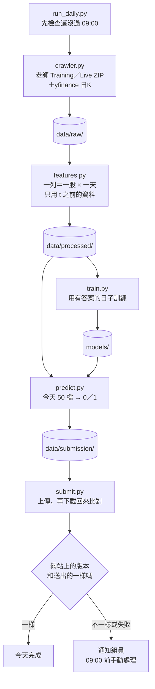

# stock-market-challenger

每個台股交易日的台北時間 09:00 前，預測 50 檔股票當天會不會「收盤高於開盤」（`y = 1` 代表 `adj_close > adj_open`），把 0/1 寫成 CSV 上傳到競賽網站。

這個分支目前只有骨架。每個檔案的用途、輸入和輸出都寫好了，函式本體還是空的（呼叫會丟出 `NotImplementedError`）。結構確認後，再一個檔案一個檔案補程式。

## 檔案樹

```text
claude/stock-market-challenger
├── README.md              這份說明
├── CLAUDE.md              給 Claude Code 的規則摘要
├── requirements.txt       套件和鎖定的版本
├── .gitignore             哪些檔案不進 Git
├── .env.example           帳號密碼的範例；真的值放 .env（不進 Git）
├── run_daily.py           一個指令跑完一天：爬蟲 → 特徵 → 訓練 → 預測 → 上傳
├── configs/
│   └── config.yaml        股票來源、yfinance 代號、特徵、模型參數、截止時間
├── data/
│   ├── raw/               爬蟲抓下來的原始資料，原樣保存
│   ├── processed/         features.py 算出來的特徵表（可以重算，不進 Git）
│   └── submission/        每天要上傳的 submission_YYYY-MM-DD.csv 和上傳紀錄
├── models/                每天用來預測的模型和它的欄位清單
├── notebooks/             組員實驗用，每天的自動流程不會讀這裡
├── src/
│   ├── __init__.py
│   ├── crawler.py         下載老師資料（課程網站）和 yfinance 額外指標
│   ├── features.py        原始資料 → 特徵表；訓練和預測用同一個函式
│   ├── train.py           按日期切分、訓練、存模型
│   ├── predict.py         用今天的特徵和模型產生 submission CSV
│   ├── submit.py          上傳 CSV，再下載回來核對
│   └── utils.py           讀設定、台北時間、截止檢查、log
└── tests/
    ├── test_no_future_data.py     特徵只能用 t 之前的資料
    └── test_submission_format.py  CSV 的欄位、列數、0/1
```

和參考的 Cookiecutter 結構相比，多了四樣東西：
- `submit.py`：比賽要上傳並確認對方收到，只產出 CSV 不夠。
- `run_daily.py`：每天只要跑一個指令，順序寫死在程式裡，不靠人記。
- `tests/`：最容易出事的兩件事是不小心用到當天的資料，以及 CSV 格式錯，各寫一個測試擋住。
- `.env.example`：課程網站的帳號密碼不能寫進程式或設定檔。

## 每天的流程



用指令表示就是：

```bash
python run_daily.py            # 依序跑下面五步
python -m src.crawler          # 1. 抓資料到 data/raw/
python -m src.features         # 2. 算特徵到 data/processed/
python -m src.train            # 3. 訓練，模型存到 models/
python -m src.predict          # 4. 產生 data/submission/submission_YYYY-MM-DD.csv
python -m src.submit           # 5. 上傳並核對（config.yaml 的 submit.enabled 是 false 時只印出要送的內容）
```

## 資料為什麼也放在這個分支

程式、資料、模型和每天的上傳紀錄都放在同一個分支。組員 clone 一次就拿到全部，而且程式和資料的版本一定對得上。這個比賽的資料不大，所以可以這樣做：老師 Training ZIP 解開約 45 MB，而且不會再變；Live 資料每天只多 100 列；yfinance 19 個序列加起來約 3 MB。

要守的規則：
- 原始資料存成解開後的 CSV，不存 ZIP。CSV 每天只多幾列，Git 只會記差異；ZIP 每天整個重存。
- `data/processed/` 可以從 `data/raw/` 重算，不進 Git。
- 每個檔案要小於 100 MB（GitHub 的上限）。
- 自動流程只改 `data/` 和 `models/`，組員只改程式，兩邊很少衝突。推上去之前先 `git pull --rebase`。

## 不能違反的規則

- 預測日 t 的特徵只能用 t 之前就知道的資料。老師資料裡 t 當天的價格、成交量、法人、技術指標和 `y` 都不能當輸入。老師 global 表的 `^TWII`、`^KS11`、`TX_OI` 是當天收盤後才有的值，只能用前一列。
- 驗證按日期切，不隨機拆列。同一天 50 檔股票共用市場特徵，隨機拆會偷看到答案。
- 過了台北 09:00 就不上傳。
- yfinance 每個請求至少間隔 2 秒。
- 帳號密碼只放 `.env` 或執行環境的 secret，不進 Git。

## 本機怎麼開始

```bash
python3.12 -m venv .venv
source .venv/bin/activate
pip install -r requirements.txt
cp .env.example .env           # 填入課程網站的帳號密碼
pytest                         # 目前兩個測試都是 skip，補完程式後拿掉 skip
```

## 還沒決定的事

- 每天用什麼方式自動觸發。GitHub Actions 的排程常常晚好幾個小時（11/04 晚 3h42m～6h17m，11/05 晚約 4 小時），所以先不放 `.github/workflows/`。
- 用哪個模型。`config.yaml` 先寫 LightGBM，之後依驗證結果換。
- Live 資料的伺服器位址和金鑰怎麼取得。舊程式的做法在 `claude/peaceful-babbage-09xeie` 分支的 `archive/system-completion/ml_financial_prediction/src/finpred/ingestion/course.py`。
