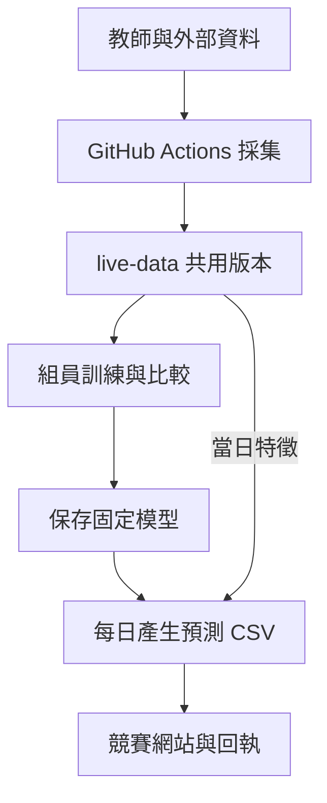
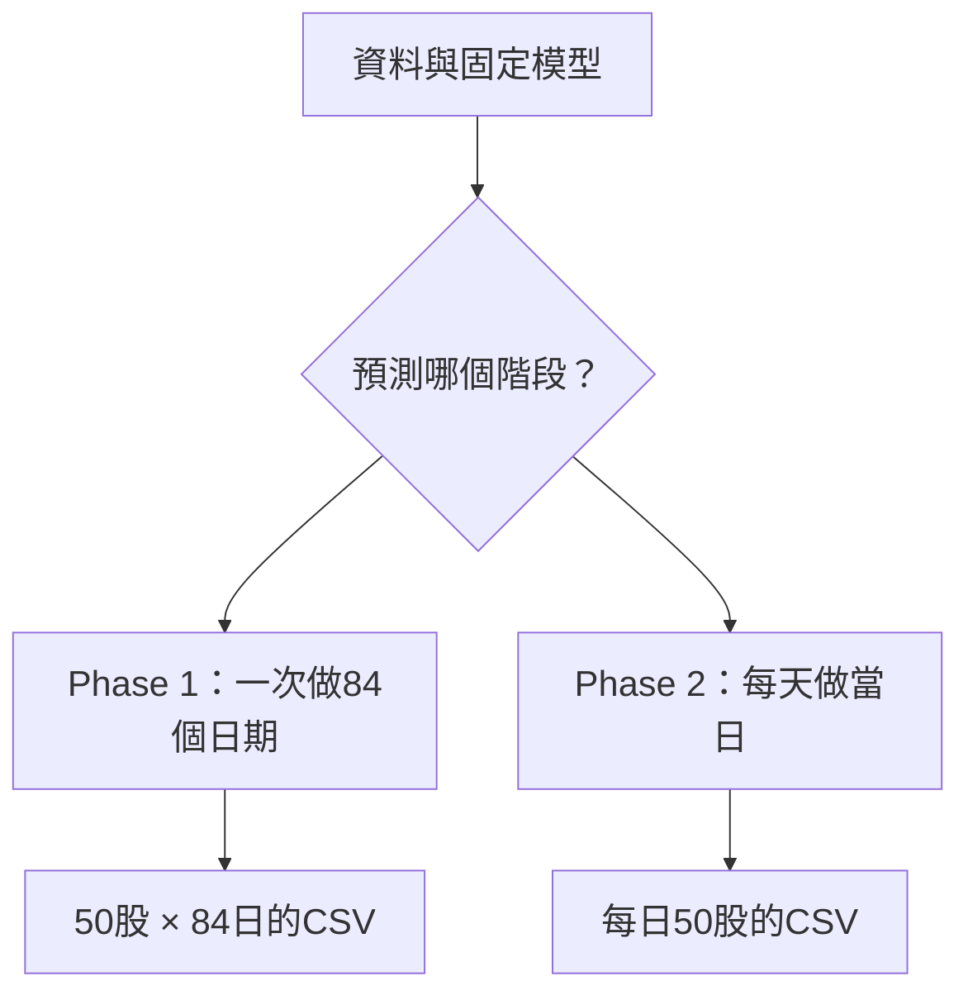

# 台股預測：組員操作指南

更新：2026-11-04（台北時間）。本頁是 `system-completion` 分支的共同入口；repository 目前為 **Public**。

**我們要做的是：共用資料 → 訓練並比較模型 → 用固定模型產生預測 CSV → 上傳競賽網站 → 核對回執。**
競賽網站收的是 **CSV 預測答案**；模型檔另外保存，供下一次推論使用。`1`＝當日調整後收盤價高於開盤價；`0`＝未高於（含持平）。預測目標是盤中方向，不是隔夜漲跌。

## 1. 整條流程：誰做、在哪做、交出什麼



| 步驟 | 負責／執行位置 | 輸入 → 輸出 | 目前狀態 |
|---|---|---|---|
| 收資料 | 共用 GitHub Actions | Training、Live、額外來源 → 原始快照與版本 | 全16類來源已手動雲端採集成功 |
| 整理特徵 | 共用資料程式 | 原始值 → 個股特徵、市場特徵、獨立 labels | 研究版已輸出，不混入當日答案 |
| 訓練與比較 | 組員本機或 Kaggle Notebook | 固定資料版本 → 分數、設定與模型包 | 本機研究完成；Kaggle連線另驗 |
| 保存模型 | 組員研究目錄；每日服務另有受控模型儲存 | 權重＋前處理＋欄位版本＋來源紀錄 | 研究包可保存；任意組員模型尚不能直接取代正式模型 |
| 每日推論 | GitHub Actions | 準時取得的當日特徵＋已驗證模型 → CSV | 研究影子流程已部署；真實盤前日待驗收 |
| 提交／驗證 | 競賽網站 | 合格 CSV → 下載目前有效版本，逐格核對 | Phase 1正在完成；Phase 2尚無合格正式模型或回執 |

「下載成功」「模型分數較高」「網站收到答案」是三個不同的驗收。現在組員可以先拿同一版資料做研究；正式自動上傳仍有未完成條件。

### 兩個階段的交付不同



| | Phase 1：靜態回測 | Phase 2：每日新資料 |
|---|---|---|
| 要交什麼 | 官方84日期，2026-06-01～09-30，共4,200個0／1 | 官方當日50股，共50個0／1 |
| 何時截止 | 2026-12-24 23:59（台北） | 每個官方session當日09:00（台北） |
| 本專案怎麼訓練 | 固定既有R2的TCN設定，只fit `target_date < 2026-06-01` 的完成標籤；不拿6～9月答案選模型 | 用已完成歷史建立候選，通過檢查才替換每日模型 |
| 時間限制怎麼看 | 使用各預測日之前的個股觀測；歷史版本假設另記錄 | 必須真的在當日截止前取得可用資料，不能事後補成準時 |

教師Training截至8/31，因此包含Phase 1的部分目標日期。**這些6/1起的標籤必須從本次訓練排除。** Phase 1使用專用靜態回測入口；Phase 2的正式模型認證、五日演練與每日09:00門檻，不是老師對Phase 1另設的上傳條件。Phase 1沿用既有winner的15欄輸入（7個股＋8個M0市場欄），保留市場時間／版本假設；目前尚待實際fit、上傳及回執驗收；最新結果以[STATUS](ml_financial_prediction/docs/STATUS.md)為準。


## 2. 會收到哪些資料

| 資料 | 用途／差別 | 存放與注意事項 |
|---|---|---|
| 教師 Training | 固定歷史包，本輪內容未變 | `live-data` 原始物件；不因重抓覆寫舊版本 |
| 教師 Live | 後續日期、未完成標籤與修訂 | 每次取得另留版本；`y=-1` 是 pending，不能當已完成答案 |
| 教師 template | 官方股票／日期／欄位順序 | 格式驗證的依據，不自行減少股票或日期 |
| Yahoo 8序列 | IXIC、GSPC、TWII、KS11、VIX、SOX、TSM ADR、NVDA | 原生日序列；TSM／NVDA是個股，SOX是指數 |
| Cboe／TWSE | VIX歷史、台灣加權指數、電子／半導體／金融類股快照 | 三類股目前的日常快照不等於完整歷史 |
| FRED 2序列 | USD/TWD匯率、US10Y殖利率 | 原始資料已收集；另有獨立研究特徵，不自動加入日常模型 |

下表路徑都從下載後的runtime根目錄算起。

| 組員實際讀取的檔案 | 每列代表什麼 | 可否直接作為特徵 |
|---|---|---|
| `shared-data/features/stock_lags.csv.gz` | 一檔股票 × 一個目標日期；列數以該版lineage為準 | 七個個股研究特徵 |
| `shared-data/features/market.csv` | 一個台股目標日期，共用市場資訊 | 先按可用時間對齊台股目標日，再供各股共用 |
| `shared-data/labels/stock_outcomes.csv.gz` | 同一股票日期的真實方向與盤中報酬 | **只用於訓練／評分，不接回當日輸入** |
| `shared-data/features/schema.json` | 欄位公式、單位、缺值政策 | 讀資料前的欄位字典 |
| `shared-data/features/lineage.json`／`shared-data/features/build_status.json` | 來源版本、檔案hash、本次成功或失敗 | 檢查是否同版、是否真的更新成功 |

自訂模型以 `(stock_id, target_date)` 對應個股features與labels。市場資料要先以「當時已可用的版本」對齊成每個台股目標日一列，再按 `target_date` 接到50股；**不能把原始市場日期直接join就當盤前可用。** 保留全部目標格，推論時不載入labels。16類來源是已採集來源數，不表示每個來源都有完整可回測歷史。

`live-data` 是共用資料分支，不需要每個組員各寫一套爬蟲。共享歷史目前標為 `research_assumption`：保留尚未核實的歷史發布／修訂假設，不表示可直接上線。

## 3. 特徵表：lag 到底是什麼

` t `＝欲預測日期；`obs-1`＝該股在 `t` 前最後一筆來源觀測；`s`＝某來源市場在截止前最新可用的交易日。**觀測列、台股交易日、海外市場交易日不能混用。**

### 個股七欄：目前每日表共用的基準

下表 `O`、`C` 為調整後開盤／收盤價，數值報酬用小數表示。

| 欄位名稱 | 白話意思 | 公式／lag與單位 |
|---|---|---|
| `stock_prev_intraday_return` | 前一觀測日盤中漲跌 | `C[obs-1]/O[obs-1]-1`；小數 |
| `stock_return_between_observed_rows` | 前兩筆觀測收盤價變化 | `C[obs-1]/C[obs-2]-1`；缺交易日時不能稱一日報酬 |
| `stock_prev_log_volume` | 前一觀測成交量的對數 | `log(1+成交股數[obs-1])` |
| `stock_prev_rsi` | 前一觀測的RSI | 沿用來源RSI尺度，不重新猜計算期數 |
| `stock_prev_atr_fraction` | 波動幅度相對於股價 | `ATR[obs-1]/C[obs-1]`；價格比例 |
| `stock_prev_sma_deviation` | 股價偏離均線的程度 | `C[obs-1]/SMA[obs-1]-1`；價格比例 |
| `stock_previous_observation_gap_days` | 距上一觀測隔了幾天 | `t-date[obs-1]`；**日曆天數** |

例：週一預測使用前週五的觀測時，間隔是3個日曆天；若價格由100變110，一次return是 `110/100-1=0.10=10%`。用了兩個價格不叫lag2；lag2是更早的一次報酬。前一列若仍pending，保留缺值，不跳過它找更早完成值。

**M0是本專案的八欄市場基準，不是Yahoo八序列。** 它包含IXIC／GSPC／TWII／KS11各一欄報酬，VIX水準與點差兩欄，以及外資淨部位水準與差分兩欄。精確欄名為 `ixic_ret_1s`、`gspc_ret_1s`、`twii_ret_1s`、`ks11_ret_1s`、`vix_level`、`vix_change_points`、`tx_foreign_net_oi`、`tx_foreign_net_oi_change`；本次淨部位兩欄因證據不足保留缺值。計算與缺值規則見[八欄市場字典](ml_financial_prediction/docs/MARKET_FEATURES.md)。

### 市場擴充：先分清楚公式與成熟度

| 類型／對應序列 | 轉換與單位 | 目前可使用到哪一步 |
|---|---|---|
| 價格：IXIC／GSPC／TWII／KS11／SOX／TSM ADR／NVDA | `ret_ks=P[s]/P[s-k]-1`，`k=1/5/20`；各自原生交易日的小數報酬 | 單期共享市場表、1／5／20期研究擴充與消融已做；尚未自動加入正式每日模型 |
| VIX | 水準 `VIX[s]`、點差 `VIX[s]-VIX[s-1]` | 研究表已有；不是持有VIX的投資報酬 |
| 外資期貨淨部位 | 有正負號的口數、水準差分；不用百分比報酬 | 日期／sentinel證據不足，研究數值保持缺值 |
| USD/TWD | 報價是「一美元需多少台幣」；`FX[o]/FX[o-k]-1` | 獨立研究有1／5觀測列報酬；正值表示台幣貶值，不冒稱連續fixing session |
| US10Y殖利率 | 年率百分比水準、`100*(Y[o]-Y[o-k])` 基點差 | 獨立研究已有；4.0→4.1是+10bp，不是債券價格報酬 |
| 台灣電子／半導體／金融 | 有完整原生日曆與歷史水準後才算類股return | 日常raw快照已有，完整歷史與特徵接入仍待驗收 |
| 品質欄 | `*_age_hours`、`*_is_missing`、`*_is_new_session…` | 描述資訊多舊、是否缺值、有無新來源交易日；精確欄名見schema |

先在完整來源序列計算return，再依可用時間對齊台股日期；不能先取多國日期交集再把相鄰列當一日。只使用截止前已取得且可用的資料，不用未來值補洞。同日市場向量會被50股共用，驗證必須按日期切分，不能隨機拆股票列。

## 4. 組員三步操作

先備妥Git、Python 3.12與[uv](https://docs.astral.sh/uv/)。下面是研究入口；現在不會因此自動得到正式可提交模型。

**第一步：取得程式與共用資料。** 從自己的工作分支研究，資料固定同一個 `live-data` commit。

```bash
git clone --branch system-completion https://github.com/jiangjiangian/ml-final-2026-fall.git
cd ml-final-2026-fall
export UV_CACHE_DIR="$HOME/.cache/uv"
bash tools/setup_project.sh
cd ml_financial_prediction
export FINPRED_TEAM_RUNTIME="$HOME/finpred-runtime"
uv run --locked --no-sync python scripts/fetch_live_data.py \
  --repo jiangjiangian/ml-final-2026-fall --revision live-data \
  --runtime-dir "$FINPRED_TEAM_RUNTIME" --with-features --allow-public-data
```

第一次可用 `live-data` 解析最新版；比較實驗時改填輸出的40碼 `git_revision`，讓組員用相同資料。資料還原到 `$FINPRED_TEAM_RUNTIME/raw/`，衍生表在 `shared-data/`；這些都在程式checkout外，不需課程帳密。

**第二步：準備研究訓練表，固定一個模型先跑通。** 內建訓練器讀JSON，不直接讀 `csv.gz`；builder用已下載的同版原始快照重建訓練表。

```bash
uv run --locked --no-sync python scripts/prepare_team_data.py \
  --runtime-dir "$FINPRED_TEAM_RUNTIME" --train-before 2026-06-01 \
  --out-dir "$HOME/finpred-team/phase1-prefix-v1" --allow-research
uv run --locked --no-sync python scripts/train_model.py \
  --table "$HOME/finpred-team/phase1-prefix-v1/training-table.json" \
  --out-dir "$HOME/finpred-models/linear-v1" \
  --family linear --objective weighted_classification --seed 42 --allow-research
```

`--train-before 2026-06-01` 表示訓練標籤日期必須**早於6/1**，不是包含6/1。準備程式會核對已下載的原始快照，輸出 `training-table.json`、`features.json` 與 `lineage.json`。其中 `features.json` 是6/1前觀測日期聯集的50股歷史研究輸入，不含答案，也不是6～9月預測表。單次fit另輸出 `model.joblib`、`manifest.json`、`training-run.json`。輸出目錄必須是新的，重跑時改用新名稱。

以上鏈已用11/04的固定公開版本實跑：準備77,674筆完成訓練樣本、77,700格歷史特徵，最後標籤日期為5/29；再完成一次linear訓練，未評分保留期、未提交。

這個linear範例讓組員先跑通研究訓練，**不會自動產生可提交的Phase 1答案**。歷史回測用下表的Phase 1專用入口；一般推論器會拒絕拿今天才fit的模型冒充過去已存在的每日模型。比較模型時以老師官方 `mean((2*p-1)*盤中return)` 為主、accuracy為輔；不重跑已用過的保留期挑winner。

**第三步：交接研究結果，依階段產預測與提交。**

前兩步可直接執行，先產生可重現的研究模型。第三步由下列對應入口接手；不是執行完訓練就已上傳網站。

| 要做什麼 | 入口／交付 | 實際條件 |
|---|---|---|
| 比較模型 | `notebooks/financial_model_comparison.ipynb`；分數、設定、baseline與全部結果 | 同資料版本、同日期切分；四架構完整比較已做48fits，不每天重選winner |
| 產生預測 | `scripts/predict.py`；用可信模型包＋相容feature表輸出 `predictions.json` | 模型訓練範圍／時間須早於預測；推論不重新fit |
| Phase 1固定回測 | `scripts/run_phase1_forecast.py` → `build_phase1_predictions.py` → `submit_phase1_predictions.py` | 專用入口只fit一次、產4,200筆、核對官方模板；提交前檢查版本／配額，提交後逐格驗回執 |
| Phase2每日提交 | 每日服務產50股CSV、提交並核對網站目前有效回執 | 合格模型、準時來源、官方session／配額與09:00截止全部通過才送出 |
| 交接模型給每日服務 | 保留模型包、前處理、版本、研究結果與來源hash | 不是把任意 `.joblib` 上傳Git就會自動啟用；正式匯入／升級仍待驗收 |

## 5. 模型到底在哪裡訓練？Kaggle MCP是什麼？

| 選擇 | 實際運算位置／適合工作 | 目前狀態 |
|---|---|---|
| 本機／目前Codex雲端環境 | CPU固定模型、研究比較；程式與Notebook共用同套核心 | 已實跑；四架構需回repo根目錄，以 `FINPRED_WITH_NEURAL=1 bash tools/setup_project.sh` 安裝CPU PyTorch |
| GitHub Actions | 清晨採集、固定recipe的研究訓練與每日推論／提交程序 | 已部署；還原演練成功，真實盤前日與正式提交待驗收 |
| Kaggle Notebook | Kaggle的CPU／選用GPU執行Notebook；可在一份Notebook比較多模型 | 本地Notebook／可攜bundle已驗；遠端帳戶連線依Kaggle readiness實查結果更新 |
| Kaggle MCP | 讓agent呼叫Kaggle的工具連線，**本身不提供算力** | 已找到官方MCP的註冊資訊；本會話尚無可呼叫的Kaggle RPC，遠端連線未驗證 |

課程網站帳密、GitHub Actions Secrets、Kaggle token與Codex的MCP連線是不同設定。11/03的[Actions檢查41645046599](https://github.com/jiangjiangian/ml-final-2026-fall/actions/runs/41645046599)實際回報 `credentials_missing`；這只說該runner沒有Kaggle憑證，不否定個人MCP設定。尚未在Kaggle遠端訓練；本機CPU訓練可以繼續。官方CLI也能操作Kaggle，不必依賴MCP；完整帳戶與bundle步驟見[Kaggle指南](ml_financial_prediction/docs/KAGGLE_TRAINING.md)。Kaggle排隊與額度不保證09:00前完成，所以不作唯一的每日提交執行器。

## 6. 每天早上的排程（台北時間）

| 時間 | 共用服務做什麼 | 若不合格 |
|---|---|---|
| 04:17／05:17／06:17／07:17 | 下載教師與額外資料、保存版本、產研究特徵 | 來源獨立回報失敗，保留舊版，不假裝新資料 |
| 07:20～07:50 | 正式候選訓練／驗證／升級 | 目前歷史時間證據不足，正式模型仍blocked |
| 07:25 | 隔離研究流程：固定linear recipe單次fit | 不寫正式approved模型 |
| 08:10／08:13 | 正式特徵凍結／隔離研究預測 | 舊快照、晚到或schema不符就停止 |
| 08:20／08:35 | 正式提交／核對目前有效回執 | 尚未啟用正式提交；09:00後不補送 |

04點是工作窗口，不是資料必定已更新的保證；08:10等是專案安排，老師每日硬截止是09:00。上述workflow已部署到GitHub Actions，但**11/04 08:05查核仍沒有任何 `schedule` run**，正在處理觸發問題；不能稱每日流程已正常運作。執行器是Actions，不需要開著聊天或依靠學校主機。

## 7. 分支與資料夾在哪裡

```text
ml-final-2026-fall/                 # system-completion 預設分支；repo Public
├── README.md                       # 組員先看本頁
├── .github/workflows/               # 採集、研究影子、正式流程與CI
├── graphify-out/                    # 可查來源的程式／文件架構圖
└── ml_financial_prediction/
    ├── notebooks/                  # 多模型比較Notebook
    ├── scripts/
    │   ├── fetch_live_data.py       # 組員取固定資料版本
    │   ├── prepare_team_data.py     # 已下載快照→研究訓練JSON
    │   ├── train_model.py           # 固定設定單次fit
    │   ├── run_phase1_forecast.py   # Phase 1完整靜態回測
    │   └── run_daily_pipeline.py    # Phase 2每日五步
    ├── src/finpred/                 # 共用特徵／模型／評分／提交流程
    └── docs/                       # 完整規格、研究與操作記錄
live-data/                          # 另一個branch，不是程式分支下的目錄
├── README.md                       # 實際data tree與欄位說明
├── objects/ manifests/ catalog/     # 原始資料與可追溯版本
├── features/ labels/               # 輸入與答案分離
└── runtime/                        # 每日服務允許保存的模型／狀態物件
```

`dev`保留核心開發歷史、`deep-research`保留來源研究；`main`依原要求保留空樹。帳密、cookie、token不進任何branch或log。

### 文件常用詞

| 用語 | 白話意思 |
|---|---|
| fit／recipe | 訓練一次模型／這次固定使用的模型設定 |
| R2／fold | 本專案第二輪四模型研究（不是R²指標）／按日期劃分的驗證區間 |
| manifest／lineage | 保存檔案版本、來源時間與hash的紀錄；hash用來核對內容有無變動 |
| session／shadow／approved | 官方指定交易日／只旁跑記錄的研究流程／通過每日模型門檻的版本 |

## 8. 已完成與仍待完成

| 已有實物證據 | 尚不能宣稱完成 |
|---|---|
| 16類來源完整手動採集、固定版本乾淨下載及hash核對 | 11/04 08:05仍沒有真正定時事件，需修復並驗收觸發 |
| 固定版本共享研究特徵；Ridge／HistGBDT／TCN／跨股attention的48fit比較 | 研究歷史發布／修訂假設尚未認證，額外市場特徵未自動納入正式模型 |
| 本機326項檢查、程式雲端CI與研究／正式入口的還原演練成功 | 真實盤前研究日、正式approved模型、有效回執與五交易日驗收 |

正式歷史時間證據門檻是目前採用的工程政策，不冒稱老師另有明文要求；今天下載成功不能證明2019／2025某時刻已公開。Public／預設分支／課程Secrets均已實測生效，無需重設；後續實際run與回執持續記錄於STATUS。

深入查詢：[完整進度](ml_financial_prediction/docs/STATUS.md) · [驗收清單](ml_financial_prediction/docs/COMPLETION_CHECKLIST.md) · [技術安裝與命令](ml_financial_prediction/README.md) · [特徵定義](ml_financial_prediction/docs/FEATURE_SPEC.md) · [每日部署](ml_financial_prediction/docs/HOSTED_AUTOMATION.md) · [研究與來源](ml_financial_prediction/docs/deep-research/README.md)。
