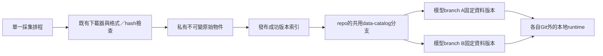

# 每天取得資料，讓不同branch成員使用相同版本

## 現在會不會自動發生？

**還不會。** 目前下載器已完成、資料已取得，但排程尚未部署。資料保存在這個Codex工作區的私有目錄；組員clone或切到其他Git branch，不會因此自動取得這些資料。同一雲端實例的worktree可以讀同一私有目錄，不等於其他人的電腦也能讀。

目標應是「一個採集者、多個讀取者」：來源帳密只放採集環境，組員讀取經授權的共同快照。Git保存程式與版本索引，原始資料保存於私有共享儲存；不讓每個branch各抓一份互不一致的來源。

## 建議分兩階段

| 方案 | 適合什麼 | 優點 | 限制與本輪狀態 |
|---|---|---|---|
| GitHub Actions＋private artifacts | 先把每天的raw快照分享給私人repo成員 | 不需學校主機；可用GitHub CLI按run ID下載，各branch相同 | 有保存期限、配額／費用與排程延遲；不當永久資料庫，也不承擔提交前ledger。僅建議，未啟用 |
| GitHub Actions＋私有S3相容物件儲存 | 長期封存所有版本、模型與重跑證據 | 固定object key／hash、版本化、條件寫入；不依賴短命runner | 要選服務、設定權限／費用／保存政策；未建bucket或連接帳戶 |
| DVC＋私有remote | 多branch經常切換資料集版本時 | 沿用成熟資料版本與cache工具，Git只放pointer；支援指定revision取資料 | 目前未安裝／整合。需配合現有外部runtime與portable manifest，不能只是加入dvc指令就宣稱完成 |

第一階段可以先做到**每天抓取、驗格式與共享最新資料**。第二階段才滿足長期歷史版本與正式每日ML狀態保存。採集不依賴模型有沒有贏：歷史vintage不足可以阻擋正式訓練，不能因此停止從現在開始保存實際版本。

依據：GitHub排程與artifact文件、DVC官方版本／get／S3文件、AWS版本化與conditional-write文件。[DAT01](SOURCES.md#dat01)、[DAT02](SOURCES.md#dat02)、[DAT03](SOURCES.md#dat03)、[DAT04](SOURCES.md#dat04)、[DAT06](SOURCES.md#dat06)、[DAT07](SOURCES.md#dat07)、[DAT08](SOURCES.md#dat08)、[DAT09](SOURCES.md#dat09)、[DAT10](SOURCES.md#dat10)

## 正式資料流



`data-catalog`是**建議的metadata分支，尚未建立**。它只存資料集ID、日期範圍、來源、實際取得時間、hash、大小與私有object key，不放ZIP／行情／帳密或會過期的signed URL。各branch以`data_lock.json`記錄採用的catalog commit＋snapshot hash，避免今天與明天的「latest」偷偷變成不同輸入。

原始物件使用內容SHA256作key；同內容去重，新修訂另存。先完整上傳並核對大小／checksum，最後才發布成功索引。採集失敗保留前一個成功版本，明列來源缺口，不把partial快照標成全部成功。來源日期、來源發布時間、collector實際取得時間與catalog發布時間分開保存。

## 採集排程怎麼安排

現有工作窗口沿用台北04:00～09:00。先以04:17／05:17／06:17／07:17重抓，對應UTC cron `17 20-23 * * *`；避開整點不代表不會延遲。每次依source hash識別變動，保留未完成label；不能把網站「00:00新增列」當作所有行情已完成。

若之後需要保存收盤後label更新，再獨立規劃該次採集；它是raw封存，不能回頭改寫當日08:10已凍結的輸入。正式每日推論仍只讀cutoff前合格版本。

GitHub官方說明：schedule只在default branch運行，也可能延遲／丟棄；workflow_dispatch也有default-branch入口限制。[DAT01](SOURCES.md#dat01) 目前main空樹、default仍main，dev已有程式。因此**僅把workflow放在deep-research或dev，不會啟用每天執行**。本輪未改main、default branch、Secrets或啟用旗標。

## 沿用現有下載器，不重寫爬蟲框架

實際存在的入口：

```bash
# 在ml_financial_prediction執行；輸出必須位於Git外。
uv run --locked --no-sync python scripts/download_course_data.py \
  --source both --out-dir /private/finpred-runtime/raw
uv run --locked --no-sync python scripts/download_external_data.py \
  --source cboe_vix --source twse_twii --source fred_us10y --source fred_usd_twd \
  --out-dir /private/finpred-runtime/raw
```

原生市場序列沿用`download_market_history.py`與已串接的daily collect，參數以其`--help`為準。daily collect目前另有官方session／04:00～09:00限制；純raw下載CLI不冒充已經部署的daemon。

短期private-artifact交接可使用真實GitHub CLI：

```bash
# 以下RUN_ID／artifact名稱是未來採集workflow產物的佔位值，不是本輪已存在的產物。
gh run download RUN_ID --repo jiangjiangian/ml-final-2026-fall \
  --name SNAPSHOT_ARTIFACT_NAME --dir /private/team-snapshot
```

這是資料取用方案，不是已設定完成的指令包。啟用前仍要實作／驗證artifact發布與portable catalog；本輪沒有建立看似可跑、卻引用不存在publisher腳本的workflow。

## 跨機器最容易忽略的問題

既有snapshot manifest包含採集主機的絕對`payload_path`。下載到另一台電腦後，那個路徑通常無效。共享層必須輸出相對object key，消費端在自己的private runtime解析；不能直接把producer絕對路徑當成跨branch契約。

同樣地，`source_fetched_at`、`catalog_published_at`、`consumer_received_at`是不同事件。遷移時要保留原始證據及原manifest hash，另記傳輸；不能為了讓strict gate通過而改寫fetched_at。正式可用性政策要說明哪個可信系統在cutoff前已取得該版本。private artifacts的下載成功也不自動證明歷史point-in-time。

## 權限、成本與可靠性

採集者有來源憑證及指定儲存prefix寫權；模型／研究成員只需讀取版本，不需共用來源密碼。AWS方案可用GitHub OIDC短期角色，限定repo、branch／environment；不是任意branch都能寫正式catalog。[DAT06](SOURCES.md#dat06) 本輪沒有把現有課程帳密複製到GitHub。

S3 Versioning預設未開、每個版本按完整物件計費；conditional `If-None-Match: *`與`If-Match`可分別防止物件覆寫及處理指標競態。[DAT07](SOURCES.md#dat07)、[DAT08](SOURCES.md#dat08)、[DAT09](SOURCES.md#dat09) 這些是能力，不是已設定好的bucket政策。Artifacts的TTL／大小／存取權也須驗證，不能承諾免費無限保存或只靠cache撐到課程結束。

多人研究可以讀同一immutable snapshot，各自產生不同特徵／模型。只有採集者更新raw catalog；模型branch不回寫raw、不把預測label混入features。正式提交的ledger與模型升級狀態另走持久原子儲存，不能拿Actions artifact的job結束上傳替代POST前的耐久記錄。

## 可驗收的導入順序

1. 選「先private artifacts共享」或「直接長期私有object store」，確認保存期限、可接受成本與default-branch入口。
2. 將現有下載器接到採集workflow；至少驗證一次真實下載、失敗保留歷史及未完成label。
3. 用第二個乾淨checkout／branch下載**同一snapshot版本**，核對payload hash、可攜路徑與權限；不要只在原主機重讀成功就算跨機器驗收。
4. 開啟定時採集，保存每次成功／失敗與來源時間；核對是否在要求窗口實際完成。
5. 在資料共享可靠後，接特徵、合格模型、每日提交及回執。不要將採集部署與模型勝出綁成同一個阻塞條件。
