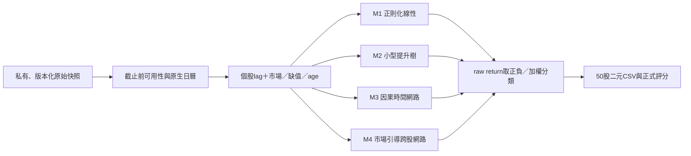

# 四種模型架構與實驗契約

交付狀態：**四種研究架構與設定已定義，尚未執行新架構實驗或宣稱增益**。現有E00的linear／HistGradientBoosting／MLP／GRU研究結果是基準，不把設計文件算成新模型已訓練。設定在[model_families.json](../../configs/research/model_families.json)，目前runner不會讀它。

## 共用資料流

訓練以`(stock_id,target_date,feature_cutoff)`和獨立label交接；同日50股同一fold。市場向量每天建立一次，與個股做left join，缺值／age可入模型；沒有資料不能靜默刪除目標股。生產來源與模型仍要過現有verified gate。

## 四個候選

| 架構 | 輸入／主要結構 | 輸出與目標 | 價值、代價及現況 |
|---|---|---|---|
| M1 正則化線性 | pooled個股向量＋少量市場互動；train-only imputer/scaler＋Ridge／加權logistic | raw return regression→sign；加權classification作固定對照 | 易診斷、CPU快、抗小樣本；linear基礎已實作，新特徵版未測 |
| M2 提升樹 | 相同tabular輸入，限制深度／leaf與最小leaf樣本；優先現有HistGradientBoosting，再評估LightGBM | MSE regression或abs(r)加權binary loss | 檢查非線性與缺值交互作用；HistGBDT已實作，LightGBM未安裝／整合 |
| M3 小型causal TCN | 每股20個可得日期窗口；缺值mask／age；3個residual dilation block，hidden32、kernel3、dilation1/2/4 | 最後合法時間位置→raw return head；預測不fit | 明確可見歷史、容易比較批次與逐日；TCN未實作。既有GRU作控制，正式context問題先修 |
| M4 市場引導跨股網路 | 小型股內時間encoder；由已知市場狀態產gate；50股特徵做masked cross-stock attention | `r_hat[i,t]=mu_market(m[t])+delta_stock(h[i,t],m[t])`，raw MSE；之後取sign | 借MASTER的資訊整合，保留共同市場方向；hidden32／2 heads／1層起步，未實作或驗證 |

方法依據：M1連接既有基石講義及Gu等RFS研究；M2連接XGBoost KDD／LightGBM；M3連接Bai等TCN與Lim／Zohren survey；M4連接MASTER原文，但**改變了target與預測head**。這些是本題的設計選擇，不是假稱作者已測過此台股任務。[SOURCES](SOURCES.md)

## M4為何保留市場head

**上游程式不等於可直接重現的證據。** MASTER作者repo的2025-06-26通知說明Qlib版本／validation processor可能不一致；也承認先前公開的valid/test dump誤用了training processor，每日只含約95%股票，原始商業資料無法再重新匯出。[MOD05](SOURCES.md#mod05) 因此本設計把股票全集、特徵與label分離、train-only processor列為明確驗收，不把作者paper分數當成我們已可重現的分數。

MASTER原文的每日標準化return／ranking會去除整體市場方向，本課則要判斷每股raw intraday return的正負。設計上由市場向量預測共同項，再由個股／跨股資訊預測剩餘項；可令預測的`delta_stock`在當日股票上平均為0，以識別共同項，但**不能在推論時減去真實當日平均label**。

股間attention只讀同一cutoff前已知的feature，不讀其他股票當日label。暫不依賴歷史產業圖：產業／相關性圖若加入，須是當時可取得的分類，或僅由train fold過去資料估計；不能用整份資料的相關矩陣。

## 時間模型輸入與狀態

標準batch形狀為`[date_batch,stock=50,lookback=20,feature]`，另附stock／time missing mask。lookback是20個台股目標session（含當次cutoff向量），缺期保留位置，不把20個觀測列一律當20個session。TCN先攤成每股序列再還原股票維度；M4保留同日stock維度作attention。每個歷史向量都要代表當時cutoff可知的內容，不能把今天修訂的歷史值直接標verified。

M4需另外建立保留每個日期50股feature的batch builder；已完成的label另外附`label_available_mask`，訓練loss僅使用已知label。沒有label不等於刪掉可見feature或該股的預測。現有E00 flat complete-label表不能直接當成完整50股張量；這項接入尚未實作。

窗口只做左側padding，禁止bfill／centered rolling。mask本身也只反映當時知道的缺值。不要因缺某股票某日而把相鄰觀測冒稱相鄰native session；需保存日期間隔。

**批次／逐日等價是部署前置。** 用同一資料重播：一次預測整段validation，與逐日載入相同歷史窗口，必須輸出相同結果（允許事先定義的浮點容忍）。新日期／未來label變動不得改變過去輸出。當前GRU缺中間推論歷史，所以仍不得正式approved。

## 實驗順序與預算

| 階段 | 固定問題 | 檢查與停止規則 |
|---|---|---|
| R0 評分／資料 | 重跑固定常數基準，核對完整日期股票鍵、source hash與發布政策 | 先過資料／時間檢查；研究假設與verified分開 |
| R1 特徵 | F0、F0＋F1、F0＋F2、F0＋F3；M1 alpha=1與M2 max_leaf_nodes=15，其餘固定 | 至多8個family-feature設定；只用既有2025時間fold探索。缺合格輸入則blocked，不以其他組合替補 |
| R2 模型 | 固定一份feature版本，比M1–M4 | 首輪總共至多12個完整候選設定，固定seed42，不做無界搜尋 |
| R3 外推 | 預先鎖定選擇規則，在尚未看過的後續官方session收集／評分 | 不再使用已看過的2026年1～5月作新holdout；不將短期幾日結果稱穩定alpha |
| R4 每日服務 | 只每日重訓選定recipe；其他架構留研究流程 | 截止前驗證、相容模型回退、50股格式／回執與五日演練 |

首輪12設定分配：M1三個alpha、M2三個小型容量、M3三個正則化強度、M4三個正則化強度；每次只改一個預註冊維度，不交叉展成大grid。所有候選共用資料／fold／預處理規則；如需增加試驗，先記錄新研究階段與已看過的資料範圍。

**預算邊界：** 12指R2模型比較，不包含另列的R1。R1至多8設定×4季度＝32 fits，R2至多12設定×4季度＝48 fits，合計上限80；不是本輪已執行次數。開始前須凍結每個F群組的精確欄名、公式、版本、共同樣本鍵與缺值政策，不能邊看分數邊更換群組內容。M1的weighted-logistic先引用既有E00結果作背景，不在這12設定中額外重訓；新特徵的weighted loss、交互作用搜尋、確認seed及融合都要另立有限預算，不能暗中加試。

主要選擇指標始終是官方score；另報accuracy、逐日／月分數、對全0／全1／train-majority差值、缺值／age、耗時與推論穩定性。深度模型以三個固定seed作確認時，不把它們當額外挑最好seed的自由度；這是後續確認預算，不是本輪已執行。

## 融合作為第五步

先比較四個獨立架構，再以時間有效OOF做固定平均或小型非負stacker。回歸head盡量在同一raw-return單位融合後取sign；不同輸出尺度需只在train校準。不得用未來holdout調權重，也不能用模型自己的train預測訓練融合器。

部署階段不要每天把四種架構全部重訓、全看同一validation再隨意換最好。候選recipe選擇與正式模型例行刷新分開；沿用D027的相容性／新歷史／不退步規則。Ray／KubeRay不是這份小型CPU優先實驗的前置。
