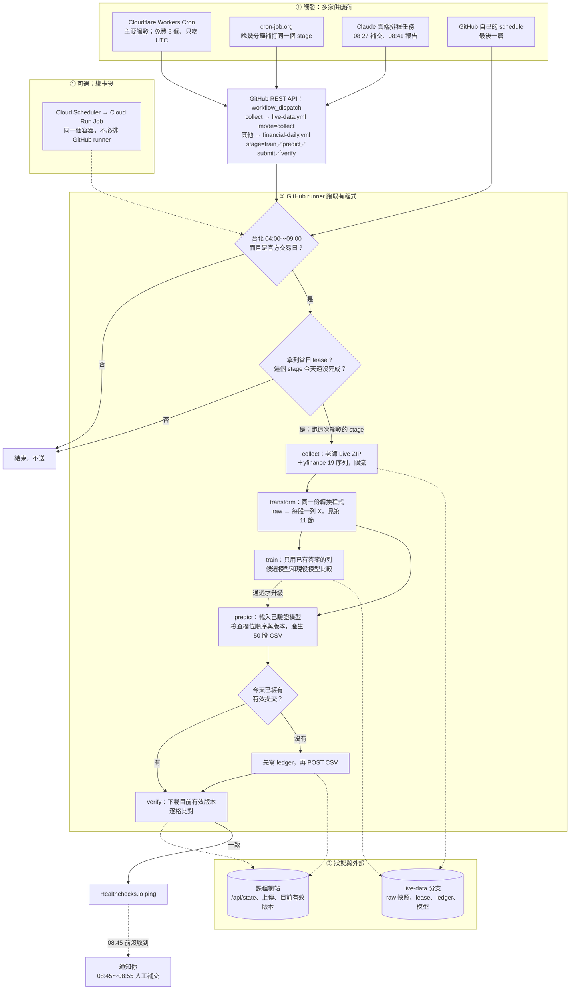
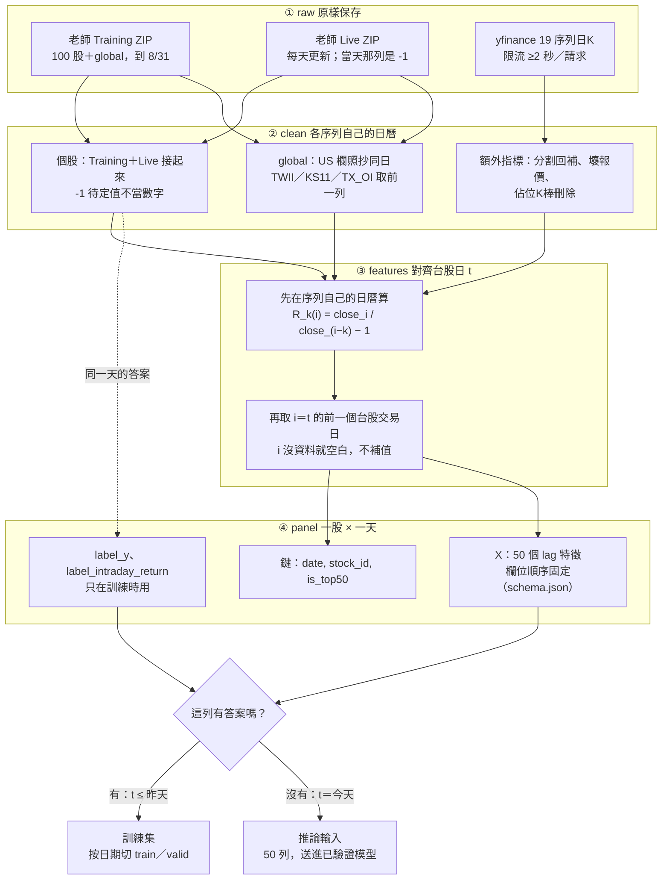

# Phase 2 每日自動提交：怎麼做到準時、不延遲

更新：2026-11-04（台北）。
研究方式：
- 第一輪（第 1～9 節）：deep-research 共 104 個 agent，查了 22 個來源；25 條宣稱各經 3 票對抗驗證，22 條確認、3 條駁回。另外讀了本 repo 的 Actions 紀錄和日誌。
- 第二輪（第 10～12 節，免費方案、raw→模型輸入、流程圖）：107 個 agent，抓了 25 個來源、抽出 100 條宣稱，最重要的 25 條各經 3 票驗證，**25 條全部確認**。第 11 節另外讀了 `system-completion` 的程式和本分支的資料。
**結論欄標「推論」的，是根據已驗證事實做的設計判斷，不是單一來源的說法。**

**目錄**：0 結論｜1 GitHub 為何延遲｜2 做法比較｜3 推薦架構｜4 時間表｜5 冪等規則｜6 成本｜7 實作清單｜8 要你決定的事｜9 未查證與風險｜**10 免費方案比較**｜**11 raw data 怎麼變成模型輸入**｜**12 完整流程圖（Mermaid）**｜13 來源

---

## 0. 一句話結論

**GitHub Actions 的 `schedule` 本身沒有準時保證，不能當主要觸發器。**
- **主要**：改用 Google Cloud Scheduler 準時呼叫 Cloud Run Job。容器映像鎖定版本，排程避開整點。
- **備援**：另一家供應商、另一個時點，用 GitHub `workflow_dispatch` 或 Claude 雲端排程任務。
- **監控**：Healthchecks.io 的 dead man's switch。
- **安全網**：每一次執行都先查「今天是否已有有效提交」，才決定要不要送。

成本估計每月 0 元左右；運算在 Cloud Run 免費額度內。

**不想綁信用卡時的全免費版**（第 10.5 節，可以先做）：
- **觸發**：Cloudflare Workers Cron 和 cron-job.org，在不同時點呼叫 GitHub `workflow_dispatch`。
- **執行**：仍在 GitHub-hosted runner 上跑。
- **監控**：Healthchecks.io。

它解決的是「schedule 晚好幾小時」，但 runner 排隊的風險還在。願意綁卡時，再加 GCP 當主要執行器。Cloud Scheduler 只用 3 個 job，運算和排程就仍是 0 元；映像存放費另外算，金額還沒查證。

---

## 1. 為什麼 GitHub CI/CD 常常失敗又延遲

### 1.1 本 repo 2026-11-04 的實際紀錄

以下是 `financial-daily.yml` 的 4 個排程。時間來自 Actions API 與 job 日誌，日誌裡的 `FINPRED_SCHEDULE` 標明了是哪一個 cron。

| cron（UTC） | 應觸發（台北） | 實際開始（台北） | 延遲 | 結果 |
|---|---|---|---|---|
| `20 23 * * *` | 07:20 | 11:02 | 3 小時 42 分 | 失敗：`outside target-day 04:00-09:00 Taipei window` |
| `10 0 * * *` | 08:10 | 14:07 | 5 小時 57 分 | 同上 |
| `20 0 * * *` | 08:20 | 14:33 | 6 小時 13 分 | 同上 |
| `35 0 * * *` | 08:35 | 14:52 | 6 小時 17 分 | 同上 |

- `live-data.yml` 的 `17 20-23 * * *` 應該觸發 4 次，只出現 1 次，在 00:37 UTC（台北 08:37）。
- 所以「失敗」其實是程式的時鐘檢查正確地擋下遲到的執行，不是程式壞掉。**真正的問題是觸發本身沒有保證。**

### 1.2 官方文件怎麼說（已驗證，3-0）

- `schedule` 在高負載時會延遲，**每個整點都是高負載時段**；負載夠高時，排隊中的工作會被**直接丟棄**。文件唯一的建議是「排在整點以外的分鐘」，而且只會「降低機率」，**沒有延遲上限，也不保證送達**。
  來源：[GitHub Docs – schedule](https://docs.github.com/en/actions/reference/workflows-and-actions/events-that-trigger-workflows#schedule)、[原始檔 schedule-delay.md](https://github.com/github/docs/blob/main/data/reusables/actions/schedule-delay.md)、[疑難排解](https://docs.github.com/en/actions/how-tos/troubleshoot-workflows)
- `schedule` 只在預設分支執行；public repo 60 天沒有活動會自動停用排程（同上來源）。
- 我們的 cron 已經避開整點（:10／:20／:35／:17），仍然晚了好幾小時。社群也回報過 5～14 小時的延遲和整天沒觸發的情況（[討論 207346](https://github.com/orgs/community/discussions/207346)、[209331](https://github.com/orgs/community/discussions/209331)、[201738](https://github.com/orgs/community/discussions/201738)；屬次要來源）。

### 1.3 改用 `workflow_dispatch` 就好了嗎？只能改善，不能根治（已驗證，3-0）

- 由外部準時呼叫 `workflow_dispatch` API，可以避開 schedule 佇列，延遲從「小時級」降到「分鐘級」。
- 但 GitHub 託管 runner 的啟動時間仍然沒有保證。2026-01-20 的官方事故中，手動 dispatch 的 workflow 也延遲，高峰約 23% 的 run 受影響，平均晚 11 分鐘；根因是 scheduled jobs 塞滿了共用後端（[事故 fw294tth5m8y](https://www.githubstatus.com/incidents/fw294tth5m8y)）。
- 2026 年 8～10 月還有其他 runner 啟動延遲事故（只有一位驗證者找到，列為參考）。

→ **GitHub Actions 適合當備援，不適合當唯一執行器。**

---

## 2. 各種做法比較

| 做法 | 準時性 | 會不會漏跑 | 成本 | 建議角色 | 依據 |
|---|---|---|---|---|---|
| GitHub `schedule` | 小時級延遲，沒有上限 | 會被丟棄 | 免費 | 只當第三層的「順便」 | 官方文件＋本 repo 實測 |
| 外部 cron → GitHub `workflow_dispatch` | 推論為分鐘級；事故時平均晚約 11 分鐘 | 很少 | 免費 | **備援** | 官方事故報告 |
| **GCP Cloud Scheduler → Cloud Run Job** | 文件沒寫準點保證（SLA 只管可用性） | at-least-once，可能重複 | 約 0 元 | **主要** | 官方文件、SLA、定價 |
| AWS EventBridge Scheduler → Lambda／Fargate | 「彈性時間窗」**必須設 Off**；實測約 60 秒內（次要來源） | at-least-once | 便宜 | 不用 GCP 時的替代主要 | AWS 文件（搜尋摘要） |
| 自架 VPS／電腦＋systemd timer | 約 1 分鐘內（`AccuracySec` 預設 1 分鐘） | 主機關機就漏跑 | VPS 月費 | 另一家的備援 | systemd man page |
| Claude Code 雲端排程任務 | 整點可能晚幾分鐘，建議用偏移分鐘；最小間隔約 1 小時 | research preview，可能沒啟動 | 用你的方案額度 | **監控／備援**，不當主要 | Claude Code 文件 |
| Claude Code session 內 `/loop` | 每次固定晚 0～30 分鐘；7 天自動過期 | 程式關掉就停 | — | **不適合** | Claude Code 文件 |
| Kaggle Notebook | 排隊與額度不保證 09:00 前完成 | — | 免費 | 不當每日執行器 | 本 repo 既有結論 |

第一輪沒查到的 Cloudflare Workers Cron、cron-job.org、Upstash QStash、Oracle Always Free，第二輪已經驗證，見第 10 節。Render、Railway、Fly.io、Modal 仍**沒有通過驗證的資料**，不納入推薦。

### 2.1 GCP 的細節（已驗證）

- **觸發**：Cloud Scheduler 用 HTTP POST 呼叫
  `https://run.googleapis.com/v2/projects/PROJECT_ID/locations/asia-east1/jobs/JOB:run`。
  - 以 OAuth service account 認證，建議專用 invoker SA、最小權限 `roles/run.invoker`。
  - RunJob 回傳 long-running operation，job 在背景執行，所以不受 Scheduler 的 `attemptDeadline` 限制（HTTP target 可設 15 秒～30 分鐘）。
  - 來源：[Run jobs on schedule](https://cloud.google.com/run/docs/execute/jobs-on-schedule)、[scheduler job.proto](https://github.com/googleapis/googleapis/blob/master/google/cloud/scheduler/v1/job.proto)、[run v2 job.proto](https://github.com/googleapis/googleapis/blob/master/google/cloud/run/v2/job.proto)、[Terraform 範例](https://github.com/terraform-google-modules/terraform-docs-samples/blob/main/run/jobs_execute_jobs_on_schedule/main.tf)
- **重要限制**：RunJobRequest 只有 `validateOnly`、`etag`、`overrides` 三個欄位，**沒有冪等鍵**，每呼叫一次就產生一次新的 execution。
- **SLA**：每月 99.5% 可用性，以伺服器端錯誤率計算，**完全沒有承諾準點**；遞送是 at-least-once，可能重複，官方要求 target 要冪等。
  來源：[SLA](https://cloud.google.com/scheduler/sla)、[overview](https://cloud.google.com/scheduler/docs/overview)
- **秘密**：課程帳密放 Secret Manager，用環境變數或 volume 掛進 Cloud Run Job（[文件](https://docs.cloud.google.com/run/docs/configuring/jobs/secrets)）。

### 2.2 可以用 Claude（我）來排程嗎？

可以，但**只當監控和備援**。

- **雲端排程任務**（本環境的 scheduled task／routine）：
  - 還在 research preview，行為和限制都可能改變，也沒有 SLA。
  - 狀態顯示 *Succeeded* 只代表 session 正常結束，**不代表提交成功**。
  - 執行中可能停下來等權限確認；連到允許清單以外的主機會被擋（`403 host_not_allowed`）。
  - 同時執行數或用量達到上限時，任務可能根本沒啟動。
  - `/fire` API 是實驗性的，**沒有冪等鍵**，也不回報執行結果。
  - 來源：[routines 文件](https://code.claude.com/docs/en/routines)、[/fire API](https://platform.claude.com/docs/en/api/claude-code/routines-fire)
- **session 內的 `/loop`**：只在程式開著而且閒置時觸發，每天固定晚 0～30 分鐘，錯過不補跑，7 天後自動過期（[文件](https://code.claude.com/docs/en/scheduled-tasks)）。**不適合 Phase 2。**

適合交給我的工作：
- 08:41 讀 ledger 和官方回執，有問題就推播通知你。
- 08:27 當備援：確認「還沒有有效提交」之後，觸發 GitHub `workflow_dispatch` 用前一版模型補交。

---

## 3. 推薦架構

```text
                     ┌─────────────── 主要（GCP，asia-east1）────────────────┐
 Cloud Scheduler ──▶ │ Cloud Run Job：同一個鎖定版本的容器                   │
 （偏移分鐘、UTC）   │   collect → train → predict → submit → verify          │
                     │   每一步先取 lease、讀 ledger 與 /api/state           │
                     └──────┬──────────────────────────────────┬─────────────┘
                            │ 狀態：ledger／lease／模型／回執   │ 成功後 ping
                            ▼                                  ▼
                  live-data 分支（現有 Git CAS）        Healthchecks.io
                  ；之後可改 Cloud Storage              （沒收到 ping 就告警）
                            ▲
 ┌──── 備援（另一家、另一個時點）────┐       ┌──── 監控 ────┐
 │ Claude 雲端排程任務 08:27          │       │ Claude 08:41 │
 │  → 沒有有效提交才 dispatch         │       │ 讀 ledger＋  │
 │    GitHub financial-daily.yml      │       │ 官方回執→推播 │
 │ GitHub 自己的 schedule（第三層）   │       └──────────────┘
 └────────────────────────────────────┘
```

| 元件 | 做什麼 | 為什麼這樣選 |
|---|---|---|
| Cloud Scheduler | 每天固定時點觸發 | 專門的排程服務，有 99.5% 可用性 SLA（但沒有準點保證，所以仍要備援）；排在偏移分鐘 |
| Cloud Run Job（asia-east1） | 跑完整流程 | 台灣區域、按秒計費、免費額度足夠；job 在背景執行，不受 HTTP 逾時限制 |
| Artifact Registry＋**以 digest 鎖定映像** | 每天跑同一份程式與套件（例如 `yfinance==1.7.0`） | 避免「昨天能跑今天不能跑」 |
| Secret Manager | `COURSE_EMAIL`、`COURSE_PASSWORD`、GitHub token、Healthchecks URL | 帳密不進 Git、不進 log |
| 狀態儲存 | **第一版沿用現有 `live-data` 分支的 Git lease／CAS 與 ledger**（system-completion 已實作） | 不重寫已驗證的鎖與帳本；之後可再搬到 Cloud Storage |
| 備援：GitHub `workflow_dispatch` | 主要層沒成功時，用前一版模型補交 | 不同供應商，故障模式不同 |
| Healthchecks.io | 沒收到「提交＋核對成功」的 ping 就告警 | 抓得到「根本沒開始跑」的故障（[about](https://healthchecks.io/about)） |
| Claude 雲端排程任務 | 08:27 備援觸發、08:41 監控報告 | 預期可直接用本環境的 GitHub 連線觸發 dispatch，不必另存 token（建立時驗證）；只當補救層 |

---

## 4. 每日時間表

台北＝UTC+8，沒有夏令時間。**cron 一律寫 UTC**；台北早上 08:00 以前的時點，在 UTC 是**前一天**，所以星期欄是 `0-4`。是否為官方交易日，一律以 `/api/state` 判斷，cron 的星期欄只是先過濾。

| 台北 | UTC cron | 誰觸發 | 做什麼 | 失敗時 |
|---|---|---|---|---|
| 05:17、06:17 | `17 21,22 * * 0-4` | 主要 | collect：老師 Live ZIP＋yfinance 19 序列（限流），寫入 manifest 與取得時間 | 第二次重試；單一來源失敗就沿用前一版並標 partial |
| 07:17 | `17 23 * * 0-4` | 主要 | train：用截止前已完成的標籤訓練候選模型，和現役模型比較 | 沿用前一版已驗證模型 |
| 07:47 | `47 23 * * 0-4` | 主要 | 補跑：ledger 沒有今天的 collect／train 完成紀錄才重跑，否則立即結束 | — |
| 08:11 | `11 0 * * 1-5` | 主要 | predict：凍結 08:10 前取得的輸入，產生 50 股 CSV | 資料或模型不合格就停，交給 08:27 的備援 |
| 08:17 | `17 0 * * 1-5` | 主要 | submit：先寫 ledger 再 POST，接著下載目前有效版本逐格核對；成功後 ping Healthchecks | 結果不明時先對帳，不盲目重送 |
| 08:27 | `27 0 * * 1-5` | **備援**（Claude → GitHub dispatch） | 查 ledger 與 `/api/state`：**今天還沒有有效提交**才用前一版模型補交 | — |
| 08:41 | `41 0 * * 1-5` | 監控（Claude） | 核對回執，推播「成功／失敗／原因」 | Healthchecks 08:45 沒收到 ping 就告警 |
| 08:45～08:55 | — | 你 | 人工介入窗口 | — |
| 09:00 | — | — | 硬截止，之後不送 | — |

- 08:10 凍結、08:20 提交是專案自己的時程提案，老師的硬截止是 09:00（`system-completion` 的 AGENTS.md）。實作時，時點要配合現有程式的時鐘門檻。
- 所有時點都避開 :00 和 :30（GitHub 和 Claude 文件都建議偏移分鐘）。

---

## 5. 「不延遲、不重複、不覆蓋」的規則（推論，實作必守）

所有觸發器都可能重複：Scheduler 是 at-least-once，Run API 和 `/fire` 都沒有冪等鍵，主備又是兩個觸發。所以**冪等性要在管線本身做**：

1. **每一步先取當日 lease**（現有 Git CAS）。拿不到就結束，不併發。
2. **POST 之前先寫 ledger**（現有設計）。結果不明時，先下載目前有效版本對帳，不盲目重送。
3. **有效提交優先**：`/api/state` 或 ledger 顯示今天已經有正確的有效提交，就只核對、不重送。
4. **回退不覆蓋**：前一版模型的備援提交，**只能在當天還沒有有效提交時送出**。否則舊模型會蓋掉新模型的結果，因為競賽以最後一次有效提交為準，而且有配額。
5. **截止前停手**：過了 09:00 一律不送（現有時鐘門檻已經做到，11/04 的日誌就是證據）。
6. **映像鎖定**：Cloud Run 和 GitHub 備援都用同一個 digest 的容器，相依套件鎖定版本。
7. **資料回退**：Yahoo 被限流或缺資料時，沿用前一日快取並標 partial（現有 crawler 已經這樣做）；限流參數不變，每個請求間隔 ≥2 秒。
8. **成功的定義**：「下載到目前有效版本、逐格比對一致」才算成功。HTTP 200 或排程顯示 Succeeded 都不算。

為什麼要「先對帳、不盲目重送」：AWS Builders' Library 的說法是，讓重試安全的首選做法是由呼叫端提供唯一的請求 ID。沒有這種 ID 時，請求逾時沒有回應，呼叫端就無法知道到底成功了沒，只能先對帳。這段引文由第二輪研究抓到，沒經三票驗證。課程網站有沒有這種 ID 也還不知道（第 9 節）。

---

## 6. 成本（2026-11-04 的定價頁）

- **Cloud Run Jobs 免費額度**：每月 240,000 vCPU-秒、450,000 GiB-秒，同一個 billing account 合計；asia-east1 屬 Tier 1。
  - 計費以 instance 存活時間計，最少 1 分鐘（[定價](https://cloud.google.com/run/pricing)）。
  - 估算：2 vCPU／4 GiB、每天合計 30 分鐘、每月 22 個交易日 → 79,200 vCPU-秒（33%）、158,400 GiB-秒（35%）→ **0 元**。即使用原價計算，也只要約 1.75 美元／月。
  - 備援先查 ledger 再決定要不要跑完整流程，就不會超額。
- **Cloud Scheduler**（第二輪已驗證，3-0）：
  - 每個帳單帳戶每月 **3 個免費 job**，以帳戶計，不以專案計；暫停中的 job 也佔名額。
  - 超過的 job 每個每 31 天 USD 0.10。按 job 計費，跑幾次都一樣。
  - 所以第 7 節 B 改成只用 3 個 job（第 10.5 節）；原本的 6 個 job 每月會多 USD 0.30。
- **Healthchecks.io**：Hobbyist 方案 0 元，20 個 check（第 10.4 節）。
- **Secret Manager、Artifact Registry**：仍**沒有查證**價格。映像存放、Cloud Build 和對外流量不在 Cloud Run 免費額度內，預期每月幾美分到幾角。
- **GitHub Actions**：public repo 免費。

---

## 7. 實作清單

### A. 先止血（不需要 GCP，約 1 天）
- [ ] **你**：建 fine-grained GitHub token。只給本 repo `actions:write`，設到期日。
- [ ] **你**：在 Cloudflare 免費帳號建 Worker，token 存成 Worker secret。在 cron-job.org 建 job，token 放在 `Authorization` header。時間表見第 10.5 節。
- [ ] **Claude**：寫 Worker 的程式（只有一個 `scheduled()` 函式，依 cron 決定要 dispatch 哪個 workflow 和 stage）和 cron-job.org 的設定清單。
- [ ] **Claude**：建立 Claude 雲端排程任務。08:27 檢查並在需要時 dispatch `financial-daily.yml`（`stage=submit`），08:41 監控與推播。**需要你同意建立排程。**
- [ ] **你**：註冊 Healthchecks.io，建一個 check（台北 08:45 前要收到 ping），把 ping URL 設成 Actions secret `FINPRED_HEALTHCHECK_URL`。
- [ ] **Claude**：在 verify 成功後加 ping；保留 GitHub 自己的 schedule 當第三層。

### B. GCP 主要執行器（約 2～3 天）
- [ ] **你**：建 GCP 專案並綁定 billing（需要信用卡；預估 0 元），在自己的電腦 `gcloud auth login`。
- [ ] **你**：啟用 API：
  ```bash
  gcloud services enable run.googleapis.com cloudscheduler.googleapis.com artifactregistry.googleapis.com secretmanager.googleapis.com
  ```
- [ ] **Claude**：寫 `Dockerfile`。內容是 Python 3.12、uv lock、`yfinance==1.7.0`，入口包裝現有的 `scripts/run_hosted_pipeline.py`。
- [ ] **Claude**：寫 `gcp/setup.sh`：
  - 建立 Artifact Registry、runner SA 與 invoker SA，設定 IAM。
  - 建立 Cloud Run Job：`--region=asia-east1 --cpu=2 --memory=4Gi --task-timeout=40m --max-retries=0 --set-secrets=...`（旗標以實作時的 `gcloud run jobs create --help` 為準）。
  - 建立 3 個 Cloud Scheduler job（第 10.5 節），用 `overrides` 指定 stage。超過 3 個，每個每月 USD 0.10。
- [ ] **你**：建立 secrets，值只在你的終端機輸入，不貼到聊天：
  - `COURSE_EMAIL`、`COURSE_PASSWORD`
  - `GITHUB_TOKEN`：fine-grained token，只給本 repo `contents:write`，用來寫回 live-data 的 lease／ledger
  - `FINPRED_HEALTHCHECK_URL`
- [ ] **你**：執行 `setup.sh`。**不建議**把 GCP 憑證交給我。
- [ ] **Claude＋你**：手動 `gcloud run jobs execute` 跑 rehearsal 模式，確認不會 POST。

### C. 演練與上線
- [ ] 連續 5 個官方交易日 dry run（`FINPRED_SUBMISSION_RELEASED=false`）。每天檢查各階段實際開始時間、資料取得時間和 ledger。
- [ ] 通過後由**你**決定打開 `FINPRED_SUBMISSION_RELEASED=true`。
- [ ] 上線後每天 08:41 由 Claude 回報結果；有異常時，在 08:45～08:55 人工介入。

### 程式放哪裡（需要你決定）
- 管線程式在 `system-completion`，Dockerfile 和 GCP 腳本**建議放在那裡**的 `deployment/gcp/`，和現有的 `deployment/hosted/` 並列。
- 本分支只放這份設計文件，以及之後的實作紀錄。

---

## 8. 需要你決定或提供的東西

1. **要不要綁卡開 GCP**（推薦，仍是 0 元）。若不綁卡，先用第 10.5 節的全免費版：Cloudflare＋cron-job.org 觸發，GitHub runner 執行。
   - 全免費版要你建 Cloudflare 和 cron-job.org 帳號。
   - 也要建一個只有 `actions:write` 的 GitHub token，存在這兩個服務裡。
2. **第 11.5 節的資料轉換選擇**：
   - 每日模型要不要改用本分支的 50 個 lag 特徵。
   - 用 A 或 B 接進去。
   - 不在官方日曆裡的老師待定列怎麼處理。
3. **實作的分支**：建議 `system-completion`（程式所在）。
4. **允許我建立 Claude 雲端排程任務**（08:27 備援、08:41 監控），以及告警要用什麼通道（email／手機推播／其他）。
5. **何時打開正式提交**（`FINPRED_SUBMISSION_RELEASED`）。

---

## 9. 還沒查證的事情與風險

- **競賽網站**：每天有多少提交配額？登入方式（cookie／CSRF）是否穩定支援程式上傳？能否取得「目前有效提交」的內容或 hash 來核對？現有程式有 `/api/state` 和 `/api/sample-submission`，正式 POST 還沒有實際回執。
- **資料幾點可用**：老師 Live ZIP 每天幾點更新？（「網站約 04 點更新」是未查證的說法。）這決定 collect 最早能排在幾點。
- **Yahoo 對雲端 IP 的限流**：GCP／GitHub 的 IP 可能更容易被 Yahoo 限流。需要實測；備案是沿用前一日快取。
- **Claude 雲端排程任務的網路權限**：能否連到 `final.html2026.csie.org`？如果不行，它只能透過 GitHub dispatch 間接補交，或只做告警。
- **沒有實測的觸發延遲數據**：Cloud Scheduler 與 Claude 雲端任務都查不到；AWS 的「60 秒內」來自次要來源。上線前的 5 日演練要記錄實際延遲。
- **被駁回的說法**（報告不採用）：
  - 「Cloud Scheduler／EventBridge 可以直接用台北時區，所以不用換算 UTC」。
  - 「Cloud Scheduler 預設不重試、上限 5 次」。
  - 重試設定要在實作時對照官方文件明確設定。
- 定價與 research preview 功能的內容都以 2026-11-04 為準，可能變動。
- **第二輪研究沒驗證到的**：
  - **要不要綁卡**：只有 GCP 經驗證需要付款方式。Healthchecks 不用卡只是第三方說法；Cloudflare、QStash、cron-job.org、Oracle 都沒驗證。
  - **實際延遲**：外部 cron 的觸發延遲，以及 dispatch 之後 GitHub runner 平時排隊多久，官方都沒公布，要自己記錄 1～2 週。
  - **Healthchecks 的 cron 排程**：用 cron 表示式加時區排程，是第二手說法，設定時再確認。
  - **Oracle 避免回收**：「升級 Pay As You Go 就不會被回收」來自第二手來源。
  - **第 11 節的引文**：Google Rules of ML、pandera、AWS 冪等文章都有抓到原文引文，但沒排進三票驗證。Rules of ML 的網域在本環境也連不上，沒能再複核。
  - **沒查到的服務**：Google Apps Script、Vercel、Netlify、Deno Deploy、Pipedream、Azure Functions、UptimeRobot、AWS 免費額度數字、GCP Secret Manager 免費額度、免費 VM 上的 self-hosted runner。
- **GitHub concurrency 會取消 pending 的 run**：依 GitHub 官方文件，同一個 concurrency group 只保留一個 pending run，新排進來的會取消舊的 pending。這點本輪沒重新驗證；`system-completion` 的 STATUS.md 記錄過一次 attempt 被 concurrency 取消。`live-data.yml` 和 `financial-daily.yml` 共用 `finpred-private-runtime`，所以多個觸發器打進來時，晚到的 verify 可能取消還在排隊的 submit。處理方式見第 10.6 節。

---

## 10. 免費方案比較（第二輪研究，2026-11-04）

這一節回答「業界可行性最高的免費方案」。研究時，docs.github.com、cron-job.org、AWS、Oracle、healthchecks.io 這幾個網域連不上，改從官方文件在 GitHub 上的原始檔、開源程式碼或搜尋摘錄確認。cron-job.org 的頁面完全沒抓到，所以信心只有 medium。

### 10.1 排名（以 09:00 硬截止為準）

排名是**推論**：每一列的事實多數是 3-0 驗證，但沒有任何來源直接給出這個排名。所有服務都沒有公布「觸發準時度」的 SLA。

| 名次 | 方案 | 角色 | 免費額度（官方頁） | 要綁卡？ | 主要風險 |
|---|---|---|---|---|---|
| 1 | **GCP Cloud Scheduler → Cloud Run Job** | 跑完整流程 | Cloud Run Jobs 每月 240,000 vCPU-秒＋450,000 GiB-秒，帳單帳戶合計，asia-east1 屬 Tier 1；Scheduler 每個帳單帳戶 3 個免費 job | **要**：免費方案頁寫註冊需信用卡或其他付款方式 | 沒有準點 SLA；映像存放、Cloud Build、對外流量另外計費 |
| 2 | **Cloudflare Workers Cron → GitHub dispatch** | 只觸發 | 每帳戶 5 個 cron；每次 10 ms CPU（等網路的時間不算）、50 個子請求、最長 15 分鐘 | 沒驗證 | 只能寫 UTC；沒寫準時度和重試；觸發後仍要等 GitHub runner |
| 3 | **cron-job.org → GitHub dispatch** | 只觸發 | 完全免費、不限數量（合理使用）、最短每分鐘一次；可以 POST 並帶 `Authorization` header | 沒驗證 | 官方明說**不保證準時**；常失敗或跑很久的 job 會被故意延後 |
| 4 | Upstash QStash 排程 → GitHub dispatch | 只觸發，可重試 | 每天 1,000 則（每次重試也算一則）、10 個啟用中的排程、預設重試 3 次 | 沒驗證 | 免費方案沒有 SLA；時區支援沒驗證 |
| 5 | GitHub Actions `schedule` | 最後一層 | public repo 免費 | 不用 | 官方明說會延遲、可能丟棄；本 repo 實測晚 3h42m～6h17m |
| 6 | Oracle Always Free VM＋systemd timer | 自己的機器 | Arm A1 每月 1,500 OCPU-小時＋9,000 GB-小時＝2 OCPU／12 GB（2026-06 起減半）；另有 2 台 AMD Micro（1/8 OCPU、1 GB） | 沒驗證 | 7 天內 CPU、網路、記憶體第 95 百分位都低於 20% 就可能被回收，一天只跑 30 分鐘會符合；home region 常建不出機器；Arm 架構要確認套件有 aarch64 wheel |
| 7 | AWS Lambda＋EventBridge Scheduler | 跑流程 | 免費額度數字沒驗證 | — | 單次最多 15 分鐘，必須拆段；90 分鐘的 Managed Instances 要付 EC2 費用 |

### 10.2 「只觸發」怎麼做：外部 cron 呼叫 workflow_dispatch（3-0；回應碼那條 2-1）

- **端點**：`POST /repos/{owner}/{repo}/actions/workflows/{檔名}/dispatches`。
  - workflow 必須有 `workflow_dispatch` trigger。
  - body 的 `ref` 必填；`inputs` 選填，最多 25 個。
- **權限**：fine-grained token 只給本 repo `actions:write`；classic PAT 要 `repo` scope。token 要存在外部 cron 服務裡，所以範圍要最小、要設到期日。
- **版本 header**：帶 `X-GitHub-Api-Version: 2026-03-10`，會回 200 並附 `workflow_run_id`、`run_url`、`html_url`。不帶的話是預設的 2022-11-28 版，回 204 而且沒有 body。
- **拿到 run ID 只代表 run 建好了**，它可能還在 `queued`。要再查 `run_url` 才知道開始了沒。
- 本 repo 的對應：
  - collect 用 `live-data.yml`，`inputs.mode=collect`。
  - 其他 stage 用 `financial-daily.yml`，`inputs.stage` 可填 `train`／`predict`／`submit`／`verify`。
  - `ref` 都是 `system-completion`。

```bash
curl -sS -X POST \
  -H "Authorization: Bearer $GITHUB_DISPATCH_TOKEN" \
  -H "Accept: application/vnd.github+json" \
  -H "X-GitHub-Api-Version: 2026-03-10" \
  https://api.github.com/repos/jiangjiangian/ml-final-2026-fall/actions/workflows/financial-daily.yml/dispatches \
  -d '{"ref":"system-completion","inputs":{"stage":"submit"}}'
```

### 10.3 只換觸發器，GitHub runner 還是可能排隊（3-0）

- **2026-10-05 事故**：18:48～22:49 UTC，也就是台北 02:48～06:49。
  - 全程有 14.3% 的 run、26.5% 的 job 沒在 5 分鐘內開始。
  - 最嚴重的 90 分鐘內，47.0% 的 run 失敗，71.9% 的 job 沒在 5 分鐘內開始。
  - self-hosted runner 不受影響。
- **2026-01-20 事故**（第 1.3 節）：平均晚 11 分鐘。
- 所以全免費版要**提早開始、多次補打**，並保留 08:45 的人工窗口。要根治 runner 排隊，就要換成不經 GitHub runner 的 GCP（第 2 步）。

### 10.4 免費監控（dead-man's switch，3-0）

| 服務 | 免費額度 | 通知管道 | 備註 |
|---|---|---|---|
| **Healthchecks.io** Hobbyist | 20 個 check、每個 check 保留 100 筆 log、3 位成員、5 則 SMS／WhatsApp | email 等 | **首選**。log 每天 2 次 ping 只能留約 50 天，不能當長期稽核紀錄 |
| Cronitor Hacker | 5 個 monitor | Slack、Teams、Discord、Telegram、Webhook、email；沒有 SMS 和 on-call | 最短 5 分鐘 |
| Better Stack | 10 個 monitor 和 heartbeat、1 個 status page | Slack、email | 頁面沒寫清楚是合計 10 個還是各 10 個；只看到固定週期，週末和台股假日會誤報 |

dead-man's switch 只能在錯過**之後**告警，不能防止錯過。所以期限要提早，留時間人工補交。

### 10.5 建議：分兩步走（推論）

**第 1 步：全免費、不綁卡，可以先做。**

| 台北 | 做什麼 | 主要：Cloudflare（UTC cron，共 5 個） | 補打：cron-job.org（UTC） | 其他 |
|---|---|---|---|---|
| 05:17、06:17 | collect | `17 21,22 * * 0-4` → `live-data.yml` collect | 06:22 `22 22 * * 0-4` | GitHub 原有 `17 20-23 * * *` |
| 07:17、07:47 | train（07:47 是沒完成才補跑） | `17,47 23 * * 0-4` → train | — | GitHub 原有 07:20 |
| 08:11 | predict | `11 0 * * 1-5` | 08:14 `14 0 * * 1-5` | GitHub 原有 08:10 |
| 08:17 | submit | `17 0 * * 1-5` | 08:22 `22 0 * * 1-5` | 08:27 Claude 排程任務：還沒有有效提交才補 |
| 08:35 | verify | `35 0 * * 1-5` | — | 08:41 Claude 報告；Healthchecks 期限 08:45 |

- 台北 08:00 以前的時點，在 UTC 是前一天，所以星期欄要寫 `0-4`（日～四），不是 `1-5`（第 4 節）。
- cron-job.org 是否支援時區沒驗證，所以一律寫 UTC。
- 補打和主要觸發相隔 3～5 分鐘，是為了避開同一個故障；pipeline 本身是冪等的，第二次會直接結束。

**第 2 步：願意綁卡時，加 GCP 當主要執行器。** Cloud Scheduler 只用 3 個 job，仍在免費名額內：

| Scheduler job | UTC cron | 台北 | 跑什麼 |
|---|---|---|---|
| A | `17 21,22 * * 0-4` | 05:17、06:17 | collect |
| B | `17,47 23 * * 0-4` | 07:17、07:47 | train（第二次是沒完成才跑） |
| C | `11,24 0 * * 1-5` | 08:11、08:24 | predict → submit → verify，在同一次執行裡依序做；第二次只補沒完成的 |

- 這時，第 1 步的 Cloudflare 和 cron-job.org 降成備援。
- job C 需要 `system-completion` 新增「一次跑完 predict→submit→verify」的入口，屬於實作項目。

### 10.6 多個觸發器並存的規則（推論，實作必守）

第 5 節的冪等規則照舊，另外加這 5 條：

1. **觸發器只負責 dispatch**：Worker 和 cron-job.org 要在幾秒內結束，不做其他事。cron-job.org 會故意延後常失敗或跑很久的 job。
2. **dispatch 前先查**：同一個 workflow 已經有 `queued` 的 run，就不再 dispatch。原因是 concurrency 只保留一個 pending，新的會取消舊的（第 9 節）。
3. **補打只補同一個 stage**，而且要排在下一個 stage 開始之前。train 必須在 predict 之前結束，實作時確認現有的時間預算。
4. **記下 run ID**：用 2026-03-10 版 header 拿 `workflow_run_id`，寫進 log，事後才能對照「哪個觸發器啟動了哪個 run」。
5. **非交易日也要 ping**：pipeline 判斷今天不是官方交易日時，也要 ping Healthchecks 並註明休市，否則台股假日會誤報。

---

## 11. raw data 怎麼變成模型的輸入（第 2 題）

### 11.1 結論

**訓練和每天推論，用同一個轉換函式。** 兩者只差在兩件事：
- 要算哪些台股日 t。
- 那一列有沒有答案。

轉換規則本分支已經定好，寫在 `schema.json` 和 README。每天要做的是：把今天抓到的 raw 接在歷史後面，用同一套函式重算，然後取最後一天的 50 列送進模型。

### 11.2 四層：從 raw 到 X（流程圖見第 12.3 節）

| 層 | 內容 | 本分支的檔案 | 規則 |
|---|---|---|---|
| ① raw | 老師 Training ZIP、老師 Live ZIP、yfinance 日K | `data/teacher/`、`data/teacher_live/`、`data/extra/`；manifest 記 sha256 | 原樣保存，記 hash 和取得時間，不改值 |
| ② clean | 每個序列留在自己的交易日曆 | `crawler.py` 的 `clean_series`、`teacher_stock_rows` | 分割回補、壞報價、佔位K棒；Training 和 Live 在 8/31 接起來；`-1` 是待定值，不是數字 |
| ③ features | 對齊到台股日 t | `data/transform/lag2/`、`lag5/`、`data/features/market_features.csv` | 先在序列自己的日曆算 lag k 報酬，再取 i＝t 的前一個台股交易日；i 沒資料就空白，不補值 |
| ④ panel | 一列＝一股 × 一天 | `data/transform/panel_lag.csv.gz` | X＝50 個 `_ret_lag` 欄，順序照 `schema.json` 的 `panel.feature_columns`；`label_` 欄只當答案 |

### 11.3 今天那一列怎麼來：以 2026-11-04 為例

以下用本分支存的 Live ZIP（`7f4c759a…`）實際查過。

- **老師 Live ZIP 已經有 11/04 那一列，但還沒開盤**：
  - 100 檔個股的每一欄都是 `-1`，包括 `y`。
  - global 的 `^VIX`、`^IXIC`、`^GSPC` 已經填了 11/03 的美股收盤；`^TWII`、`^KS11`、`TX_OI` 是 `-1`。
- **t＝11/04 的特徵，只讀 i＝11/03（前一個台股交易日）以前的值**：
  - 個股：`etl:adj_close` 在 11/03，以及往回第 k 列。
  - 老師 global：`teacher_*` 取 11/03 那一列，以及往回第 k 列。
  - yfinance：該序列 11/03 的K棒。例如 SOX 的 11/03 收盤是台北 11/04 05:00，09:00 前已經知道。日經在 11/03（日本文化之日）休市，沒有K棒，所以 `n225_ret_lag*` 在 11/04 這列是空白。
- 所以 11/04 那一列的 `-1` **不會被當成數字讀**，它只告訴我們「今天要預測」。真正要預測哪一天、哪 50 檔，以官方 `/api/state` 和模板為準。
- **訓練用的答案**：11/04 07:17 訓練時，最後一個有答案的是 11/03。11/04 的 Live ZIP 裡，11/03 已經是完整的一列。

### 11.4 避免「訓練和推論算的不一樣」（train/serve skew）

1. **同一份程式**：每日 job 呼叫同一個轉換函式，推論端不另寫一份。
   - 依據：Google《Rules of ML》建議用一個共同的方法把資料轉成模型要的格式，訓練和服務都用它，也不要用兩種程式語言。這段引文由研究 agent 抓到，但網域在本環境連不上，沒有再複核。
2. **時間點正確的對齊（as-of）**：只能往回找，不能用 t 當天才有的值。
   - **pandas `merge_asof`**（已用本機 pandas 3.0.6 的官方 docstring 核對）。組員如果自己用它把外部序列接到台股日，要注意：
     - 預設 `direction="backward"`：找 key ≤ 左邊 key 的最後一列。
     - 但預設 `allow_exact_matches=True`，會接到**同一天**的值。像 `^TWII` 這種當日收盤，要設 `allow_exact_matches=False`，或先把日期往後移一天。
     - 兩邊都要先按 key 由小到大排序。
     - `tolerance` 可以讓太舊的值變空白，而不是一直沿用。
   - **Feast 的 point-in-time join**（已用 Feast 在 GitHub 上的文件原始檔核對）：
     - 是同一個概念：從每一列的時間往回找，最多找到 TTL。
     - 但預設只看事件時間，**事後補上或修正的值**仍可能接到過去的列；要排除，就要設 `filter_by_created_timestamp=True`。
     - 對我們的意義：老師 ZIP 的還原價每次更新都可能整段重算（本分支看過 ≤1.1e-6 的漂移），所以要保存每天的 raw 快照。
3. **存下推論當下的輸入**：每天把送進模型的 50 列連同 hash 存起來，之後拿來檢查重算是否一致。`system-completion` 已經存 prediction table 和 hash。
   - 依據：Rules of ML 建議在服務時記錄特徵，因為被接的表在訓練和服務之間可能被改；只做每日快照，也只能做到「接近」。同樣沒有複核。
4. **欄位合約**：模型存檔時，一起存欄位順序、`feature_version`、轉換程式的 hash、訓練結束日；推論時任何一項不一致就停。
   - `system-completion` 的 `predict_rows` 已經檢查欄位順序、`feature_version` 和 fit cutoff，而且推論端不會 fit scaler 或 imputer。
5. **預測前驗證輸入**，以下全部要成立：
   - 50 列，股票順序和模板一樣。
   - 沒有任何 `label_` 欄、當日 `etl:adj_*` 或當日成交量。
   - 數值都是有限值。
   - 每個特徵的空白率，和訓練期相比沒有暴增。例如 yfinance 某個序列今天抓失敗，就會暴增。

   可以用 pandera 做 runtime schema 驗證（能用 decorator 套在函式上；研究有抓到文件，但沒經三票驗證），也可以直接寫幾行檢查。
6. **按日期驗證**：用 t 以前的資料訓練，用 t 以後的資料測試。同一列在訓練資料裡算出來的值，和推論時算出來的值要完全相同；不同就是程式錯誤（Rules of ML，未複核）。

### 11.5 接上 Phase 2 之前還缺什麼（要你確認後才實作）

| # | 缺口 | 現況 | 建議 |
|---|---|---|---|
| 1 | **每日模式** | `crawler.py` 的範圍固定到 9/30，範圍內只要出現 `-1` 就拒絕 | 加 `--target-date t`：範圍算到 t；t 那一列只當日曆，`-1` 不讀；其他 `-1` 照舊拒絕 |
| 2 | **永遠不會補上的待定列** | 11/04 版 Live 的 10/23：100 檔全是 `-1`，global 的 `^TWII`、`TX_OI` 也是 `-1`。Yahoo `^TWII` 沒有 10/23 的K棒，0050 這天是和前一天同價的佔位K棒，所以很可能是休市日。另外 STATUS.md 記錄官方 state 在 10/12～11/03 有 15 個 session，而這段期間有 17 個平日；老師資料缺 10/26、10/23 全是 `-1`，正好 2 天，吻合但沒有逐日核對 | 台股日曆以官方 `/api/state` 為準；不在官方日曆裡的待定列直接拿掉，不算一個交易日。否則 lag k 會把它算成一天 |
| 3 | **50 個特徵還沒接進每日模型** | `system-completion` 的每日模型目前只用 7 個個股 lag（`stock_lags`）；本分支 panel 的 50 個 lag 特徵還沒接上 | **A（推薦）**：把 `crawler.py` 的轉換函式搬進 `finpred.features`，當新的 `feature_version`，沿用那邊的 lease、ledger 和重算驗證。**B**：每日 job 直接跑 `crawler.py --target-date`，取最後一天的 50 列 |
| 4 | **yfinance 在雲端 IP 被限流** | 沒實測 | 失敗時沿用前一版並標 partial。該序列在 i 沒資料，特徵就是空白，所以模型要能吃空白：HistGBDT 原生支援；線性模型要在訓練 fold 上 fit imputer |
| 5 | **空白率監控** | 沒有 | 預測前，比較今天每個特徵是否空白和訓練期的覆蓋率；大量空白時改用備援模型或停止 |

---

## 12. 完整流程圖（第 3 題）

GitHub 會直接把 `mermaid` 區塊畫成圖。三張圖都已經用 mermaid 11.12 實際渲染過，確認語法正確。

### 12.1 總覽：誰觸發、在哪裡跑、怎麼確認成功

每個 stage 由各自的觸發啟動，圖中由上到下是一天裡的先後。實線是流程，虛線是讀寫資料或可選的路徑。



### 12.2 每天的時間表

```mermaid
gantt
  title 每個交易日（台北時間）
  dateFormat HH:mm
  axisFormat %H:%M
  section 資料
  collect 第一次              :c1, 05:17, 15m
  collect 第二次              :c2, 06:17, 15m
  section 模型
  train 候選模型              :t1, 07:17, 25m
  train 補跑，沒完成才跑       :t2, 07:47, 10m
  section 提交
  predict 凍結輸入            :p1, 08:11, 5m
  submit 先寫 ledger 再送      :s1, 08:17, 5m
  備援補交，沒有有效提交才送    :b1, 08:27, 5m
  verify 與監控               :v1, 08:35, 10m
  人工介入窗口                :crit, h1, 08:45, 10m
  硬截止                      :milestone, m1, 09:00, 0m
```



### 12.3 raw data → 模型輸入（第 11 節）



---

## 13. 主要來源

- GitHub：[schedule 文件](https://docs.github.com/en/actions/reference/workflows-and-actions/events-that-trigger-workflows#schedule)、[schedule-delay.md](https://github.com/github/docs/blob/main/data/reusables/actions/schedule-delay.md)、[疑難排解](https://docs.github.com/en/actions/how-tos/troubleshoot-workflows)、[2026-01-20 事故](https://www.githubstatus.com/incidents/fw294tth5m8y)
- Google Cloud：[Run jobs on schedule](https://cloud.google.com/run/docs/execute/jobs-on-schedule)、[Scheduler SLA](https://cloud.google.com/scheduler/sla)、[Scheduler overview](https://cloud.google.com/scheduler/docs/overview)、[重試設定](https://docs.cloud.google.com/scheduler/docs/configuring/retry-jobs)、[Cloud Run 定價](https://cloud.google.com/run/pricing)、[Jobs 秘密](https://docs.cloud.google.com/run/docs/configuring/jobs/secrets)
- AWS：[EventBridge Scheduler＋ECS](https://docs.aws.amazon.com/AmazonECS/latest/developerguide/tasks-scheduled-eventbridge-scheduler.html)
- systemd：[systemd.timer](https://manpages.debian.org/buster/systemd/systemd.timer.5.en.html)
- Claude Code：[routines](https://code.claude.com/docs/en/routines)、[scheduled tasks](https://code.claude.com/docs/en/scheduled-tasks)、[/fire API](https://platform.claude.com/docs/en/api/claude-code/routines-fire)
- 監控：[Healthchecks.io](https://healthchecks.io/about)、[GitHub 原始碼](https://github.com/healthchecks/healthchecks)

第二輪（第 10～12 節）：
- GitHub：[workflow dispatch REST API](https://docs.github.com/en/rest/actions/workflows)、[REST breaking changes（2026-03-10）](https://docs.github.com/en/rest/about-the-rest-api/breaking-changes)、[OpenAPI 規格](https://raw.githubusercontent.com/github/rest-api-description/main/descriptions/api.github.com/api.github.com.yaml)、[2026-10-05 事故](https://www.githubstatus.com/incidents/3q1yb5m7ltvb)
- Cloudflare：[Cron Triggers](https://developers.cloudflare.com/workers/configuration/cron-triggers/)、[Workers limits](https://developers.cloudflare.com/workers/platform/limits/)
- cron-job.org：[FAQ](https://cron-job.org/faq/)、[開源程式碼](https://github.com/pschlan/cron-job.org)
- Upstash：[QStash 定價](https://upstash.com/pricing/qstash)、[重試](https://upstash.com/docs/qstash/features/retry)
- Google Cloud：[Scheduler 定價](https://cloud.google.com/scheduler/pricing)、[免費方案](https://cloud.google.com/free/docs/free-cloud-features)
- Oracle：[Always Free 資源](https://docs.oracle.com/en-us/iaas/Content/FreeTier/resourceref.htm)
- AWS：[Lambda 限制](https://docs.aws.amazon.com/lambda/latest/dg/gettingstarted-limits.html)、[Builders' Library：用冪等 API 讓重試安全](https://aws.amazon.com/builders-library/making-retries-safe-with-idempotent-APIs/)（未經三票驗證）
- 監控定價：[Healthchecks](https://healthchecks.io/pricing)、[Cronitor](https://cronitor.io/pricing)、[Better Stack](https://betterstack.com/pricing)
- 資料與特徵：[Rules of ML](https://developers.google.com/machine-learning/guides/rules-of-ml/)（未複核）、[pandas merge_asof](https://pandas.pydata.org/docs/reference/api/pandas.merge_asof.html)（已用 3.0.6 docstring 核對）、[Feast point-in-time joins](https://github.com/feast-dev/feast/blob/master/docs/getting-started/concepts/point-in-time-joins.md)（已核對）、[pandera](https://pandera.readthedocs.io/en/latest/)（未經三票驗證）
- 本 repo 證據：Actions run [41764521303](https://github.com/jiangjiangian/ml-final-2026-fall/actions/runs/41764521303)、[41783443959](https://github.com/jiangjiangian/ml-final-2026-fall/actions/runs/41783443959)、[41786356232](https://github.com/jiangjiangian/ml-final-2026-fall/actions/runs/41786356232)、[41788428307](https://github.com/jiangjiangian/ml-final-2026-fall/actions/runs/41788428307)（四個都是 `PipelineBlocked: outside target-day 04:00-09:00 Taipei window`）
