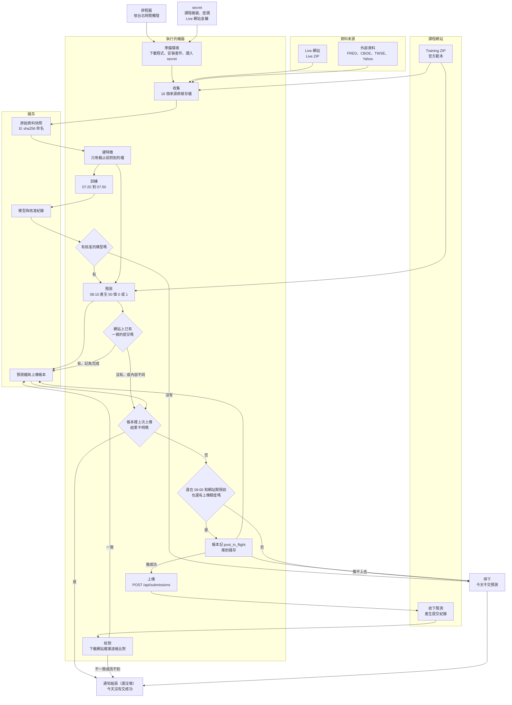

# 每日自動預測怎麼部署：以封存的舊程式為例

新的比賽主程式在 `claude/stock-market-challenger` 分支，目前是骨架。這份說明的是 `archive/system-completion/` 那套舊程式怎麼跑，可以當作補新程式時的參考。

## 什麼是自動部署

Phase 2 每個交易日要在台北時間 09:00 前交出 50 檔股票的 0/1 預測。自動部署就是讓一台機器每天照固定時間，把你手動會做的事跑一遍：抓資料、算特徵、訓練、預測、上傳，最後回課程網站確認對方真的收到。封存的程式除了失敗通知，每一步都寫好了。依 2026-11-05 的狀態快照，這套程式還沒交出任何一天的 Phase 2 預測。

## 從爬蟲到上傳的六個步驟

workflow 是 GitHub 上的 YAML 檔，寫明幾點觸發、要跑哪些步驟。收集用 `live-data.yml`，訓練到核對用 `financial-daily.yml`，兩個都封存在 `archive/system-completion/.github/workflows/`。下表的開始時間取自它們的排程，截止時間寫在 `daily.py` 和 `daily_tables.py`，都是台北時間。

目標日是要預測的那個交易日。訓練表是過去每個交易日、每檔股票一列，有特徵也有答案 `y`；預測表是目標日的 50 檔股票各一列，只有特徵。

| 步驟 | 時間 | 放進去 | 產出 |
|---|---|---|---|
| 收集 | 04:17、05:17、06:17、07:17 | 課程網站的 Training ZIP 和 Phase 1 範本、Live 網站（用金鑰登入）的 Live ZIP，加上 FRED（美國聯準會經濟資料）、CBOE（VIX 的來源）、TWSE（台灣證交所）、Yahoo 等外部資料，共 16 個來源 | 每個回應原樣存成一個檔，以 sha256 命名（由檔案內容算出的指紋），另附一份 manifest 記下網址和抓取時間 |
| 建特徵 | 訓練和預測開始時各做一次。訓練表只收 07:20 前抓到的檔，預測表只收 08:10 前的 | 截止前抓到的最新 ZIP | 每檔股票 7 個特徵 |
| 訓練 | 07:20 開始，07:50 前結束 | 訓練表 | 候選模型，通過比較才核准；超時或失敗就沿用舊模型 |
| 預測 | 08:10 | 預測表、已核准的模型、Phase 2 範本 | 一個 CSV：表頭 `id,<目標日>`，50 列，每列只有 0 或 1，股票順序和範本相同 |
| 上傳 | 08:20 | 預測 CSV | CSV 轉成股票代號和 0/1 兩個陣列，用 JSON 送到課程網站的 `POST /api/submissions` |
| 核對 | 08:35 | 網站 `GET /api/state` 裡的提交紀錄 | 把網站上的檔案下載回來和送出的內容逐格比對，一致才算交成功 |

收集一天跑四次，某個來源失敗時，之後成功抓到的版本會接手。排在 17 分是為了避開整點，GitHub 文件說整點是排程最擠的時候。Phase 2 範本是課程給的空白提交檔，定出 50 檔股票的順序，預測和上傳時才下載。

每日模型只用下面 7 個特徵，收集到的外部資料和收集時另外寫的共享研究特徵（`features/`、`labels/`）都沒用上。7 個特徵都取自目標日之前、最後兩筆有資料的日子，停牌或休市時這兩筆可能隔好幾天：

- `stock_prev_intraday_return`：前一筆的盤中報酬
- `stock_return_between_observed_rows`：最後兩筆收盤價之間的報酬
- `stock_prev_log_volume`：前一筆的成交股數取 log
- `stock_prev_rsi`、`stock_prev_atr_fraction`、`stock_prev_sma_deviation`：前一筆的 RSI、ATR 除以收盤價、收盤價偏離 SMA 的比例
- `stock_previous_observation_gap_days`：前一筆離目標日幾天

核准是把模型登記成之後預測要用的那一個（寫進 `approved.json`）。訓練用最後 60 個交易日驗證：候選模型的分數要比「現有模型的配方在同一段資料上重訓」的版本高；還沒有任何模型時，改和「全猜多數那邊」的基準比。如果候選和現有模型是同一種配方，只是多了新資料，分數沒變差也會核准。

## 每日流程圖

圖把一天裡的步驟接成一條線。實際上收集、訓練、預測、上傳、核對是排程器分開觸發的，機器每次跑完就清空，步驟之間靠「儲存」傳資料。



## 需要哪些零件

| 零件 | 做什麼、為什麼需要 | 封存的程式用什麼 |
|---|---|---|
| 排程器 | 照時間表觸發工作。時間表用 cron 寫，五欄依序是分、時、日、月、星期，`*` 代表每一個。`17 20-23 * * *` 是 UTC 每天 20:17 到 23:17 每小時一次；台北是 UTC+8，所以是台北隔天 04:17 到 07:17 | GitHub Actions 的 `schedule` |
| 執行的機器 | 跑程式的電腦。GitHub 每次給一台全新的臨時 runner，跑完就收回 | `ubuntu-latest`（GitHub 提供的 Ubuntu 機器），收集限 35 分鐘，`financial-daily.yml` 限 40 分鐘 |
| 儲存 | 放原始資料、模型、預測和上傳紀錄，讓下一步和明天拿得到。這裡用一個專門放資料的 git 分支當儲存 | `live-data` 分支：`objects/` 放原始檔，`catalog/` 放索引，`runtime/` 放模型、預測、帳本和 lease |
| secret | 不寫進程式碼的密碼，存在 repo 的 Settings > Secrets and variables > Actions，執行時才拿得到 | `COURSE_EMAIL`、`COURSE_PASSWORD`、`COURSE_LIVE_KEY` |
| lease（租約） | 幾個 workflow 都會寫同一個分支，lease 讓同一時間只有一個在寫。正常跑完就釋放；機器中途當掉沒釋放的話，45 分鐘後自動過期，比單次執行的上限長 | `runtime/lease.json` |
| 警報 | 當天沒交成功時通知組員，讓人在 09:00 前還來得及自己交 | 封存的程式沒有失敗通知。GitHub 能在 run 失敗時寄信（看個人通知設定），但收集時有來源失敗，job 仍算成功，不會寄 |

## 安全規則

1. 只用 09:00 以前拿得到的資料。預測表只收 08:10 以前抓到的檔，Live ZIP 還必須是目標日 04:00 到 08:10 之間抓的，也就是當天早上的版本。
2. 當天的結果不能當輸入。`y`、`adj_open`、`adj_close` 和 `etl:adj_*`（老師資料裡的調整後價格欄）在程式裡列為禁止特徵，訓練資料最多只用到目標日前一天。
3. 上傳前先寫紀錄。ledger（上傳帳本）先記成 `post_in_flight` 並推到 `live-data`，推成功了才送出。機器如果在送出途中當掉，下一次執行看到這筆紀錄就不會再送一次。
4. 再傳之前先查網站。網站上已經有一樣的提交，就直接記為完成。帳本裡上次的結果不明（`post_in_flight`，或送出後核對不到的 `unverified`），就停下來等人查。上傳失敗不會自動重試，現在也沒有通知，所以要有人在 09:00 前自己上網站看。
5. 每一步只在目標日 04:00 到 09:00 之間執行；過了 09:00 或網站的截止時間就不上傳，也不能補交前一天。例外是 `course-benchmark.yml` 的手動 initialize 模式：它只做訓練，可以在這段時間外跑（11/04 13:19 那個模型就是這樣來的）。
6. `financial-daily.yml` 用的是 `daily.py` 的核准規則，我們叫它嚴格版：訓練資料的發布時間和調整後價格的版本都要驗證過。嚴格版沒有核准的模型就不預測，也不會改交全 0 或預設答案。`course-benchmark.yml` 的規則不一樣，線性模型沒贏過基準時，它核准的是全猜多數那邊的基準模型，50 檔會填同一個值（平手時全 0）。

## 這個 repo 現在的狀況

完整程式在 `archive/system-completion/`。收集主要靠 `live-data.yml`，`course-benchmark.yml` 的訓練步驟也會先抓一次。主程式在 `ml_financial_prediction/src/finpred/pipelines/daily.py`，上傳和核對在 `ml_financial_prediction/src/finpred/submission/course.py`。

- 嚴格版沒有核准任何模型。`ml_financial_prediction/docs/STATUS.md`（2026-11-03）把正式模型、預測、提交都標成 blocked（卡住）。排程執行不會開研究選項，所以訓練表直接被擋下；手動開了也只到 `research_assumption`，意思是歷史資料當時是否已公開沒驗證過，可能偷看到未來，嚴格版不核准這種模型。
- 所以 `financial-daily.yml` 每天停在訓練和預測，不產生預測檔，上傳和核對沒有東西可做。真上傳的開關 `FINPRED_SUBMISSION_RELEASED` 沒設定時是 `false`；repo 變數實際設成什麼，我們沒查。
- `course-benchmark.yml` 是另一個會真的上傳的 workflow，開關寫死成 `'true'`。特徵一樣是那 7 個，核准走自己的規則。11/05 11:39 的狀態快照裡，核准的是 11/04 13:19 用 initialize 模式訓練的線性模型；它每天 07:20 和 07:35 會重訓、換上新模型。到快照時還沒交出任何每日預測，原因從檔案看不出來。
- Phase 1 的 84 天靜態預測在 2026-11-04 13:07 上傳，4,200 格逐格核對一致，官方分數 0.000968。程式裡的官方分數算法是每格填 1 得當天盤中報酬、填 0 得負的報酬，再取平均。
- 每日模型還沒用到 `claude/peaceful-babbage-09xeie` 的 `data/transform/panel_lag.csv.gz` 和市場特徵。

## 刪分支和換預設分支會怎樣

刪掉分支只會移除那個名字，commit 只要還有別的分支或 tag 指到就不會消失。現在的打算是只留 `claude/hopeful-brahmagupta-wikys1`、`claude/peaceful-babbage-09xeie` 和空的 `main`，其他分支的檔案已經原樣放進 `archive/`。`system-completion`、`dev`、`deep-research`、`main` 的 commit 都還在兩個 claude 分支的歷史裡。`live-data` 的 12 個 commit 只有它自己有，想留就在刪之前打 tag（給 commit 一個固定的名字）。指令和每個分支的 SHA（commit 的編號）記在 `archive/README.md`。沒開過 PR 的分支刪掉後能不能從網頁還原，GitHub 文件沒寫，我們也沒查證，所以先當作只能用 SHA 推回去：`git push origin <SHA>:refs/heads/<分支名>`。

預設分支是打開 repo 首頁時看到的分支。GitHub 只執行預設分支根目錄 `.github/workflows/` 裡的排程，`archive/` 裡的副本不會跑，所以預設分支選哪一個，決定每日自動化還跑不跑。現在的預設分支是 `system-completion`。GitHub 不讓你刪預設分支，要先到 Settings > Default branch 換掉，這需要 admin 權限。

| 預設分支 | 會發生什麼 |
|---|---|
| `system-completion`（現況） | 4 個有排程的 workflow 照跑，**`course-benchmark.yml` 在檢查都通過時會真的上傳** |
| 空的 `main` | 沒有排程會觸發，網頁上也沒有 Run workflow 按鈕，每日自動化全停 |
| `claude/peaceful-babbage-09xeie` | 根目錄沒有 `.github/`，一樣全停 |
| `claude/hopeful-brahmagupta-wikys1` | 根目錄的 8 個 workflow 和封存版逐字相同，其中 4 個有排程，會繼續觸發。這 4 個開頭都要讀 `live-data` 分支：`live-data` 刪掉，它們會在那一步失敗；留著，`course-benchmark.yml` 會照寫死的開關嘗試上傳 |

想讓自動化全部停下（包括 `course-benchmark.yml` 的真上傳），選空的 `main` 或 `claude/peaceful-babbage-09xeie`。想繼續跑，就要選根目錄有 workflow 的分支，並留著 `live-data`。

`crawler.py` 是本分支整理資料用的程式，不在每日流程裡。它預設從 `origin/live-data` 讀老師 ZIP，`live-data` 刪掉後要加參數，改讀封存的快照。`git rev-parse HEAD:archive/live-data` 會取出這個資料夾的 git 編號交給它：

```bash
python crawler.py --live-data-ref "$(git rev-parse HEAD:archive/live-data)"
```

## 怎麼讓排程準時觸發

GitHub 自己的 `schedule` 會遲到。2026-11-04 `financial-daily.yml` 的四個排程晚了 3 小時 42 分到 6 小時 17 分才開始，全被 04:00 到 09:00 的時間檢查擋下（Actions 紀錄，見 `archive/old-research/deploy-README-2026-11-04.md` 第 1.1 節）。GitHub 文件也寫明負載高時排程會延遲，排隊中的工作還可能被丟掉。可以改由外部準時觸發，有兩種做法：

1. 免費的做法是 GitHub Actions 照樣負責執行，由外部的 cron 服務（例如 cron-job.org、Cloudflare Workers 的 Cron）在預定的分鐘呼叫 GitHub 的 `workflow_dispatch` API。`workflow_dispatch` 是從外面叫 GitHub 立刻跑某個 workflow 的觸發方式。外部服務要存一個 fine-grained token，只給這個 repo 的 `actions:write` 權限，呼叫 `POST https://api.github.com/repos/<owner>/<repo>/actions/workflows/<檔名>/dispatches`，body 帶 `{"ref":"<分支>","inputs":{...}}`。`live-data.yml` 要給 `mode=collect`，預設的 rehearsal 只檢查、不抓資料；`financial-daily.yml` 要明確給 `stage`。這解決的是 schedule 晚好幾小時的問題，runner 排隊還是可能晚幾分鐘或更久。workflow 檔要在預設分支的根目錄，`main` 保持空的話，要先把 workflow 放回去。文件說跑過一次的 workflow 可以用 API 指定別的分支，這點我們沒試過。
2. 改用 Google Cloud，由 Cloud Scheduler 在預定時間啟動 Cloud Run Job。Cloud Run Job 是跑完就結束的容器工作；容器是把程式和套件打包好的映像，放到哪台機器都能跑。Google 沒有承諾準點，同一次觸發也可能送到兩次，所以程式要能重跑不出錯。要先開 billing account（付費帳戶），設定信用卡或其他付款方式。估算這個工作量的運算在 Cloud Run 免費額度內，Cloud Scheduler 每個付費帳戶有 3 個免費 job。課程帳密可以放 Secret Manager（Google 存密碼的服務），它和映像存放的費用沒查證。這條路不用 GitHub 的 workflow，程式要另外打包成映像。

兩種都還沒做。舊的研究建議先做免費的第 1 種，願意綁卡再加 Google Cloud 當主要執行器；時間表在 `archive/old-research/deploy-README-2026-11-04.md` 第 10.5 節，實作清單在第 7 節。
