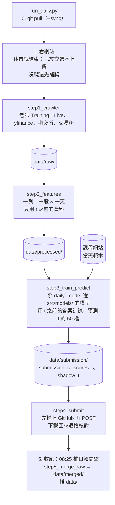

# 每天的流程

## 五個步驟

2026-11-15 起程式照步驟放在 `src/pipeline/`，模型放在 `src/models/`（見下面「檔案結構為什麼這樣」）。`run_daily.py` 依序呼叫：



模型每天從頭訓練，不讀也不寫 `models/`（`models/README.md`）。

## 指令

```bash
python run_daily.py --dry-run                     # 一次跑完，不上傳；--date 2026-11-17 指定 t，--phase 1 交 Phase 1
python -m src.pipeline.step1_crawler              # 1. 抓資料到 data/raw/；研究模式，正式流程由 run_daily.py 傳 --date t
python -m src.pipeline.step2_features             # 2. 算特徵到 data/processed/；--rebuild 重建全部月份
python -m src.pipeline.step4_submit               # 4. 上傳並核對；submit.enabled 是 false 時只印出要送的內容
python -m src.pipeline.step5_merge_raw            # 5. data/raw/ → data/merged/
```

要在 repo 根目錄用 `python -m` 跑，才 import 得到 `src`。第 3 步沒有自己的指令，`run_daily.py` 呼叫 `step3_train_predict.train_and_predict`。

## 什麼時候跑

- 正式流程在 t 當天早上跑：Live ZIP 要到 t 當天早上才有 t 的一列。
- 爬蟲排在台北 06:00 之後，美股前一天的K棒才收完（規則見 `memory/context/05-data-rules.md`）。yfinance 的 DXY 要到 07:00 才收完，所以爬蟲排台北 07:10（使用者 2026-11-05 決定，見 `memory/projects/01-crawler.md`）。
- 排程（使用者 2026-11-06 決定，11-07 改主機）：不用 GitHub Actions 的 `schedule`。主跑原本定 GCP e2-micro 免費額度，2026-11-07 量到流程高峰約 750 MB、e2-micro 只有 1 GB，使用者改用學校的 `oop.cs.nccu.edu.tw`（Ubuntu 22.04、16 核、24 GB；ghost 是 Solaris，裝不了套件）。台北 07:10、07:25、07:40、07:55、08:05 用 cron 跑 `run_daily_test.py --sync`（使用者 2026-11-08 從兩次加到五次：當天 07:10 學校 DNS 短暫查不到 github.com，那次停下；最後一次 08:05 而不是 08:15，離爬蟲截止 08:30 留 25 分鐘）；備援是使用者的 Mac，08:15、08:25、08:35 跑（2026-11-08 從 08:05 起改到 08:15 起，不和 oop 的 08:05 同時爬），網站上還沒有今天的有效提交才交。Mac 的 launchd 2026-11-09 查到沒有裝，使用者決定先不裝，現在只有 oop。帳密放各台的 `.env`。大模型之後在 Kaggle 訓練好推進 repo，主機只預測。安裝步驟見 `memory/reference/06-runner-hosts.md`（2026-11-12 從 README 移過去）。
- 08:25 的時段（使用者 2026-11-11）：oop 的 cron 多一行 08:25，跑同一個指令。`run_daily.py` 在流程結束後（`--sync`、不是休市、沒被 Ctrl-C）呼叫 `fill_today_open`（2026-11-15 前叫 `open_today_step`）：t 是今天、特徵表最後一天是 t、過了 `open_today.not_before`（08:22）才抓日韓當天的開盤（`crawler.open_today`），有新存的就再跑一次 `features --date t`，結尾照常 commit、push，大約 08:28 推上去。任何錯誤只記 log，不改這次的結果。07:10～08:05 那五次也會經過這一步，還沒到 08:22 就直接跳過。前五次都沒交成時，08:25 這次會照常跑完整的流程再補開盤。
- 使用者 2026-11-06：先寫 `run_daily_test.py` 每天交 Phase 2，用組員 `notebooks/teammate/02_feature_switch.ipynb` 第 6 節的方法（邏輯迴歸，最近 14 個月訓練、每週重訓、每天用前一天的答案微調，機率 > 0.5 猜漲），特徵是組員 `build_model.ipynb` 的個股特徵加新表的 32 欄。使用者確認舊系統的排程停了，`submit.enabled` 可以打開。跑完要自動 commit、push `data/`。
- 爬蟲 08:30 以後才開始時（排程延遲才會發生）：每一步只試一次，不等不重試，yfinance 不抓、沿用舊檔，盡量趕在截止前交（使用者 2026-11-06 確認，就是目前的做法）。
- 合併的原始資料（使用者 2026-11-11）：`run_daily.py` 在 `fill_today_open` 之後、結尾的 commit 之前呼叫 `merge_raw_data`，跑 `step5_merge_raw.main([])`（2026-11-15 前是 `run_daily_test.py` 的 `open_today_step`、`merged_step`），把 `data/raw/` 併成 `data/merged/` 的個股表（`stock/YYYY-MM.csv.gz`）和市場表（`market.csv.gz`）給組員研究，模型和上傳不看。休市（status 是 closed）和 Ctrl-C 不跑；不分 `--sync`。來源檔的指紋（`manifest.json` 的 `source_digest`，含 `merge_raw.FORMAT`）沒變就跳過，約 0.3 秒；有變就重算全部（2026-11-11 量的：約 19 秒、記憶體 0.5 GB），只寫內容不一樣的檔。錯誤只記 log。`DATA_PATHS` 加了 `data/merged`，`commit_data` 和 `git_start` 的「只動 data/」都算它。
- 證交所、櫃買（2026-11-09 寫好，使用者 2026-11-10 打開 `exchange.enabled`，11-11 起每天跑）：爬蟲在期交所之後補 i 那天，平常每個主機 2 個請求、約多 20 秒，最壞約 5 分鐘；失敗只寫警告和 manifest 的 `exchange`，不影響上傳。i 那天的資料台北 18:00 前就公布（見 `memory/projects/01-crawler.md` 的「每天的步驟」）。
- `predict.py`（09:00）和 `submit.py`（08:50）檢查截止。crawler 的每日模式（`--date t`）在 07:00 前不跑，08:30 後不再等待或重試。研究模式的 crawler 和 `features`、`train` 什麼時間都能跑。

## 失敗時怎麼處理

- yfinance 某個序列失敗：記在 manifest，流程繼續，那個特徵當天可能是空白，爬蟲回傳 3。外國放假沒有 i 那根不算失敗，記在 `run.no_bar_i`。
- 課程網站登入遇到逾時或 5xx 再試 2 次；`/api/state` 讀不到時改用上次存的 `phase2_days.json`（要有 t）。過了 08:30 每一步只試一次。
- 其他步驟失敗：停下，在 `data/submission/run_YYYY-MM-DD.log` 寫原因，已經產生的檔案留著。
- 手動交：
  1. 看 `run_YYYY-MM-DD.log`，找出停在哪一步。
  2. 登入課程網站，確認 t 還沒有有效的提交，不要重複送。
  3. `submission_YYYY-MM-DD.csv` 已經產生的話，在網站上手動上傳它。
- 通知組員用 Email（使用者 2026-11-05 決定）：Healthchecks.io 在開始和成功時各收一次回報，沒收到成功就用它內建的信件通知。實作排程時接上。

## 檔案結構為什麼這樣

參考 Cookiecutter Data Science（常見的資料科學專案範本，把 data、models、notebooks、src 分開放），另外加四樣：

- `submit.py`：上傳 CSV，再確認網站收到的內容和送出的一樣。
- `run_daily.py`：每天只跑這一個指令。
- `tests/`：擋住兩件最容易出事的事，用到當天的資料和 CSV 格式錯。
- `.env.example`：帳號密碼不寫進程式或設定檔。

2026-11-15 晚上使用者要照一般機器學習專案整理 `src/`，細節交給 Claude 決定。做法（`run_daily.py` 的行為不變）：

| 現在 | 2026-11-15 以前 |
|---|---|
| `src/pipeline/step1_crawler.py` | `src/crawler.py` |
| `src/pipeline/step2_features.py` | `src/features.py` |
| `src/pipeline/step3_train_predict.py`（新：選模型、換備援、存分數） | `run_daily_test.py` 的 `daily_predict`、`save_scores` |
| `src/pipeline/step4_submit.py`、`site_api.py` | `src/submit.py`、`src/site_api.py` |
| `src/pipeline/step5_merge_raw.py` | `src/merge_raw.py` |
| `src/pipeline/utils.py` | `src/utils.py` |
| `src/models/m1_online_lr.py`～`m4_c2_tilt.py` | `src/online_lr.py`、`persist_rule.py`、`rank_ensemble.py`、`c2_tilt.py` |
| `run_daily.py`（排程跑的這支） | `run_daily_test.py`（現在只轉到 `run_daily.py`） |
| 刪掉 | `src/train.py`、`src/predict.py`、舊的 `run_daily.py`（都是沒在用的骨架） |

- 編號：Python 的模組名不能用數字開頭，所以寫成 `step1_`、`m1_`。步驟照執行順序，模型照做出來的日期。
- `models/`：照 Cookiecutter 的慣例放訓練好的模型檔。現在的模型每天重訓不存檔，所以只有 `README.md`。
- 舊路徑：`src/__init__.py` 讓 `from src import features` 這種舊寫法還能用（組員舊的 notebook）；`import src.features`、`from src.features import ...`、`python -m src.features` 都不能用了。
- oop 的 crontab 叫的是 `run_daily_test.py`，它直接 `os.execv` 到 `run_daily.py`，不用重裝 crontab。`deploy/crontab.txt` 改成 `run_daily.py`，重裝時兩種舊行都會被換掉。
- 回滾：oop 的 crontab 叫 `run_daily_test.py` 時，整個 revert 也接得上（`run_daily.py` 重新執行的是排程叫的那支，revert 後它又是正式的主程式）。如果之後重裝了 crontab（`runner_setup.sh` 會改成直接叫 `run_daily.py`），回滾時 `run_daily.py` 不能變回骨架：只退 `src/` 的搬家，或把 `run_daily.py` 留成轉到 `run_daily_test.py` 的小程式，或同一步用舊的 `deploy/crontab.txt` 重裝 crontab（舊的 `runner_setup.sh` 只會拿掉 `run_daily_test.py` 那幾行）。
- 下面的歷史紀錄保留當時的檔名。

2026-11-12 使用者想把 `src/` 收成「爬蟲、特徵、模型、上傳」四塊，共用的函式放 `utils`，寫法偏純函式。問過之後使用者選「先不動程式」：README 已經照這四步介紹現有的檔案，程式維持現狀。當時 `train.py`、`predict.py`、`run_daily.py` 是沒在用的骨架，模型分散在 `persist_rule.py`、`online_lr.py`（另一個 session 正在加 `rank_ensemble.py`），`crawler.py` 2,939 行。沒選的兩個做法：只搬檔案不改函式（刪骨架、模型收進 `src/model/`、`site_api.py` 併進上傳）；拆 `crawler.py`、改寫成純函式（要改寫大部分測試，建議比賽結束後）。之後要做，先確認沒有別的 session 有沒 commit 的改動。

## run_daily.py（2026-11-07 寫成 run_daily_test.py，2026-11-15 改名）

排程跑的是 `run_daily.py --sync`（oop 的 crontab 還寫舊名字，會轉過來）。下面是 Claude 2026-11-07 照使用者 11/06 的決定做的設計：

- 模型開關（使用者 2026-11-12）：`configs/config.yaml` 的 `daily_model.kind` 和 `fallback`。名字和檔案的對照在 `src/models/__init__.py` 的 `MODEL_KINDS`；沒有這個設定時用 `online_lr`。現在是 `c2v2d`（2026-11-15 起），備援 `[c2, rank_ensemble, persist, online_lr]`，見下面「每天交件的模型」和 `memory/reference/05-daily-model.md`。
- 組員的模型：`src/models/m1_online_lr.py`，組員 `feature_switch.ipynb` 第 6 節的方法。每天早上重新 fit，不讀 `models/`：每週重訓、每天用前一天的答案微調是這個方法的一部分。
- 開關：`configs/config.yaml` 的 `submit.phase`。1 是 Phase 1（網站範本的 84 天 × 50 檔，測自動化用），2 是每天的 t。使用者 2026-11-06：先交 Phase 1 測試，之後改 2。2026-11-07 07:10 oop 第一次自動交 Phase 1 成功（網站分數 0.0012354，排行仍是 0.0027732；07:40 看到已交就結束），使用者同一天要改成 2。
- 休市（使用者 2026-11-07：不要寫死，要靈活）：每次執行都看網站的 `phase2Days`（`site_api.day_status`），不看星期幾、也沒有假日表。t 不在清單上就記「休市」結束，不爬、不上傳。在清單上但 `enabled` 是 0 時（沒看過這種狀態；使用者提醒可能只是還沒更新），照常準備，上傳前再看一次，還是停用就記 not_open、這次不送，不擋下一次排程。特徵的交易日曆看老師資料（至少 `min_stocks_filled` 檔填好），新的颱風假自動排除；`closed_days` 只用來把關 10/23。網站的 `phase2Days` 只列到今天為止，沒有週末和 10/23；開放和截止看網站每天的 `openAt`、`deadline`：2026-11-08 起前一個交易日 09:01 開放到當天 09:00（見 `memory/context/01-competition.md`），以前是前一天 15:00 開放。
- 跳過：Phase 1 今天（台北）已經交過，或 `upload_log.jsonl` 今天有 done／same 就結束；Phase 2 網站上 t 已經有提交（不算「強制繳交」）就不上傳（2026-11-17 起，t 還沒爬過時照樣補爬）。所以後面的時段和 Mac 只在前面沒交成時才做事。例外是排程自己交的那份資料不完整時的重做（「2026-11-17 的決定」第 1 題）。
- t 不是交易日（不在 `phase2Days`）：不跑爬蟲和特徵。Phase 2 直接結束，Phase 1 用現有的特徵表。
- 不上傳也補爬（使用者 2026-11-17）：Phase 2、t 是今天、網站沒說休市時，組員先交了、這台已經交好、上次送出還沒核對完成、網站的 `/api/state` 讀不到，這幾種不上傳的情況都先看 t 爬過了沒有（`ensure_crawled`、`crawled`），沒爬過就爬、照樣推上 GitHub。要交件的那條路照舊每次都爬。細節在下面的「2026-11-17 的決定」。
- 上傳前：`--sync` 時先 commit 並 push `data/` 和「準備上傳」紀錄。push 失敗時看 `submit.require_push_before_post`：false（現在，只有 oop 一台排程）記 WARNING、照樣上傳，紀錄留在本機的 commit；true 就寫 not_sent、不上傳。出錯（例外）一律寫 not_sent、不上傳。推完再檢查一次截止（08:50）、網站的開放時間、網站上的提交有沒有變（別台交了就不送）、別台有沒有也在準備上傳，都過了才 POST。
- POST 失敗後不自動重送：`upload_log.jsonl` 今天有某次執行（`run_id`）的「準備上傳」，同一個 `run_id` 卻沒有 done 或 not_sent 時，之後的執行（後面的時段、Mac）停下，留給人到網站確認後手動處理。
- git：只有 `--sync` 才做，而且先同步完才寫 log（log 檔也在 Git 裡）。開始前 data/ 以外有改動就停；data/ 裡上次留下的改動先 commit 再 `pull --rebase`。pull 失敗時，本機多出來的 commit 只動 data/、也沒有 data/ 以外沒追蹤的檔，才丟掉、對齊 origin（資料這次重抓）。git 逾時當成失敗。pull、fetch 都連不上 GitHub（逾時或 DNS、連線的錯誤；其他原因照舊停下）時重試約 2 分鐘，再不行就用本機的程式照爬照交（2026-11-17，「2026-11-17 的決定」第 2 題）；對齊 origin 時 `data/submission/` 裡本機新增或改過的檔留回去。`upload_log.jsonl` 用 union 合併。`submit.phase` 在 pull 之後才讀。
- 同一台主機同時只跑一個（`.cache/run_daily_test.lock`，改名後沿用舊的鎖檔，交接那一次舊版和新版也互相擋住）。
- 載入順序（2026-11-07 第三輪審查後）：`--sync` 時先 `git pull` 才載入 `src/`，推上去的修正這次就用到；`run_daily.py` 自己被更新時用新版重新執行一次。新程式 import 失敗時寫到 `.cache/cron.log`，修正推上去後下一次會先 pull 再載入。
- 組員手動交了就不蓋掉：排程上傳時（`respect_existing`），網站上已經有這次的提交（Phase 2 的 t，或 Phase 1 今天交的；不算強制繳交）就不送，POST 前會再看一次。手動跑 `python -m src.pipeline.step4_submit` 可以蓋掉。使用者 2026-11-08 確認維持這樣：預設交排程的版本，組員在截止前手動交了就以組員的為準（Phase 2 算最後一份，組員比排程早交時排程不送，比排程晚交時本來就算組員的）。2026-11-16 起這種日子排程還是會做影子跑（不上傳）；同一天使用者決定請組員別再先手動交，讓排程交 C2v2d。
- Phase 2 的上傳紀錄看交易日 t 的全部紀錄（t 前一晚送的也算）；Phase 1 只看今天寫的。
- `requirements.txt` 改了要在 oop 重裝套件（oop 連不到 PyPI，見 `memory/reference/06-runner-hosts.md`）。`runner_setup.sh` 記下安裝時的 sha256，不一樣時 `run_daily.py` 在 log 裡警告。
- 資源（2026-11-07 在 Mac 上量）：特徵和模型在同一個程式裡時，記憶體高峰約 735～760 MB（模型讀資料那一步）；Phase 1 全程 40～60 秒。
- 外資持股比率（使用者 2026-11-07）：Live 的這一欄常常隔天才公布（11/06 晚上那天 100 檔都是 -1），待定時沿用這檔股票前一個有值的比率，持股變化就成了 0。
- Phase 1 本機分數（2026-11-07，用 26 個個股特徵加 32 欄）：0.001235，正確率 53.4%；全猜 0 是 −0.000204。組員 11/06 交的版本網站算 0.002773，本機重算一樣，計分方式對得上。

## 每天交件的模型（使用者 2026-11-12）

使用者 2026-11-12 凌晨：把 `run_daily_test.py` 的模型「暫時」換成「目前」我們做的最穩定且最好的。Claude 選了持續性規則 `persist120`，理由和做法：

- 規則：只看要預測的 50 檔。e = 這檔的盤中報酬 − 當天 50 檔的平均；t 的分數 = t 之前 120 個有答案的交易日 e 的平均（至少 60 天有值）；分數高的 25 檔猜 1，低的 25 檔猜 0。沒有分數的排中間，名次一樣時代號大的排前面。程式在 `src/persist_rule.py`，設定在 `persist_rule`。
- 為什麼是它：Kaggle notebook 12～14 的結論是大盤方向猜不準，個股排序才有穩定的分數。照 notebook 14 事先寫好的規則選到的是 12 個模型的集成 `E2_no_svm`（每天 +0.00091，t 5.9），但它要訓練 12 個模型，也沒有對「還沒答案的一天」跑過正式流程。持續性規則每天 +0.00069（95% 區間 +0.00040～+0.00101，t 4.5，11 季都是正的，最差的一季 +0.00021，Phase 2 的 20 天加總 +0.052），拿到集成約四分之三的分數，不用訓練，只讀 `label_intraday_return`，當晚就能在 oop 驗完。
- 驗證（2026-11-12 01:10，oop 的測試 worktree，不上傳）：用 `online_lr.load_data` 加 `persist_rule.predict` 重播 notebook 14 的 690 天，回測平均 0.0006885、Phase 2 加總 0.0522304，和 notebook 的 0.0006885、0.0522303 一樣。正式流程每天固定排 50 檔，notebook 有 11 天只有 49 檔，所以正式流程的回測平均是 0.0006864，有 3 天的分數不同。t = 11-11（答案還是空白的那列）算得出 50 檔、25 檔猜漲。上傳檔的列也用 `submit.build_rows`、`check_rows` 檢查過。
- 備援：規則丟錯時照 `daily_model.fallback` 的順序換下一個，當天照樣交件，log 寫「persist 算不出來（原因），改用 online_lr」。規則會丟錯的情況：最新的答案和 t 中間隔超過 `max_stale_days`（3）個交易日，或有分數的股票不到 `min_scored_share`（0.8）。
- 換模型：改 `daily_model.kind` 和 `fallback` 兩行，push，避開台北 07:00～08:40。這個改動不動特徵欄，不用重建 `data/processed/`。
- 2026-11-12 晚上換成排名集成，見下一節。
- 不上傳、只看規則當天會交什麼（在 oop 的 clone 裡跑，不要在 Mac 跑模型）：

  ```bash
  python -c "import json; from src import online_lr, persist_rule, utils; cfg = utils.load_config(); d = online_lr.load_data(cfg); ids = sorted(str(x) for x in json.loads((utils.ROOT / 'data/raw/teacher/training/info.json').read_text(encoding='utf-8-sig'))['Top50@Y']); print(persist_rule.predict(d, cfg, ['<t>'], ids).to_string())"
  ```

### 2026-11-12 晚上換成排名集成

使用者 2026-11-12 傍晚看完比較後選「今晚換成集成」。`daily_model.kind: rank_ensemble`、`fallback: [persist, online_lr]`，11-13 07:10 起生效。

- 模型：`src/rank_ensemble.py`，Kaggle notebook 16 的 `X_price`（41 個價量欄的當天排名，ridge、Nyström kernel ridge、LightGBM 三個模型的排名平均）。每天早上用 t 之前 500 個有答案的交易日重訓，oop 上約 30 秒。說明給組員看的版本在 `memory/reference/05-daily-model.md`。
- 為什麼換：notebook 18 的成對比較，集成減 `persist120` 在 11 季回測每天 +0.00032（95% 區間 +0.00004～+0.00061，block bootstrap 也不含 0），2022～2023 每天 +0.00023（區間含 0）。11-12 當天集成的紙上預測 +0.020554，交出去的 `persist` +0.011575（用 yfinance 的開收盤算，`persist` 和網站的分數一模一樣）。
- 驗證：oop 重播 1,175 天、3 個種子、60 次重訓，0／1 有 99.45% 的格子和 notebook 一樣，回測 0.0010279（notebook 0.0010102）；沒有答案的那天（11-06、11-09、11-10）和有答案時算的一樣；推之前在 oop 的測試 worktree 用正式的 `daily_predict` 和真的 config 算 t = 11-12，跑完整個測試。
- 兩輪獨立審稿（2026-11-12，唯讀）找到的都是小問題，推之前一起修了：爬蟲記下前一天沒填時改用備援；只有幾檔前一天沒填時那幾檔當成空白；t 那列空白太多、整欄空白、預測不是有限的數時改用備援，訊息寫出空白的欄名；備援的 log 把路徑換成相對的（oop 的家目錄含學號，log 會推上 GitHub）；`kind` 不認得或填 `none` 時停下，`fallback` 裡不認得或重複的名字記 ERROR 後跳過；`online_lr` 還在備援順序外面（流程一開始就載入、讀特徵也用它），寫進 docstring 和 `05-daily-model.md`。
- 隔天早上要看：`data/submission/run_2026-11-13.log` 有「模型 rank_ensemble」，沒有「算不出來」。集成失敗時流程不會停，會交 `persist`，只有 log 看得出來。
- 換回去：`kind: persist`、`fallback: online_lr`，push，避開台北 07:00～08:40。

### 2026-11-15 晚上換成 C2v2d

使用者 2026-11-15 晚上在 MT session 直接決定（原本選「影子跑」，同一晚改掉）：`daily_model.kind: c2v2d`、`fallback: [c2, rank_ensemble, persist, online_lr]`，11-16 07:10 起生效；12-06 看情況再決定要不要改成 `c2`。

- 模型：`src/c2_tilt.py`（commit `748db97`），`rank_ensemble` 的三個模型再依方向模型的 p 換高低 β。說明和回測在 `memory/reference/05-daily-model.md`。
- 驗證：Kaggle `c2-tilt-production-code-check` version 2 full（用 `748db97` clone repo）。p 和 notebook 44 差 1.5e-12（1,155 天），11 月係數和組員一樣，24 個測試過，重放 10-12～11-13 每天 25 檔猜漲，11-13 原版和實際交的 100% 一樣。事先寫的「p 和組員一樣」那條沒過：11-11 是油、金的收盤 07:10 後被修正，11-12 是組員的長表檔沒更新，兩個原因都查過；換的組數和分數的差來自組員的原版排名和正式的不同。β 的程式和 notebook 44 逐行一樣。
- 時間：所有狀態都是 07:10 前就有的，沒有日韓當天的開盤。11-09～11-13 交件時的 commit，老師 global 表 t 那列都已經有美股三欄。美國休市的隔天會換備援。
- 同一次 push 加了一行 log（`run_daily_test.py`，Phase 2 才寫）：當天的 p、傾斜、和 `rank_ensemble` 換了幾組、缺幾個狀態、重訓日。
- 隔天早上要看：`data/submission/run_2026-11-16.log` 有「模型 c2v2d」和「大盤方向 p =」那行，沒有「算不出來」；`scores_2026-11-16.csv` 的 `variant` 是 `c2v2d`。
- 11-16 實際：網站上 00:50（台北）已經有一份手動交的 `submission_2026-11-16_C2.csv`，排程 07:10～08:25 六次都照「手動交了就不蓋掉」結束，沒有跑模型、沒有 `scores_2026-11-16.csv`，爬蟲和特徵也沒跑（已交過時在爬之前就結束）。C2v2d 第一次真的由排程交，最早是 11-17。使用者 2026-11-16 確認那份是組員手動交的。
- 2021 的確認沒過（特徵組 Kaggle notebook 42 full，2026-11-15 晚上）：2021-01-11～12-30 的 239 天，C2v2d 減原版每天 −0.000228（t −1.11，p 0.87），擇時那塊 −0.000219；方向模型在 2021 反而比較準（corr(p, m) 0.158），輸在 β 傾斜的報酬。使用者約 21:55 在特徵組 session 選維持 C2v2d、不改 config（特徵組轉述；這邊沒有改動，只是記下）。特徵組 notebook 45 每週逐格核對正式的 C2v2d。
- 換回去：`kind: rank_ensemble`、`fallback: [persist, online_lr]`，push，避開台北 07:00～08:40。

### 2026-11-15 起另存每檔的分數（`scores_<t>.csv`）

- 使用者 2026-11-15 決定：大盤擇時研究要每週重算「每天多猜 5 檔（30 或 20 檔猜漲）會差多少」，要知道第 21～30 名是哪幾檔，0/1 的 `submission_<t>.csv` 看不出來。
- 做法：`run_daily_test.py` 寫好 `submission_<t>.csv` 後（Phase 2），`save_scores` 另寫 `data/submission/scores_<t>.csv`：模型輸出的全部欄（`rank_ensemble` 是 `ridge`、`kridge`、`lgbm`、`prob`、`pred`）加上 `model` 和 `rank`（1～50，照 `prob` 排，同分時代號大的名次高）。寫失敗只記 WARNING，不擋上傳；上傳的檔和模型不變。跟著「準備上傳」那次 commit 一起推。
- 網站上已經有當天的提交時流程提早結束，不會寫這個檔，所以每天只有第一次成功的那次會存。
- 11-15 下午推，oop 11-16 07:10 那次 pull 後生效。隔天看 `run_2026-11-16.log` 有「另存 data/submission/scores_2026-11-16.csv」。

### 2026-11-16 起影子跑（`shadow_<t>.csv`）

- 使用者 2026-11-16 決定（這個 session 問了「影子跑是什麼」之後）：每天把 `daily_model.shadow` 的五個模型都算一遍，存檔不上傳，組員先手動交的日子也做。同一天也決定請組員別再先手動交，讓排程交 C2v2d（使用者自己跟組員講）。
- 程式：`run_daily.py` 的 `shadow_run` 決定什麼時候做；`src/pipeline/step3_train_predict.py` 的 `shadow_predict` 算、`shadow_scores` 對答案。設定是 `configs/config.yaml` 的 `daily_model.shadow`。檔案和欄的說明在 `memory/reference/05-daily-model.md` 的「影子跑」。
- 交件那次：`submit.run` 回來之後才做，POST 丟錯就不做。交件的模型（`kind_of(model_name)`）直接拿交出去的預測；`c2` 用 `m4_c2_tilt` 的快取（同一次執行不重訓 `rank_ensemble`），`rank_ensemble` 拿 `c2v2d` 的 `base_pred`，所以只多算 `persist`、`online_lr`。
- 組員先交了（`check_site` 回 already_submitted）：先由 `ensure_crawled` 補爬（2026-11-17 起，t 爬過就不重爬；之前是影子跑自己爬），再讀特徵表、讀範本算，約多 3 分鐘。這種日子 08:25 那次補日韓開盤也做得成了（以前特徵表沒有 t 那列，所以不補）。爬蟲失敗只記 WARNING，結果還是 already_submitted、exit 0，下一次排程再試。
- 一天一次：`shadow_<t>.csv` 已經有就跳過。Phase 1、過了 t 的 09:00、`shadow: []` 都不做。任何錯誤只記 WARNING，不改執行結果，不上傳任何東西。
- `scores_<t>.csv` 照舊（特徵組 notebook 45 讀它），影子跑是另外的檔。
- 11-16 沒有影子跑：那天排程在爬蟲之前就結束。使用者問了之後，18:16 在 oop 另開的 clone 事後重算五個模型（不進 `data/submission/`，不算影子跑），結果在 `memory/context/01-competition.md` 的「正式期第一天」。第一份真的影子跑是 11-17。
- 換回去：`shadow: []`，或 revert 這次的 commit（733cce8 的程式不認得 `daily_model.shadow`，留著也沒關係）。

### 2026-11-17 的決定

- 背景：使用者問「爬蟲不管怎樣都應該跑吧」，接著說明目標是「盡全力得到 9:00 前完整的特徵」，資料要齊到能放進模型、在台灣 09:00 前上傳。
- 11-17 的排程照舊，不推程式（使用者：「明天請照舊」）。
- 不上傳也補爬（使用者選「照這樣改」）：爬過的定義是 `data/raw/manifest.json` 的 `run.target_date` 是 t、`status` 是 ok 或 stale，而且 `data/processed/manifest.json` 的 `last_date` 是 t。爬到一半停下（running、failed）不算，下一次排程再試。休市日、t 不是今天、Phase 1 不做。失敗只記 WARNING（這次本來就不上傳）。`shadow_run` 不再自己爬，由 `submit_today` 先呼叫 `ensure_crawled`。網站讀不到時照樣試爬：爬蟲會再讀一次 `/api/state`，還是讀不到時要上次存的 `phase2_days.json` 有 t 才繼續。早上存的清單通常只到前一個交易日，所以這種情況多半停下，只記 WARNING，`data/raw/manifest.json` 記 failed（審查 `wf_77cc1c0f-6c1` 查到的，行為照使用者的決定不改）。補爬失敗時 log 會多一行爬蟲自己的 ERROR「爬蟲停下」，不影響結果。Kaggle 對照 rs3（`modelnovice/catch-up-crawl-test-gate`）過了才推，避開台北 07:00～08:40。
- 每天先交 c2 系列（使用者：「請預先可上傳 c2 系列 model 為主即可」）：維持 `c2v2d`，備援 `c2`。
- 等 SD 回測（`memory/projects/12-same-day-features.md`）完成再討論，現在不做：08:47 再跑一次、用當天資料重算重交（使用者：「回測表現有變好才要走後續納入新特徵的 model」）；某次爬到的資料不完整（有序列沿用舊檔，或 c2v2d 換成備援）時要不要重交；GitHub 連不上時要不要照爬照交。
- SD 01 跑完並驗證（2026-11-17）：當天資料沒有讓任何模型變好，08:47 不做模型重算（`memory/projects/12-same-day-features.md`）。
- 回測完再問的三題，使用者 2026-11-17 的回答：
  1. 資料不完整時「先交保底，補齊後預測變了就重交」：第一次成功的排程照樣交 c2 系列。之後的排程看到那份用的資料不完整（爬蟲有序列沿用舊檔，或 c2v2d 因缺資料換成 c2 以下的備援），就重爬重算；資料補齊、預測又不一樣才重交，08:50 前為止。只蓋排程自己交的那份，組員手動交的不動。
     - 實作（2026-11-18 推上）：「不完整」的精確定義在 `step3_train_predict.completeness`：用的模型不是 `daily_model.kind`（用了備援），或預測表的 `missing_states` > 0。使用者說的「爬蟲有序列沿用舊檔」只在影響模型時才算：c2 系列吃的 yfinance、期交所序列沒抓到會變成方向模型的狀態空白，算在 `missing_states` 裡；不進模型的序列（CNN、VIXTWN、證交所、`stoxx50e`、`kospi`）沒抓到，預測不會變，不算。
     - 排程交好（done）後用 `crawler.write_atomic` 寫 `data/submission/complete_<t>.json`：t、run_id、time、model、missing_states、complete、reasons、site_id、sha256、redo（重做幾次）；重交成功的那筆多 `replaced_site_id`。
     - 之後的排程看到「已經交過」時，下面全部成立才重做（`run_daily.redo_wanted`）：Phase 2、t 是今天、`submit.redo_incomplete` 是 true、紀錄說不完整而且沒有 `replaced_site_id`、網站上目前那份（`submit.existing`）的 id 等於紀錄的 site_id、upload_log 沒有送出後還沒核對完的上傳（`open_prepared`）、現在早於 `submit.redo_latest`（08:44；一次重做約 3～4 分鐘，上傳截止 08:50）、上傳次數還有剩。不重做時照舊 `ensure_crawled` 加影子跑。
     - 重做（`run_daily.redo_upload`）：不看 `crawled()`，直接 `crawl_and_build_features`、讀特徵和範本、`train_and_predict`。還是不完整：INFO「還是不完整（原因），不重交，下一次排程再試」，紀錄的 redo 加一。補齊而且 50 格一樣：INFO「補齊了，預測一樣，不重交」，complete 改成 true。補齊而且不一樣：舊檔改名 `submission_<t>_first.csv`，寫新的 `submission_<t>.csv`，`step4_submit.run(replace_own=site_id)` 只在網站上目前那份是它時才送（POST 前再看一次；upload_log 裡交那份的 done 不算「已經交過」）；done 之後重寫 `scores_<t>.csv`、紀錄（complete true、新的 site_id），刪掉 `shadow_<t>.csv` 用這次的預測重寫。沒有送出（例如這段時間組員交了）時把檔案還原；網站上那份已經和重算的一樣（same）時留著新的檔、紀錄改成完整。重算之前（爬蟲、特徵、模型）的錯誤只記 WARNING，網站上那份不變，下一次排程再試。重交那段（寫檔、`submit.run`）的錯照樣往上丟：還沒 POST（upload_log 裡這次執行沒有「準備上傳」，或有 not_sent：`step4_submit.run` 寫了「準備上傳」之後、POST 之前停下的每一條路都會寫 not_sent）就把 `submission_<t>.csv` 還原，下一次排程才比得出不一樣；可能已經 POST（包括拿到 200 之後核對時出錯）就兩個檔都留著，upload_log 留著沒核對完的「準備上傳」，之後不再重做，留給人看。
     - 美國休市的隔天 c2v2d 照設計會換備援（老師 global 表沒有 t 那列的美股），那天每個後面的時段都會重爬重算到 08:44，不會補齊。美國公債休市的隔天（例如 11-12）方向模型固定缺 1 個狀態，也一樣。使用者 2026-11-17 選「照現在的做法」：不排除，那幾天每個時段多花 3～4 分鐘重算，不會多交。
     - 測試：`tests/test_redo.py`；Kaggle 對照 rs4（`modelnovice/redo-upload-test-gate`）。
  2. GitHub 連不上時「重試約 2 分鐘，還是連不上就照爬照交」：用 oop 上次 pull 到的程式，資料和上傳紀錄先留在 oop，下次連得上再推。放寬「準備上傳的紀錄推不上 GitHub 就不上傳」（當初為了兩台排程互看紀錄，現在只有 oop）。
     - 實作（2026-11-18 推上）：`git_start` 的 pull 和 fetch 都失敗、而且是連不上網路（`network_error`：git 逾時，或 `NETWORK_ERRORS` 的 DNS、連線錯誤；oop 看過的是 `ssh: Could not resolve hostname github.com`）時每 30 秒再試，約 120 秒後不再試（`GIT_RETRY_WAIT`、`GIT_RETRY_SECONDS`），不停下：設 `OFFLINE`，log 記一行 WARNING「連不上 GitHub（最後的錯誤），試了 N 次；用本機的程式繼續（commit 短碼）；資料和上傳紀錄下次再推」。其他 git 失敗照舊停下：不像網路問題的 pull、fetch 失敗（deploy key 被撤、repo 搬家，用舊程式一直交下去不對）、不在分支上、data/ 以外有改動、rebase 衝突又不能丟。收尾推不上照舊記 ERROR、下次再推。連不上那次的交件檔只 commit 在本機；之後 pull 衝突、丟掉本機 commit 對齊 origin 時，`data/submission/` 裡本機新增或改過的檔（交件檔、`complete_<t>.json`、scores、shadow、run log）照本機的版本留回去、再 commit，upload_log 照舊只補回 origin 沒有的行。
     - 新設定 `submit.require_push_before_post`，現在是 false：「準備上傳」紀錄推不上時記 WARNING「『準備上傳』的紀錄推不上 GitHub，先留在本機（只有 oop 一台排程，使用者 2026-11-17）；照樣上傳」；這次已經連不上 GitHub（`OFFLINE`）時不試著推。裝第二台排程（Mac 備援）之前要改回 true，不然兩台看不到彼此的紀錄。`step4_submit.run` 收到 before_post 的結果後怎麼做不變。
     - 測試：`tests/test_run_daily.py` 的連不上 GitHub、重試、before_post 三組。
  3. 加 08:47 的排程，只把台指期 08:45 的開盤抓進長表 t 那列給組員研究，模型和上傳不動。先找期交所的即時來源，新欄的定義給使用者確認再做。
     - 使用者 2026-11-17 傍晚確認定義（「照這樣做」）和先探測（「好，先探測」）。定義、來源的研究、探測在 `memory/projects/01-crawler.md` 的「台指期日盤開盤（08:47）」。程式等 11-18 的探測結果和第 1、2 題上線之後再寫。
- 傍晚打分（使用者問「我們沒有爬蟲抓老師的正確答案，所以不能馬上知道五個模型的分數嗎」之後，選「加，18:00 和 20:00」）：
  - 程式：`src/pipeline/step6_evening_score.py`，排程跑 `run_daily.py --sync --evening`（`deploy/crontab.txt` 台北 18:00、20:00）。這條路不經過第 1～5 步和 `fill_today_open`、`merge_raw_data`，只 commit、推 `data/`。
  - 做的事：讀 `/api/state`（只讀；t 不在 `phase2Days` 就結束）；下載老師 Live（和爬蟲同一套 `live_clients`、`live_fetch`，不抓其他來源）；要打分的每一檔（`shadow_<t>.csv` 和網站上那份的股票）t 那列都填好（`crawler.row_filled`）才寫進 `data/raw/teacher/live/`，`data/raw/manifest.json` 只更新 `teacher_live` 的指紋、`date_max` 和 `evening_refresh`，`run` 不動（`crawled()` 不受影響）；有一檔沒填好什麼都不寫，記 WARNING，20:00 再試。
  - 答案：Live t 那列的 `etl:adj_close / etl:adj_open − 1`，和特徵表的 `label_intraday_return`、網站同一條算法。`shadow_scores` 改成合併：這次算得到的蓋掉同一列，算不到的日子留著；分數差超過 1e-9 記 WARNING；多一欄 `source`（`live`、`features`，舊檔沒有這欄當成 `features`）。
  - 網站：`current_entry` 下載我們那份重算（和網站的分數差超過 1e-6 記 WARNING，網站的分數可能四捨五入過；下載失敗只是不重算，影子跑照樣打分）；名次用 `state["team"]["id"]` 對 `phase2Leaderboards[t]`、`phase2CompetitionCumulative` 的 `teamId`（沒有 team.id 時名次留空），同分不算比我們高。檔名只存排程的 `submission_<t>.csv`，其他寫 `other`。寫 `data/submission/site_scores.csv`，欄的說明在 `memory/reference/05-daily-model.md`。不存任何隊名、隊伍代碼、成員和帳號。
  - 打完的定義（20:00 直接結束）：`site_scores.csv` 有 t 那列和 `site_score`，而且 `shadow_<t>.csv` 有的話 `shadow_scores.csv` 有 t 的 `live` 列。網站還沒給分數時回 `scored_waiting_site`，20:00 再做一次。
  - 測試：`tests/test_evening_score.py`（21 個，老師 Live 用真的 ZIP 格式）；Kaggle 對照 rs5（`modelnovice/evening-score-test-gate`）：v2（審查修正後）舊版 535 個測試、只加傍晚 556 個、和 rs4 v2 一起 586 個，沒有失敗。上線前在 oop 的複本用真的 Live 和網站跑 `--evening --date 2026-11-17`（不加 `--sync`）：網站分數 0.0012735373009367676，Live 重算差不到 1e-17；五個模型的分數和早上影子跑一樣；當天第 22／126 名，累計 0.0126 第 71／126 名（扣掉全部強制繳交的 28 隊第 43 名）；`run` 紀錄沒動。
  - crontab 不會跟著 `git pull` 更新：2026-11-18 16:55 在 oop 用 `deploy/runner_setup.sh` 第 57～59 行那段重裝（舊的備份在 oop 的 `~/crontab_backup_20261118.txt`）。早上六行從舊名字 `run_daily_test.py` 改成直接叫 `run_daily.py`，多了 18:00、20:00 兩行 `--evening`。所以之後回滾時 `run_daily.py` 不能變回骨架（「檔案結構為什麼這樣」）。第一次傍晚打分是 11-18 18:00。
- 11-17 的排程（第一次由排程交 c2v2d）：07:10 又因為解析不到 `github.com` 停下。07:25 爬蟲 165 秒，期交所連不上、沿用舊檔，台指期夜盤空白，c2v2d「狀態缺 1 個」，p = 0.649，07:29:26 上傳、核對一致；影子跑 6 秒寫好（online_lr 0 檔猜漲）。之後四次都是已經交過，08:25 補了日韓開盤。08:29 在 oop 另開的複本 `~/recheck-1117` 重爬（期交所已經好了）、重算：狀態缺 0 個，p = 0.650，50 檔和交的那份 0 格不同，所以不用重交。
- 11-18 的排程：07:10 第一次沒被 DNS 擋，07:14:25 交 c2v2d、核對一致（p = 0.565，傾斜 +0.260，狀態缺 1 個：07:12 期交所、VIXTWN、CNN 都連不上）；後面五次都是已經交過、「之前已經爬過，不重爬」，影子跑寫好、補上 11-17 的分數。08:30 在 oop 另開的複本重爬（期交所已經好了，過了爬蟲截止所以 yfinance 沒重抓），c2v2d 重算 p = 0.557，和交的那份 0 格不同，不用重交。11-17 19:25 到 11-18 08:27 從 Mac ssh 進不去 oop（banner exchange 逾時，ping、連接埠都通）；VPN 斷線時就是這個樣子，所以多半是 Mac 的 NCCU VPN 斷了，oop 本身正常（開機 122 天，cron 和推送照常）。
- 查到的事（2026-11-17）：近 5 個交易日有 4 天 07:10 沒跑成（11-10、11-11、11-12、11-15），原因都是 oop 解析不到 `github.com`，`git pull` 失敗就整次停下；07:25 都成功。過去爬到時的警告只有不進模型的欄（CNN、`stoxx50e`、`kospi`）。一次完整流程約 3～4 分鐘（爬蟲 145～160 秒）。

### 2026-11-12 凌晨補推重建的特徵表

組員 2026-11-11 19:14 的 commit f7b7189 把特徵表從 84 欄改成 107 欄（模型欄 32 變 55），只推了程式和 config，沒有重建的 `data/processed/`。這樣 11-12 早上每個時段的特徵那一步都會丟「特徵欄和上次不一樣」，當天交不出去（在 oop 的測試 worktree 重現過）。處理：

1. 在 oop 另開 worktree（`git worktree add --detach ~/mlfinal-rebuild origin/claude/stock-market-challenger`），用排程 clone 的 `.venv/bin/python` 跑 `-m src.features --rebuild`，92 秒。
2. 檢查：107 欄、模型欄 55、`warnings` 是 `[]`；原本就有的 82 個數值欄和重建前完全一樣；`stock_intraday_ret_lag1` 等於前一列的答案（沒有用到 t 當天）；組員的模型用 81 個特徵跑得出 t = 11-11 的 50 檔；全部測試 485 個通過。
3. 01:05 從 oop 推 e7c5c99。再用每天的指令 `-m src.features --date 2026-11-11` 跑一次，沒有丟錯，也沒有月份變動。

### 2026-11-12 晚上又補推一次（產業欄）

組員 chihyu 18:35 的 `9afa3e2` 加了 3 個產業欄（`industry_original`、`industry_group`、`industry_group_id`，讀 `data/processed/industry/tw_top100_industry.csv`，插在 `is_top50` 後面），一樣只推了程式。11-13 早上每個時段都會停在特徵那一步（22:46 在 Mac 的暫存 worktree 重現）。使用者 22:55 選「今晚重建並推上去」。處理，全部在 oop：

1. 開 `~/mlfinal-before`、`~/mlfinal-rebuild` 兩個 worktree（origin 的 `9afa3e2`），後者跑 `-m src.features --rebuild`，88 秒：110 欄、模型欄 55、`warnings`、`notes` 都是 `[]`。
2. 原本的 107 欄：只有 `tsm_adr`、`nvda`、`etf_0050`、`etf_0052`、`etf_0055`、`etf_006201` 在 2026-03 以前有最多 9e-07 的差（Yahoo 重算除息），`stock_log_shares_*` 有 1e-14 的浮點差，最近兩個月完全一樣。
3. 用正式的 `run_daily_test.daily_predict` 算 t = 11-12：重建前後排名集成的 0／1 和機率完全一樣，也和 `~/mlfinal-tmp/rank_2026-11-12_v2.csv` 的紙上預測 50 檔一樣；`persist` 一樣；`online_lr` 的 0／1 一樣（機率最多差 0.0022）。
4. 乾淨的 worktree：`--date 2026-11-12` 不丟錯、`data/processed` 沒有改動；全部測試 509 個通過；`--date 2026-11-13` 也不丟錯。
5. 23:09 從 oop 推 `4e454a6`，排程的 clone 拉到 `4e454a6`，worktree 都刪了。

新的風險：產業對照表和老師的 100 檔對不上（少一檔或多一檔）時，`add_industry_columns` 丟 `FeatureError`，特徵那一步停下，當天交不出去。

## 特徵欄位變了怎麼推（2026-11-09 審查後寫）

特徵表的欄位一變，舊的 `data/processed/manifest.json` 就和新程式對不起來，每天的 `features.main(["--date", t])` 沒加 `--rebuild` 會丟「特徵欄和上次不一樣」，那天交不出去。反過來，舊程式配新的 manifest 也一樣會停。所以程式和重建過的表要在同一次 push。2026-11-09 的 17 欄就是這種情況，之後再改欄位也照這裡做。

### 同一次 push 要有的東西

- 一定要有：改過的程式和 `configs/config.yaml`，以及 pull 之後用 `--rebuild` 重建的整個 `data/processed/`（`manifest.json` 和全部月份檔）。2026-11-09 那次程式是 `src/crawler.py` 和 `src/features.py`（`features.py` 用到 `crawler.EXCHANGE_SPECS`），config 也要一起（新程式讀 `features.tick_table`，新 config 配舊程式會多出 `kospi_ret` 兩欄）。
- 強烈建議：`data/raw/twse/`、`data/raw/tpex/`。不推不會出錯，但 oop 每天重寫最後兩個月時，交易所 9 欄會變空白，只記在 notes。
- 可有可無：`data/raw/exchange_backfill.json`（回補的進度）。每天的爬蟲不寫它，沒有這個檔也照常跑。
- 測試和文件跟著程式一起 commit。

### 步驟

1. 先 commit 程式、測試、文件，只 `git add` 自己改的檔。`README.md` 用 `git add -p`，另一個 session 寫的 `notebooks/kaggle/` 那幾行不要收。`.gitignore`、`notebooks/`、`memory/projects/02-kaggle-models.md` 不要 stage。
2. `git fetch origin && git rebase --autostash origin/claude/stock-market-challenger`。`--autostash` 會先收起別人沒 commit 的改動，rebase 完再放回來。`git pull --rebase --autostash origin <分支>` 在這個 repo 會失敗（2026-11-09：「Cannot rebase onto multiple branches」）。oop 每天會 commit `data/`，不先 pull 的話，重建的月份檔和 `manifest.json` 會和 origin 二進位衝突；衝突時選了 origin 那邊，就回到舊欄位。
3. `python -m src.pipeline.step2_features --rebuild`。t 會從 pull 下來的 `data/raw/manifest.json` 取（oop 最新那天）。確認新的 `manifest.json`：`columns` 是預期的欄數，`warnings` 是 `[]`。這一步會在 `data/submission/run_<t>.log` 多幾行，不用 commit，推完用 `git restore data/submission` 還原。
4. 比一次重建前後 t 那天 50 檔的 0／1。重建會用現在的 yfinance 檔重算過去凍住的月份，Yahoo 每次重抓 `adj_close` 會往回調，所以 `tsm_adr`、`nvda`、`etf_0050` 這類模型欄在舊月份會有 1e-6 級的變動（2026-11-09 模擬：692,900 格，最大差 9.2e-7，t = 11-09 的機率最多差 0.0011，沒有一檔的 0／1 改變）。這和程式改了什麼無關，舊程式加 `--rebuild` 也一樣。
   - 不要用 `run_daily.py` 或 `step4_submit` 來比：`submit.enabled` 是 true，下一個 t 的上傳在前一個交易日 09:01 就開放，跑下去可能真的送出。
   - 只呼叫模型、不上傳的做法：在重建前的 worktree（`git worktree add <暫存資料夾> origin/claude/stock-market-challenger`）和重建後的 repo 各跑一次下面這行，比兩個輸出檔的 `pred` 欄。worktree 沒有 `.venv`，在 worktree 的資料夾裡用這個 repo 的 `.venv/bin/python` 跑，`src` 會從目前的資料夾載入。

     ```bash
     python -c "import json; from src.models import m1_online_lr as online_lr; from src.pipeline import utils; cfg = utils.load_config(); d = online_lr.load_data(cfg); ids = sorted(str(x) for x in json.loads((utils.ROOT / 'data/raw/teacher/training/info.json').read_text(encoding='utf-8-sig'))['Top50@Y']); online_lr.predict(d, cfg, ['<t>'], ids).to_csv('<輸出檔>', index=False)"
     ```
5. `git add data/processed data/raw/twse data/raw/tpex`，commit，先不要 push。
6. 在乾淨的 worktree（`git worktree add <暫存資料夾> HEAD`，這時 HEAD 已經有重建的表）用這個 repo 的 `.venv/bin/python` 跑一次 `-m src.pipeline.step2_features --date <第 3 步的 t>`。要沒有丟錯，`git status data/processed` 也沒有新的改動（log 會寫進 `data/submission/`，那個不算）。如果丟「特徵欄和上次不一樣」，代表重建的表沒有 commit 到，不要在 worktree 裡加 `--rebuild` 蓋過去，回去查第 5 步。
7. push。推的時間避開台北 07:00～08:40：oop 07:10～08:05 跑五次、08:25 再跑一次（補日韓開盤，約 08:28 推完），Mac 08:15～08:35 備援；推送剛好落在某次執行中間時，那次的 `before_post` 推送會在 `data/processed` 衝突，那次就不上傳。
8. 推完後，oop 第一次 pull 要下載約 20 MB（重建的月份檔約 14.6 MB、證交所和櫃買的 CSV 壓縮後約 5.3 MB），`git_start` 的 pull、fetch 各有 180 秒上限。方便連 VPN 的話先在 oop 手動 `git pull` 一次，不然看隔天 07:10 那次的 log 確認 pull 有成功。

### 之後還要再重建的時候

- `data/merged/` 不受這一節限制：`src/pipeline/step5_merge_raw.py` 不讀也不寫 `data/processed/`，欄位變了也不會讓每天的特徵停下。改了合併表的欄位或寫法就把 `merge_raw.FORMAT` 加 1，oop 下一次就會重算全部；要自己先推一版，在 pull 之後跑 `python -m src.pipeline.step5_merge_raw --rebuild`，`git add data/merged` 和程式一起推，一樣避開台北 07:00～08:40。

- 新加 yfinance 序列時：在第 3 步之前，先在暫存的 worktree（`git worktree add <暫存資料夾> HEAD`，連結 `.env`）用研究模式 `python -m src.pipeline.step1_crawler`（不給 `--date`）爬一次，只把新序列的 CSV 複製進這個 repo 的 `data/raw/yfinance/`，其他檔用 pull 下來的 oop 版本，再 `--rebuild`，和表一起推。研究模式會丟掉日期 ≥ t 的K棒，所以白天爬也只到 i。2026-11-09 的 `kospi` 就是這樣做。只靠 oop 每天抓的話，過去月份的新欄會一直空白（每天只重寫最後兩個月），要再重建、再推一次。
- 交易所的檔斷了超過 `exchange.gapfill_days`（10 個交易日）時（oop 連續兩週抓不到，或 `exchange.enabled` 關掉一陣子），每天的爬蟲補不到中間那段。2026-11-10 打開時離回補的最後一天 11-06 只差 2 個交易日，不用補。要補時先在開發用的 clone 跑 `python -m src.pipeline.step1_crawler --exchange-backfill --start <檔案最後一天的下一天>` 補上（不要在 oop 或 Mac 的排程 clone 跑，原因見 `README.md`「證交所、櫃買的回補」），再照第 2～8 步 `--rebuild`。
