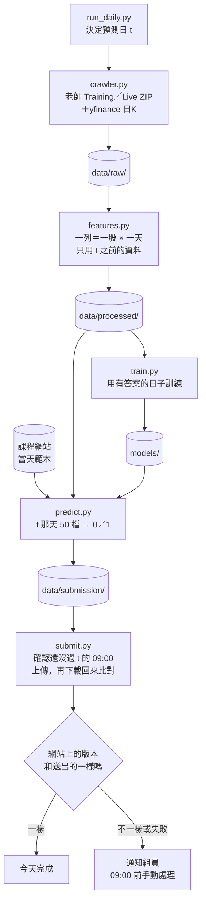

# 每天的流程

## 五個步驟



## 指令

```bash
python run_daily.py            # 一次跑完五步；--skip-train 沿用 models/ 的模型；--date 2026-11-17 指定 t
python -m src.crawler          # 1. 抓資料到 data/raw/；這是研究模式，正式流程由 run_daily.py 傳 --date t
python -m src.features         # 2. 算特徵到 data/processed/
python -m src.train            # 3. 訓練，模型存到 models/
python -m src.predict          # 4. 產生 data/submission/submission_YYYY-MM-DD.csv
python -m src.submit           # 5. 上傳並核對；submit.enabled 是 false 時只印出要送的內容
```

要在 repo 根目錄用 `python -m` 跑，才 import 得到 `src`。各模組的 `main(argv=None)` 都用 `parser.parse_args(argv)`，`run_daily.py` 依序呼叫它們。

## 什麼時候跑

- 正式流程在 t 當天早上跑：Live ZIP 要到 t 當天早上才有 t 的一列。
- 爬蟲排在台北 06:00 之後，美股前一天的K棒才收完（規則見 `memory/context/data-rules.md`）。yfinance 的 DXY 要到 07:00 才收完，所以爬蟲排台北 07:10（使用者 2026-11-05 決定，見 `memory/projects/crawler.md`）。
- 排程（使用者 2026-11-06 決定，11-07 改主機）：不用 GitHub Actions 的 `schedule`。主跑原本定 GCP e2-micro 免費額度，2026-11-07 量到流程高峰約 750 MB、e2-micro 只有 1 GB，使用者改用學校的 `oop.cs.nccu.edu.tw`（Ubuntu 22.04、16 核、24 GB；ghost 是 Solaris，裝不了套件）。台北 07:10、07:25、07:40、07:55、08:05 用 cron 跑 `run_daily_test.py --sync`（使用者 2026-11-08 從兩次加到五次：當天 07:10 學校 DNS 短暫查不到 github.com，那次停下；最後一次 08:05 而不是 08:15，離爬蟲截止 08:30 留 25 分鐘）；備援是使用者的 Mac，08:15、08:25、08:35 跑（2026-11-08 從 08:05 起改到 08:15 起，不和 oop 的 08:05 同時爬），網站上還沒有今天的有效提交才交。Mac 的 launchd 2026-11-09 查到沒有裝，使用者決定先不裝，現在只有 oop。帳密放各台的 `.env`。大模型之後在 Kaggle 訓練好推進 repo，主機只預測。安裝步驟見 `memory/reference/runner-hosts.md`（2026-11-12 從 README 移過去）。
- 08:25 的時段（使用者 2026-11-11）：oop 的 cron 多一行 08:25，跑同一個指令。`run_daily_test.py` 在流程結束後（`--sync`、不是休市、沒被 Ctrl-C）呼叫 `open_today_step`：t 是今天、特徵表最後一天是 t、過了 `open_today.not_before`（08:22）才抓日韓當天的開盤（`crawler.open_today`），有新存的就再跑一次 `features --date t`，結尾照常 commit、push，大約 08:28 推上去。任何錯誤只記 log，不改這次的結果。07:10～08:05 那五次也會經過這一步，還沒到 08:22 就直接跳過。前五次都沒交成時，08:25 這次會照常跑完整的流程再補開盤。
- 使用者 2026-11-06：先寫 `run_daily_test.py` 每天交 Phase 2，用組員 `notebooks/feature_switch.ipynb` 第 6 節的方法（邏輯迴歸，最近 14 個月訓練、每週重訓、每天用前一天的答案微調，機率 > 0.5 猜漲），特徵是組員 `build_model.ipynb` 的個股特徵加新表的 32 欄。使用者確認舊系統的排程停了，`submit.enabled` 可以打開。跑完要自動 commit、push `data/`。
- 爬蟲 08:30 以後才開始時（排程延遲才會發生）：每一步只試一次，不等不重試，yfinance 不抓、沿用舊檔，盡量趕在截止前交（使用者 2026-11-06 確認，就是目前的做法）。
- 合併的原始資料（使用者 2026-11-11）：`run_daily_test.py` 在 `open_today_step` 之後、結尾的 commit 之前呼叫 `merged_step`，跑 `src.merge_raw.main([])`，把 `data/raw/` 併成 `data/merged/` 的個股表（`stock/YYYY-MM.csv.gz`）和市場表（`market.csv.gz`）給組員研究，模型和上傳不看。休市（status 是 closed）和 Ctrl-C 不跑；不分 `--sync`。來源檔的指紋（`manifest.json` 的 `source_digest`，含 `merge_raw.FORMAT`）沒變就跳過，約 0.3 秒；有變就重算全部（2026-11-11 量的：約 19 秒、記憶體 0.5 GB），只寫內容不一樣的檔。錯誤只記 log。`DATA_PATHS` 加了 `data/merged`，`commit_data` 和 `git_start` 的「只動 data/」都算它。
- 證交所、櫃買（2026-11-09 寫好，使用者 2026-11-10 打開 `exchange.enabled`，11-11 起每天跑）：爬蟲在期交所之後補 i 那天，平常每個主機 2 個請求、約多 20 秒，最壞約 5 分鐘；失敗只寫警告和 manifest 的 `exchange`，不影響上傳。i 那天的資料台北 18:00 前就公布（見 `memory/projects/crawler.md` 的「每天的步驟」）。
- `predict.py`（09:00）和 `submit.py`（08:50）檢查截止。crawler 的每日模式（`--date t`）在 07:00 前不跑，08:30 後不再等待或重試。研究模式的 crawler 和 `features`、`train` 什麼時間都能跑。

## 失敗時怎麼處理

- yfinance 某個序列失敗：記在 manifest，流程繼續，那個特徵當天可能是空白，爬蟲回傳 3。外國放假沒有 i 那根不算失敗，記在 `run.no_bar_i`。
- 課程網站登入遇到逾時或 5xx 再試 2 次；`/api/state` 讀不到時改用上次存的 `phase2_days.json`（要有 t）。過了 08:30 每一步只試一次。
- 其他步驟失敗：停下，在 `data/submission/run_YYYY-MM-DD.log` 寫原因，已經產生的檔案留著。
- 手動交：
  1. 看 `run_YYYY-MM-DD.log`，找出停在哪一步。
  2. 登入課程網站，確認 t 還沒有有效的提交，不要重複送。
  3. `submission_YYYY-MM-DD.csv` 已經產生的話，在網站上手動上傳它。
- 通知組員用 Email（使用者 2026-11-05 決定）：Healthchecks.io 在開始和成功時各收一次回報，沒收到成功就用它內建的信件通知。實作排程時接上。

## 檔案結構為什麼這樣

參考 Cookiecutter Data Science（常見的資料科學專案範本，把 data、models、notebooks、src 分開放），另外加四樣：

- `submit.py`：上傳 CSV，再確認網站收到的內容和送出的一樣。
- `run_daily.py`：每天只跑這一個指令。
- `tests/`：擋住兩件最容易出事的事，用到當天的資料和 CSV 格式錯。
- `.env.example`：帳號密碼不寫進程式或設定檔。

2026-11-12 使用者想把 `src/` 收成「爬蟲、特徵、模型、上傳」四塊，共用的函式放 `utils`，寫法偏純函式。問過之後使用者選「先不動程式」：README 已經照這四步介紹現有的檔案，程式維持現狀。當時 `train.py`、`predict.py`、`run_daily.py` 是沒在用的骨架，模型分散在 `persist_rule.py`、`online_lr.py`（另一個 session 正在加 `rank_ensemble.py`），`crawler.py` 2,939 行。沒選的兩個做法：只搬檔案不改函式（刪骨架、模型收進 `src/model/`、`site_api.py` 併進上傳）；拆 `crawler.py`、改寫成純函式（要改寫大部分測試，建議比賽結束後）。之後要做，先確認沒有別的 session 有沒 commit 的改動。

## run_daily_test.py（2026-11-07 寫好）

排程跑的是 `run_daily_test.py --sync`，不是 `run_daily.py`。下面是 Claude 2026-11-07 照使用者 11/06 的決定做的設計：

- 模型開關（使用者 2026-11-12）：`configs/config.yaml` 的 `daily_model.kind` 和 `fallback`。`rank_ensemble` 是 `src/rank_ensemble.py` 的排名集成，`persist` 是 `src/persist_rule.py` 的持續性規則，`online_lr` 是組員的邏輯迴歸；沒有這個設定時用 `online_lr`。現在是 `rank_ensemble`，備援 `[persist, online_lr]`，見下面「每天交件的模型」和 `memory/reference/daily-model.md`。
- 組員的模型：`src/online_lr.py`，組員 `feature_switch.ipynb` 第 6 節的方法。每天早上重新 fit，不讀 `models/`：每週重訓、每天用前一天的答案微調是這個方法的一部分，和 `predict.py`「只載入存好的模型」不同。
- 開關：`configs/config.yaml` 的 `submit.phase`。1 是 Phase 1（網站範本的 84 天 × 50 檔，測自動化用），2 是每天的 t。使用者 2026-11-06：先交 Phase 1 測試，之後改 2。2026-11-07 07:10 oop 第一次自動交 Phase 1 成功（網站分數 0.0012354，排行仍是 0.0027732；07:40 看到已交就結束），使用者同一天要改成 2。
- 休市（使用者 2026-11-07：不要寫死，要靈活）：每次執行都看網站的 `phase2Days`（`site_api.day_status`），不看星期幾、也沒有假日表。t 不在清單上就記「休市」結束，不爬、不上傳。在清單上但 `enabled` 是 0 時（沒看過這種狀態；使用者提醒可能只是還沒更新），照常準備，上傳前再看一次，還是停用就記 not_open、這次不送，不擋下一次排程。特徵的交易日曆看老師資料（至少 `min_stocks_filled` 檔填好），新的颱風假自動排除；`closed_days` 只用來把關 10/23。網站的 `phase2Days` 只列到今天為止，沒有週末和 10/23；開放和截止看網站每天的 `openAt`、`deadline`：2026-11-08 起前一個交易日 09:01 開放到當天 09:00（見 `memory/context/competition.md`），以前是前一天 15:00 開放。
- 跳過：Phase 1 今天（台北）已經交過，或 `upload_log.jsonl` 今天有 done／same 就結束；Phase 2 網站上 t 已經有提交（不算「強制繳交」）就結束。所以後面的時段和 Mac 只在前面沒交成時才做事。
- t 不是交易日（不在 `phase2Days`）：不跑爬蟲和特徵。Phase 2 直接結束，Phase 1 用現有的特徵表。
- 上傳前：`--sync` 時先 commit 並 push `data/` 和「準備上傳」紀錄，push 失敗或出錯就寫 not_sent、不上傳。推完再檢查一次截止（08:50）、網站的開放時間、網站上的提交有沒有變（別台交了就不送）、別台有沒有也在準備上傳，都過了才 POST。
- POST 失敗後不自動重送：`upload_log.jsonl` 今天有某次執行（`run_id`）的「準備上傳」，同一個 `run_id` 卻沒有 done 或 not_sent 時，之後的執行（後面的時段、Mac）停下，留給人到網站確認後手動處理。
- git：只有 `--sync` 才做，而且先同步完才寫 log（log 檔也在 Git 裡）。開始前 data/ 以外有改動就停；data/ 裡上次留下的改動先 commit 再 `pull --rebase`。pull 失敗時，本機多出來的 commit 只動 data/、也沒有 data/ 以外沒追蹤的檔，才丟掉、對齊 origin（資料這次重抓）。git 逾時當成失敗。`upload_log.jsonl` 用 union 合併。`submit.phase` 在 pull 之後才讀。
- 同一台主機同時只跑一個（`.cache/run_daily_test.lock`）。
- 載入順序（2026-11-07 第三輪審查後）：`--sync` 時先 `git pull` 才載入 `src/`，推上去的修正這次就用到；`run_daily_test.py` 自己被更新時用新版重新執行一次。新程式 import 失敗時寫到 `.cache/cron.log`，修正推上去後下一次會先 pull 再載入。
- 組員手動交了就不蓋掉：排程上傳時（`respect_existing`），網站上已經有這次的提交（Phase 2 的 t，或 Phase 1 今天交的；不算強制繳交）就不送，POST 前會再看一次。手動跑 `python -m src.submit` 可以蓋掉。使用者 2026-11-08 確認維持這樣：預設交排程的版本，組員在截止前手動交了就以組員的為準（Phase 2 算最後一份，組員比排程早交時排程不送，比排程晚交時本來就算組員的）。
- Phase 2 的上傳紀錄看交易日 t 的全部紀錄（t 前一晚送的也算）；Phase 1 只看今天寫的。
- `requirements.txt` 改了要在 oop 重裝套件（oop 連不到 PyPI，見 `memory/reference/runner-hosts.md`）。`runner_setup.sh` 記下安裝時的 sha256，不一樣時 `run_daily_test.py` 在 log 裡警告。
- 資源（2026-11-07 在 Mac 上量）：特徵和模型在同一個程式裡時，記憶體高峰約 735～760 MB（模型讀資料那一步）；Phase 1 全程 40～60 秒。
- 外資持股比率（使用者 2026-11-07）：Live 的這一欄常常隔天才公布（11/06 晚上那天 100 檔都是 -1），待定時沿用這檔股票前一個有值的比率，持股變化就成了 0。
- Phase 1 本機分數（2026-11-07，用 26 個個股特徵加 32 欄）：0.001235，正確率 53.4%；全猜 0 是 −0.000204。組員 11/06 交的版本網站算 0.002773，本機重算一樣，計分方式對得上。

## 每天交件的模型（使用者 2026-11-12）

使用者 2026-11-12 凌晨：把 `run_daily_test.py` 的模型「暫時」換成「目前」我們做的最穩定且最好的。Claude 選了持續性規則 `persist120`，理由和做法：

- 規則：只看要預測的 50 檔。e = 這檔的盤中報酬 − 當天 50 檔的平均；t 的分數 = t 之前 120 個有答案的交易日 e 的平均（至少 60 天有值）；分數高的 25 檔猜 1，低的 25 檔猜 0。沒有分數的排中間，名次一樣時代號大的排前面。程式在 `src/persist_rule.py`，設定在 `persist_rule`。
- 為什麼是它：Kaggle notebook 12～14 的結論是大盤方向猜不準，個股排序才有穩定的分數。照 notebook 14 事先寫好的規則選到的是 12 個模型的集成 `E2_no_svm`（每天 +0.00091，t 5.9），但它要訓練 12 個模型，也沒有對「還沒答案的一天」跑過正式流程。持續性規則每天 +0.00069（95% 區間 +0.00040～+0.00101，t 4.5，11 季都是正的，最差的一季 +0.00021，Phase 2 的 20 天加總 +0.052），拿到集成約四分之三的分數，不用訓練，只讀 `label_intraday_return`，當晚就能在 oop 驗完。
- 驗證（2026-11-12 01:10，oop 的測試 worktree，不上傳）：用 `online_lr.load_data` 加 `persist_rule.predict` 重播 notebook 14 的 690 天，回測平均 0.0006885、Phase 2 加總 0.0522304，和 notebook 的 0.0006885、0.0522303 一樣。正式流程每天固定排 50 檔，notebook 有 11 天只有 49 檔，所以正式流程的回測平均是 0.0006864，有 3 天的分數不同。t = 11-11（答案還是空白的那列）算得出 50 檔、25 檔猜漲。上傳檔的列也用 `submit.build_rows`、`check_rows` 檢查過。
- 備援：規則丟錯時照 `daily_model.fallback` 的順序換下一個，當天照樣交件，log 寫「persist 算不出來（原因），改用 online_lr」。規則會丟錯的情況：最新的答案和 t 中間隔超過 `max_stale_days`（3）個交易日，或有分數的股票不到 `min_scored_share`（0.8）。
- 換模型：改 `daily_model.kind` 和 `fallback` 兩行，push，避開台北 07:00～08:40。這個改動不動特徵欄，不用重建 `data/processed/`。
- 2026-11-12 晚上換成排名集成，見下一節。
- 不上傳、只看規則當天會交什麼（在 oop 的 clone 裡跑，不要在 Mac 跑模型）：

  ```bash
  python -c "import json; from src import online_lr, persist_rule, utils; cfg = utils.load_config(); d = online_lr.load_data(cfg); ids = sorted(str(x) for x in json.loads((utils.ROOT / 'data/raw/teacher/training/info.json').read_text(encoding='utf-8-sig'))['Top50@Y']); print(persist_rule.predict(d, cfg, ['<t>'], ids).to_string())"
  ```

### 2026-11-12 晚上換成排名集成

使用者 2026-11-12 傍晚看完比較後選「今晚換成集成」。`daily_model.kind: rank_ensemble`、`fallback: [persist, online_lr]`，11-13 07:10 起生效。

- 模型：`src/rank_ensemble.py`，Kaggle notebook 16 的 `X_price`（41 個價量欄的當天排名，ridge、Nyström kernel ridge、LightGBM 三個模型的排名平均）。每天早上用 t 之前 500 個有答案的交易日重訓，oop 上約 30 秒。說明給組員看的版本在 `memory/reference/daily-model.md`。
- 為什麼換：notebook 18 的成對比較，集成減 `persist120` 在 11 季回測每天 +0.00032（95% 區間 +0.00004～+0.00061，block bootstrap 也不含 0），2022～2023 每天 +0.00023（區間含 0）。11-12 當天集成的紙上預測 +0.020554，交出去的 `persist` +0.011575（用 yfinance 的開收盤算，`persist` 和網站的分數一模一樣）。
- 驗證：oop 重播 1,175 天、3 個種子、60 次重訓，0／1 有 99.45% 的格子和 notebook 一樣，回測 0.0010279（notebook 0.0010102）；沒有答案的那天（11-06、11-09、11-10）和有答案時算的一樣；推之前在 oop 的測試 worktree 用正式的 `daily_predict` 和真的 config 算 t = 11-12，跑完整個測試。
- 兩輪獨立審稿（2026-11-12，唯讀）找到的都是小問題，推之前一起修了：爬蟲記下前一天沒填時改用備援；只有幾檔前一天沒填時那幾檔當成空白；t 那列空白太多、整欄空白、預測不是有限的數時改用備援，訊息寫出空白的欄名；備援的 log 把路徑換成相對的（oop 的家目錄含學號，log 會推上 GitHub）；`kind` 不認得或填 `none` 時停下，`fallback` 裡不認得或重複的名字記 ERROR 後跳過；`online_lr` 還在備援順序外面（流程一開始就載入、讀特徵也用它），寫進 docstring 和 `daily-model.md`。
- 隔天早上要看：`data/submission/run_2026-11-13.log` 有「模型 rank_ensemble」，沒有「算不出來」。集成失敗時流程不會停，會交 `persist`，只有 log 看得出來。
- 換回去：`kind: persist`、`fallback: online_lr`，push，避開台北 07:00～08:40。

### 2026-11-12 凌晨補推重建的特徵表

組員 2026-11-11 19:14 的 commit f7b7189 把特徵表從 84 欄改成 107 欄（模型欄 32 變 55），只推了程式和 config，沒有重建的 `data/processed/`。這樣 11-12 早上每個時段的特徵那一步都會丟「特徵欄和上次不一樣」，當天交不出去（在 oop 的測試 worktree 重現過）。處理：

1. 在 oop 另開 worktree（`git worktree add --detach ~/mlfinal-rebuild origin/claude/stock-market-challenger`），用排程 clone 的 `.venv/bin/python` 跑 `-m src.features --rebuild`，92 秒。
2. 檢查：107 欄、模型欄 55、`warnings` 是 `[]`；原本就有的 82 個數值欄和重建前完全一樣；`stock_intraday_ret_lag1` 等於前一列的答案（沒有用到 t 當天）；組員的模型用 81 個特徵跑得出 t = 11-11 的 50 檔；全部測試 485 個通過。
3. 01:05 從 oop 推 e7c5c99。再用每天的指令 `-m src.features --date 2026-11-11` 跑一次，沒有丟錯，也沒有月份變動。

## 特徵欄位變了怎麼推（2026-11-09 審查後寫）

特徵表的欄位一變，舊的 `data/processed/manifest.json` 就和新程式對不起來，每天的 `features.main(["--date", t])` 沒加 `--rebuild` 會丟「特徵欄和上次不一樣」，那天交不出去。反過來，舊程式配新的 manifest 也一樣會停。所以程式和重建過的表要在同一次 push。2026-11-09 的 17 欄就是這種情況，之後再改欄位也照這裡做。

### 同一次 push 要有的東西

- 一定要有：改過的程式和 `configs/config.yaml`，以及 pull 之後用 `--rebuild` 重建的整個 `data/processed/`（`manifest.json` 和全部月份檔）。2026-11-09 那次程式是 `src/crawler.py` 和 `src/features.py`（`features.py` 用到 `crawler.EXCHANGE_SPECS`），config 也要一起（新程式讀 `features.tick_table`，新 config 配舊程式會多出 `kospi_ret` 兩欄）。
- 強烈建議：`data/raw/twse/`、`data/raw/tpex/`。不推不會出錯，但 oop 每天重寫最後兩個月時，交易所 9 欄會變空白，只記在 notes。
- 可有可無：`data/raw/exchange_backfill.json`（回補的進度）。每天的爬蟲不寫它，沒有這個檔也照常跑。
- 測試和文件跟著程式一起 commit。

### 步驟

1. 先 commit 程式、測試、文件，只 `git add` 自己改的檔。`README.md` 用 `git add -p`，另一個 session 寫的 `notebooks/kaggle/` 那幾行不要收。`.gitignore`、`notebooks/`、`memory/projects/kaggle-models.md` 不要 stage。
2. `git fetch origin && git rebase --autostash origin/claude/stock-market-challenger`。`--autostash` 會先收起別人沒 commit 的改動，rebase 完再放回來。`git pull --rebase --autostash origin <分支>` 在這個 repo 會失敗（2026-11-09：「Cannot rebase onto multiple branches」）。oop 每天會 commit `data/`，不先 pull 的話，重建的月份檔和 `manifest.json` 會和 origin 二進位衝突；衝突時選了 origin 那邊，就回到舊欄位。
3. `python -m src.features --rebuild`。t 會從 pull 下來的 `data/raw/manifest.json` 取（oop 最新那天）。確認新的 `manifest.json`：`columns` 是預期的欄數，`warnings` 是 `[]`。這一步會在 `data/submission/run_<t>.log` 多幾行，不用 commit，推完用 `git restore data/submission` 還原。
4. 比一次重建前後 t 那天 50 檔的 0／1。重建會用現在的 yfinance 檔重算過去凍住的月份，Yahoo 每次重抓 `adj_close` 會往回調，所以 `tsm_adr`、`nvda`、`etf_0050` 這類模型欄在舊月份會有 1e-6 級的變動（2026-11-09 模擬：692,900 格，最大差 9.2e-7，t = 11-09 的機率最多差 0.0011，沒有一檔的 0／1 改變）。這和程式改了什麼無關，舊程式加 `--rebuild` 也一樣。
   - 不要用 `run_daily_test.py` 或 `src.submit` 來比：`submit.enabled` 是 true，下一個 t 的上傳在前一個交易日 09:01 就開放，跑下去可能真的送出。
   - 只呼叫模型、不上傳的做法：在重建前的 worktree（`git worktree add <暫存資料夾> origin/claude/stock-market-challenger`）和重建後的 repo 各跑一次下面這行，比兩個輸出檔的 `pred` 欄。worktree 沒有 `.venv`，在 worktree 的資料夾裡用這個 repo 的 `.venv/bin/python` 跑，`src` 會從目前的資料夾載入。

     ```bash
     python -c "import json; from src import online_lr, utils; cfg = utils.load_config(); d = online_lr.load_data(cfg); ids = sorted(str(x) for x in json.loads((utils.ROOT / 'data/raw/teacher/training/info.json').read_text(encoding='utf-8-sig'))['Top50@Y']); online_lr.predict(d, cfg, ['<t>'], ids).to_csv('<輸出檔>', index=False)"
     ```
5. `git add data/processed data/raw/twse data/raw/tpex`，commit，先不要 push。
6. 在乾淨的 worktree（`git worktree add <暫存資料夾> HEAD`，這時 HEAD 已經有重建的表）用這個 repo 的 `.venv/bin/python` 跑一次 `-m src.features --date <第 3 步的 t>`。要沒有丟錯，`git status data/processed` 也沒有新的改動（log 會寫進 `data/submission/`，那個不算）。如果丟「特徵欄和上次不一樣」，代表重建的表沒有 commit 到，不要在 worktree 裡加 `--rebuild` 蓋過去，回去查第 5 步。
7. push。推的時間避開台北 07:00～08:40：oop 07:10～08:05 跑五次、08:25 再跑一次（補日韓開盤，約 08:28 推完），Mac 08:15～08:35 備援；推送剛好落在某次執行中間時，那次的 `before_post` 推送會在 `data/processed` 衝突，那次就不上傳。
8. 推完後，oop 第一次 pull 要下載約 20 MB（重建的月份檔約 14.6 MB、證交所和櫃買的 CSV 壓縮後約 5.3 MB），`git_start` 的 pull、fetch 各有 180 秒上限。方便連 VPN 的話先在 oop 手動 `git pull` 一次，不然看隔天 07:10 那次的 log 確認 pull 有成功。

### 之後還要再重建的時候

- `data/merged/` 不受這一節限制：`src/merge_raw.py` 不讀也不寫 `data/processed/`，欄位變了也不會讓每天的特徵停下。改了合併表的欄位或寫法就把 `merge_raw.FORMAT` 加 1，oop 下一次就會重算全部；要自己先推一版，在 pull 之後跑 `python -m src.merge_raw --rebuild`，`git add data/merged` 和程式一起推，一樣避開台北 07:00～08:40。

- 新加 yfinance 序列時：在第 3 步之前，先在暫存的 worktree（`git worktree add <暫存資料夾> HEAD`，連結 `.env`）用研究模式 `python -m src.crawler`（不給 `--date`）爬一次，只把新序列的 CSV 複製進這個 repo 的 `data/raw/yfinance/`，其他檔用 pull 下來的 oop 版本，再 `--rebuild`，和表一起推。研究模式會丟掉日期 ≥ t 的K棒，所以白天爬也只到 i。2026-11-09 的 `kospi` 就是這樣做。只靠 oop 每天抓的話，過去月份的新欄會一直空白（每天只重寫最後兩個月），要再重建、再推一次。
- 交易所的檔斷了超過 `exchange.gapfill_days`（10 個交易日）時（oop 連續兩週抓不到，或 `exchange.enabled` 關掉一陣子），每天的爬蟲補不到中間那段。2026-11-10 打開時離回補的最後一天 11-06 只差 2 個交易日，不用補。要補時先在開發用的 clone 跑 `python -m src.crawler --exchange-backfill --start <檔案最後一天的下一天>` 補上（不要在 oop 或 Mac 的排程 clone 跑，原因見 `README.md`「證交所、櫃買的回補」），再照第 2～8 步 `--rebuild`。
