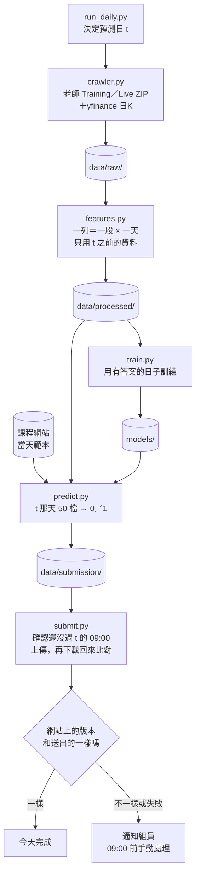

# 每天的流程

## 五個步驟



## 指令

```bash
python run_daily.py            # 一次跑完五步；--skip-train 沿用 models/ 的模型；--date 2026-11-17 指定 t
python -m src.crawler          # 1. 抓資料到 data/raw/；這是研究模式，正式流程由 run_daily.py 傳 --date t
python -m src.features         # 2. 算特徵到 data/processed/
python -m src.train            # 3. 訓練，模型存到 models/
python -m src.predict          # 4. 產生 data/submission/submission_YYYY-MM-DD.csv
python -m src.submit           # 5. 上傳並核對；submit.enabled 是 false 時只印出要送的內容
```

要在 repo 根目錄用 `python -m` 跑，才 import 得到 `src`。各模組的 `main(argv=None)` 都用 `parser.parse_args(argv)`，`run_daily.py` 依序呼叫它們。

## 什麼時候跑

- 正式流程在 t 當天早上跑：Live ZIP 要到 t 當天早上才有 t 的一列。
- 爬蟲排在台北 06:00 之後，美股前一天的K棒才收完（規則見 `memory/context/data-rules.md`）。yfinance 的 DXY 要到 07:00 才收完，所以爬蟲排台北 07:10（使用者 2026-11-05 決定，見 `memory/projects/crawler.md`）。
- 排程（使用者 2026-11-06 決定）：不用 GitHub Actions，在雲端小主機上用 cron 跑 `run_daily.py`。帳密放主機的 `.env`。用哪一家、誰的帳號還沒定（`memory/context/open-questions.md`）。
- 爬蟲 08:30 以後才開始時（排程延遲才會發生）：每一步只試一次，不等不重試，yfinance 不抓、沿用舊檔，盡量趕在截止前交（使用者 2026-11-06 確認，就是目前的做法）。
- `predict.py`（09:00）和 `submit.py`（08:50）檢查截止。crawler 的每日模式（`--date t`）在 07:00 前不跑，08:30 後不再等待或重試。研究模式的 crawler 和 `features`、`train` 什麼時間都能跑。

## 失敗時怎麼處理

- yfinance 某個序列失敗：記在 manifest，流程繼續，那個特徵當天可能是空白，爬蟲回傳 3。外國放假沒有 i 那根不算失敗，記在 `run.no_bar_i`。
- 課程網站登入遇到逾時或 5xx 再試 2 次；`/api/state` 讀不到時改用上次存的 `phase2_days.json`（要有 t）。過了 08:30 每一步只試一次。
- 其他步驟失敗：停下，在 `data/submission/run_YYYY-MM-DD.log` 寫原因，已經產生的檔案留著。
- 手動交：
  1. 看 `run_YYYY-MM-DD.log`，找出停在哪一步。
  2. 登入課程網站，確認 t 還沒有有效的提交，不要重複送。
  3. `submission_YYYY-MM-DD.csv` 已經產生的話，在網站上手動上傳它。
- 通知組員用 Email（使用者 2026-11-05 決定）：Healthchecks.io 在開始和成功時各收一次回報，沒收到成功就用它內建的信件通知。實作排程時接上。

## 檔案結構為什麼這樣

參考 Cookiecutter Data Science（常見的資料科學專案範本，把 data、models、notebooks、src 分開放），另外加四樣：

- `submit.py`：上傳 CSV，再確認網站收到的內容和送出的一樣。
- `run_daily.py`：每天只跑這一個指令。
- `tests/`：擋住兩件最容易出事的事，用到當天的資料和 CSV 格式錯。
- `.env.example`：帳號密碼不寫進程式或設定檔。
