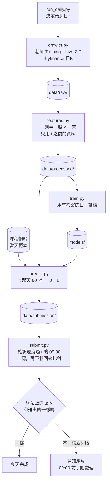

# 每天的流程

## 五個步驟



## 指令

```bash
python run_daily.py            # 一次跑完五步；--skip-train 沿用 models/ 的模型；--date 2026-11-17 指定 t
python -m src.crawler          # 1. 抓資料到 data/raw/；這是研究模式，正式流程由 run_daily.py 傳 --date t
python -m src.features         # 2. 算特徵到 data/processed/
python -m src.train            # 3. 訓練，模型存到 models/
python -m src.predict          # 4. 產生 data/submission/submission_YYYY-MM-DD.csv
python -m src.submit           # 5. 上傳並核對；submit.enabled 是 false 時只印出要送的內容
```

要在 repo 根目錄用 `python -m` 跑，才 import 得到 `src`。各模組的 `main(argv=None)` 都用 `parser.parse_args(argv)`，`run_daily.py` 依序呼叫它們。

## 什麼時候跑

- 正式流程在 t 當天早上跑：Live ZIP 要到 t 當天早上才有 t 的一列。
- 爬蟲排在台北 06:00 之後，美股前一天的K棒才收完（規則見 `memory/context/data-rules.md`）。yfinance 的 DXY 要到 07:00 才收完，所以爬蟲排台北 07:10（使用者 2026-11-05 決定，見 `memory/projects/crawler.md`）。
- 排程（使用者 2026-11-06 決定，11-07 改主機）：不用 GitHub Actions 的 `schedule`。主跑原本定 GCP e2-micro 免費額度，2026-11-07 量到流程高峰約 750 MB、e2-micro 只有 1 GB，使用者改用學校的 `oop.cs.nccu.edu.tw`（Ubuntu 22.04、16 核、24 GB；ghost 是 Solaris，裝不了套件）。台北 07:10、07:40 用 cron 跑 `run_daily_test.py --sync`；備援是使用者的 Mac，08:05、08:20、08:35 跑，網站上還沒有今天的有效提交才交。帳密放各台的 `.env`。大模型之後在 Kaggle 訓練好推進 repo，主機只預測。安裝步驟見 `README.md`「排程主機」。
- 使用者 2026-11-06：先寫 `run_daily_test.py` 每天交 Phase 2，用組員 `notebooks/feature_switch.ipynb` 第 6 節的方法（邏輯迴歸，最近 14 個月訓練、每週重訓、每天用前一天的答案微調，機率 > 0.5 猜漲），特徵是組員 `build_model.ipynb` 的個股特徵加新表的 32 欄。使用者確認舊系統的排程停了，`submit.enabled` 可以打開。跑完要自動 commit、push `data/`。
- 爬蟲 08:30 以後才開始時（排程延遲才會發生）：每一步只試一次，不等不重試，yfinance 不抓、沿用舊檔，盡量趕在截止前交（使用者 2026-11-06 確認，就是目前的做法）。
- `predict.py`（09:00）和 `submit.py`（08:50）檢查截止。crawler 的每日模式（`--date t`）在 07:00 前不跑，08:30 後不再等待或重試。研究模式的 crawler 和 `features`、`train` 什麼時間都能跑。

## 失敗時怎麼處理

- yfinance 某個序列失敗：記在 manifest，流程繼續，那個特徵當天可能是空白，爬蟲回傳 3。外國放假沒有 i 那根不算失敗，記在 `run.no_bar_i`。
- 課程網站登入遇到逾時或 5xx 再試 2 次；`/api/state` 讀不到時改用上次存的 `phase2_days.json`（要有 t）。過了 08:30 每一步只試一次。
- 其他步驟失敗：停下，在 `data/submission/run_YYYY-MM-DD.log` 寫原因，已經產生的檔案留著。
- 手動交：
  1. 看 `run_YYYY-MM-DD.log`，找出停在哪一步。
  2. 登入課程網站，確認 t 還沒有有效的提交，不要重複送。
  3. `submission_YYYY-MM-DD.csv` 已經產生的話，在網站上手動上傳它。
- 通知組員用 Email（使用者 2026-11-05 決定）：Healthchecks.io 在開始和成功時各收一次回報，沒收到成功就用它內建的信件通知。實作排程時接上。

## 檔案結構為什麼這樣

參考 Cookiecutter Data Science（常見的資料科學專案範本，把 data、models、notebooks、src 分開放），另外加四樣：

- `submit.py`：上傳 CSV，再確認網站收到的內容和送出的一樣。
- `run_daily.py`：每天只跑這一個指令。
- `tests/`：擋住兩件最容易出事的事，用到當天的資料和 CSV 格式錯。
- `.env.example`：帳號密碼不寫進程式或設定檔。

## run_daily_test.py（2026-11-07 寫好）

排程跑的是 `run_daily_test.py --sync`，不是 `run_daily.py`。下面是 Claude 2026-11-07 照使用者 11/06 的決定做的設計：

- 模型：`src/online_lr.py`，組員 `feature_switch.ipynb` 第 6 節的方法。每天早上重新 fit，不讀 `models/`：每週重訓、每天用前一天的答案微調是這個方法的一部分，和 `predict.py`「只載入存好的模型」不同。
- 開關：`configs/config.yaml` 的 `submit.phase`。1 是 Phase 1（網站範本的 84 天 × 50 檔，測自動化用），2 是每天的 t。使用者 2026-11-06：先交 Phase 1 測試，之後改 2。2026-11-07 07:10 oop 第一次自動交 Phase 1 成功（網站分數 0.0012354，排行仍是 0.0027732；07:40 看到已交就結束），使用者同一天要改成 2。
- 休市（使用者 2026-11-07：不要寫死，要靈活）：每次執行都看網站的 `phase2Days`（`site_api.day_status`），不看星期幾、也沒有假日表。t 不在清單上就記「休市」結束，不爬、不上傳。在清單上但 `enabled` 是 0 時（沒看過這種狀態；使用者提醒可能只是還沒更新），照常準備，上傳前再看一次，還是停用就記 not_open、這次不送，不擋下一次排程。特徵的交易日曆看老師資料（至少 `min_stocks_filled` 檔填好），新的颱風假自動排除；`closed_days` 只用來把關 10/23。網站的 `phase2Days` 只列到今天為止，沒有週末和 10/23；每天在前一天台北 15:00（`openAt`）開放，所以週一那天週日下午才會出現在清單上。
- 跳過：Phase 1 今天（台北）已經交過，或 `upload_log.jsonl` 今天有 done／same 就結束；Phase 2 網站上 t 已經有提交（不算「強制繳交」）就結束。所以 07:40 和 Mac 只在前面沒交成時才做事。
- t 不是交易日（不在 `phase2Days`）：不跑爬蟲和特徵。Phase 2 直接結束，Phase 1 用現有的特徵表。
- 上傳前：`--sync` 時先 commit 並 push `data/` 和「準備上傳」紀錄，push 失敗或出錯就寫 not_sent、不上傳。推完再檢查一次截止（08:50）、網站的開放時間、網站上的提交有沒有變（別台交了就不送）、別台有沒有也在準備上傳，都過了才 POST。
- POST 失敗後不自動重送：`upload_log.jsonl` 今天有某次執行（`run_id`）的「準備上傳」，同一個 `run_id` 卻沒有 done 或 not_sent 時，之後的執行（07:40、Mac）停下，留給人到網站確認後手動處理。
- git：只有 `--sync` 才做，而且先同步完才寫 log（log 檔也在 Git 裡）。開始前 data/ 以外有改動就停；data/ 裡上次留下的改動先 commit 再 `pull --rebase`。pull 失敗時，本機多出來的 commit 只動 data/、也沒有 data/ 以外沒追蹤的檔，才丟掉、對齊 origin（資料這次重抓）。git 逾時當成失敗。`upload_log.jsonl` 用 union 合併。`submit.phase` 在 pull 之後才讀。
- 同一台主機同時只跑一個（`.cache/run_daily_test.lock`）。
- 載入順序（2026-11-07 第三輪審查後）：`--sync` 時先 `git pull` 才載入 `src/`，推上去的修正這次就用到；`run_daily_test.py` 自己被更新時用新版重新執行一次。新程式 import 失敗時寫到 `.cache/cron.log`，修正推上去後下一次會先 pull 再載入。
- 組員手動交了就不蓋掉：排程上傳時（`respect_existing`），網站上已經有這次的提交（Phase 2 的 t，或 Phase 1 今天交的；不算強制繳交）就不送，POST 前會再看一次。手動跑 `python -m src.submit` 可以蓋掉。使用者 2026-11-08 確認維持這樣：預設交排程的版本，組員在截止前手動交了就以組員的為準（Phase 2 算最後一份，組員比排程早交時排程不送，比排程晚交時本來就算組員的）。
- Phase 2 的上傳紀錄看交易日 t 的全部紀錄（t 前一晚送的也算）；Phase 1 只看今天寫的。
- `requirements.txt` 改了要在 oop 重裝套件（oop 連不到 PyPI，見 `README.md`「排程主機」）。`runner_setup.sh` 記下安裝時的 sha256，不一樣時 `run_daily_test.py` 在 log 裡警告。
- 資源（2026-11-07 在 Mac 上量）：特徵和模型在同一個程式裡時，記憶體高峰約 735～760 MB（模型讀資料那一步）；Phase 1 全程 40～60 秒。
- 外資持股比率（使用者 2026-11-07）：Live 的這一欄常常隔天才公布（11/06 晚上那天 100 檔都是 -1），待定時沿用這檔股票前一個有值的比率，持股變化就成了 0。
- Phase 1 本機分數（2026-11-07，用 26 個個股特徵加 32 欄）：0.001235，正確率 53.4%；全猜 0 是 −0.000204。組員 11/06 交的版本網站算 0.002773，本機重算一樣，計分方式對得上。
