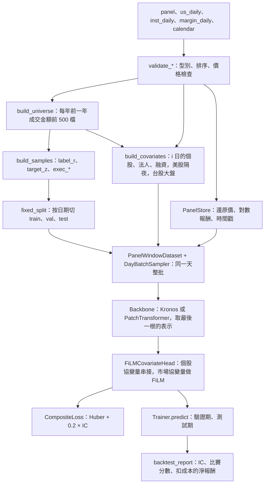

# twfm：台股時序基礎模型的遷移學習和微調

`twfm` 把預訓練的 K 棒基礎模型 Kronos-small（24.7M 參數）接到台股的橫斷面排名任務：開盤前替每檔股票打分數，預測 t 日「收盤 ÷ 開盤 − 1」的名次。對照組是同一套介面、從頭訓練的 `PatchTransformerBackbone`。

這是研究用的套件，和每天交件的正式流程分開：不 import `src.pipeline`、`src.models`、`run_daily`，正式程式也不 import `twfm`。

目前的狀態和要先知道的事：

- 所有程式只過了語法檢查，還沒在真資料或 GPU 上跑過。第一次在 Kaggle 先跑測試（見「在 Kaggle 跑」）。
- 扣掉真實交易成本後，比賽式的每天多空分數很可能是負的。當沖來回成本在手續費 2.8 折時約 0.23%，c2v2d 的毛分數每天約 0.15%（見「交易成本」）。所以這條線先回答「預訓練的表示能不能提高 RankIC」，要拿來交易得先過成本這一關。

## 架構



純文字版：

```text
panel, us_daily, inst_daily, margin_daily, calendar
   |
   | validate_*
   v
build_universe --> build_samples --> fixed_split --> train / val / test 的樣本
   |                                                  |
   v                                                  |
build_covariates (stock_cov, market_cov)              |
   |                       PanelStore (到 i 為止的視窗) |
   |                              |                   |
   +-------------> PanelWindowDataset <---------------+
                          |  DayBatchSampler (同一天的股票在同一個 batch)
                          v
     levels 或 rets --> Backbone --> repr [B, d_model]
     stock_cov, market_cov -----> FiLMCovariateHead --> score [B]
                          |
          訓練: CompositeLoss       驗證和測試: Trainer.predict
                                              |
                                              v
                                    backtest_report --> report.json
```

## 資料時點規則

t 是要預測的交易日，i 是 calendar 裡 t 的前一個交易日。每個函式都照這張表。

| 資料 | 什麼時候知道（台北時間） | t 的輸入用哪一列 |
|---|---|---|
| 個股日 K（價、量、金額） | d 日收盤後 | `date ≤ i` 的列，視窗最後一天是 i |
| 三大法人買賣超 | d 日約 16:30 | i 那天的列，沒有就是缺值，不往前找 |
| 融資餘額 | d 日約 21:30 | i 那天的列 |
| 美股 `^SOX`、`^IXIC` | 美國 d 日收盤，台北 d+1 日約 05:00 | 美國日期 `us_date < t` 的最後一根 |
| t 的開盤、收盤、量、跳空、漲跌停 | t 日 | 不當輸入，只進 `label_` 和 `exec_` 開頭的欄 |

其他規則：

- 即時抓美股不能在台北 22:30 之後抓，那時美國 t 當天已經開盤。
- 個股協變量：同一個 t、股票池內做橫斷面 rank-gauss（排名換成常態分位數），只用 t 那天已知的值。
- 市場協變量：以 t 為索引的滾動 250 天 z-score（`min_periods=60`），只含 ≤ t 已知的值。
- 有要 fit 的東西（例如 ridge probe 的標準化）都只用訓練期 fit。
- 切分只按日期，同一天的股票一定在同一邊。`horizon = h` 時訓練和驗證之間隔 `h − 1` 個交易日（embargo），標籤才不會跨段。
- 還原權息用參考價算事件因子，d 日的累積因子只用 d 以前的事件。視窗內兩天的價格比只和兩天之間的事件有關，所以每個視窗自己標準化之後，和「站在視窗最後一天往回還原」完全一樣。

## 資料格式

全部是 long 格式的 parquet（也可以是 csv），放在同一個資料夾，用 `--data-dir` 指過去。格式檢查在 `data/schema.py`。

| 檔 | 必要欄 | 說明 |
|---|---|---|
| `panel.parquet` | `date, stock_id, market, open, high, low, close, volume, amount, ref_price` | 一定要有。交易所原始價（未還原）。`market` 是 `twse` 或 `tpex`。停牌日沒有列，下市股留到最後一筆 |
| `us_daily.parquet` | `us_date, symbol, close` | `us_date` 是美國當地交易日 |
| `inst_daily.parquet` | `date, stock_id, foreign_net, trust_net, dealer_net` | 三大法人買賣超股數 |
| `margin_daily.parquet` | `date, stock_id, margin_balance` | 張或股都可以，只算變化率 |
| `calendar.csv` | `date` | 台股交易日，一列一天。沒有這個檔就用 panel 出現過的日期 |

- `stock_id` 要存成字串（`"2330"`、`"0050"`）。存成整數會掉前面的 0，存成浮點數會被拒絕。
- `ref_price` 是交易所當天的參考價（除權息調整後的前一天收盤）。缺的列用前一列收盤補，等於那天沒有事件。
- 法人、融資、美股三份可以沒有，那些協變量全 0，另有 `_isna = 1`。
- 普通股的規則是四碼、第一碼 1～9、不是 91 開頭。ETF、TDR、權證、特別股不進股票池。

## 協變量

`build_covariates` 回傳兩張表，都是 float32、沒有缺值。

| 表 | 欄 | 說明 |
|---|---|---|
| `stock_cov`（28 欄） | `ret_cc_i, ret_gap_i, ret_oc_i, ret_hl_i, close_at_up_i, close_at_down_i, limit_streak_i, beta_i, amount_rank_i, foreign_ratio_i, trust_streak_i, dealer_ratio_i, margin_chg_i, margin_chg5_i`，再加每欄的 `_isna` | i 日的狀態。`beta_i` 是 60 列對全市場等權報酬的滾動 beta，`limit_streak_i` 是連續漲停（正）或跌停（負）天數 |
| `market_cov`（11 欄） | `us_sox_ret, us_sox_ret5, us_ixic_ret, us_ixic_ret5, us_stale_days, tw_ret_cc_i, tw_ret_gap_i, tw_ret_oc_i, tw_ret_cc5_i, tw_up_frac_i, tw_down_frac_i` | 美股隔夜報酬和 5 根累計、美股資料隔幾天、i 日台股普通股的等權報酬和漲跌停比例 |

## 模組

| 模組 | 做什麼 | 要 torch |
|---|---|---|
| `config.py` | 全部設定（frozen dataclass），`PipelineConfig.from_dict`、`to_dict` | 不用 |
| `data/schema.py` | 欄名常數、`validate_*`、`is_common_stock` | 不用 |
| `data/adjust.py` | 事件因子、還原價、對數報酬、升降單位、漲跌停價和旗標 | 不用 |
| `data/align.py` | t 開盤前已知的協變量、rank-gauss、市場 z-score | 不用 |
| `data/universe.py` | 每個 t 的股票池（含之後下市的股票）、`universe_audit` | 不用 |
| `data/synthetic.py` | 假市場（除息、漲跌停、下市、美國假日），給測試和 smoke | 不用 |
| `data/dataset.py` | `SampleIndex`、`build_samples`、`PanelStore`、`PanelWindowDataset`、`DayBatchSampler`、`make_loader` | 要 |
| `models/revin.py` | RevIN（每個樣本用自己視窗的平均和標準差標準化） | 要 |
| `models/lora.py` | 自己寫的 LoRA：`LoRALinear`、`inject_lora`、`merge_lora` | 要 |
| `models/backbones.py` | `KronosBackbone`、`PatchTransformerBackbone`、分層解凍 | 要 |
| `models/heads.py` | `FiLMCovariateHead` | 要 |
| `models/model.py` | `TWFMModel`、`build_model`、分層學習率的參數分組 | 要 |
| `train/walkforward.py` | `fixed_split`、`walk_forward_splits`、`assert_no_overlap` | 不用 |
| `train/losses.py` | Huber、pinball、IC、ListNet、pairwise、portfolio、`CompositeLoss` | 要 |
| `train/finetune.py` | 分階段微調、checkpoint 接續、ridge linear probe、預測 | 要 |
| `eval/metrics.py` | 每天 IC、Newey-West 標準誤、Sharpe、最大回撤 | 不用 |
| `eval/costs.py` | 台股手續費、證交稅、最低手續費（`TaiwanCostModel`） | 不用 |
| `eval/backtest.py` | 權重、扣成本回測、比賽分數、損益兩平成本、`backtest_report` | 不用 |
| `pipeline.py` | 端到端 `run_pipeline` 和命令列 `main` | 要 |

「不用」的模組只 import numpy、pandas、scipy，沒有 torch 也能用和測試。`twfm`、`twfm.data`、`twfm.models`、`twfm.train`、`twfm.eval` 的 `__init__` 都不會在 import 時載入 torch。

## 設計取捨

### Kronos 的輸入用還原價格水準加視窗 z-score

Kronos 預訓練看的是 K 棒的價格水準，每個視窗自己做 `(x − mean) / (std + 1e-5)` 再裁在 ±5，等於 `RevIN(affine=False, clip=5)`。換成對數報酬會和預訓練的分布對不上，預訓練的權重就白費了。對數報酬給從頭訓練的 `PatchTransformerBackbone`（RevIN 加可學的仿射）和協變量用。

### 協變量進 head，不進主幹

主幹只吃它預訓練時看過的 K 棒。美股隔夜、法人、融資接在主幹輸出的後面：個股協變量和主幹的表示串接，市場協變量用 FiLM（`h · (1 + gamma) + beta`）調變。市場協變量同一天每檔都一樣，直接相加只會讓當天分數一起平移，排名不變；相乘才會依個股特性改變排名。這樣可以先凍結主幹、快取 embedding，便宜地試很多協變量組合。

### 微調照 probe、head、最後 2 層、LoRA 的順序

每一階都只用驗證期的每天 RankIC 選。Kronos-small 只有 24.7M 參數，T4 放得下全部微調，所以 LoRA 在這裡的用途是正則化（少動預訓練權重，高雜訊資料比較不會過擬合）和一次存很多變體，省記憶體是次要的。tokenizer 永遠凍結，重訓 tokenizer 會讓預訓練的預測器對不上 token。

### 主要損失是 Huber 加 0.2 × IC

目標是每天 z-score 後的報酬（裁在 ±5）。Huber（delta 1）對肥尾的大報酬只用線性懲罰，IC 損失直接對準每天的排名。pairwise 和 portfolio 比較貼近比賽分數，但以前用報酬加權的損失沒有比 MSE 好，所以列為驗證期要比較的選項，不當預設。

### 成本預設手續費 6 折

券商折扣差很多，預設用比較保守的 0.6，報告同時列 1.0、0.6、0.28。開盤進、收盤出是現股當沖，證交稅 0.15%（減半從 2017-04-28 起，適用到 2027-12-31）。回測照每天的日期算稅，這段期間以外的當沖用 0.3%。

### t 的漲跌停只用在評估

t 開盤在不在漲跌停，開盤前不知道，所以不能當輸入。它只用在「可不可以成交」的遮罩：開盤漲停買不到、開盤跌停空不到（`exec_long_ok`、`exec_short_ok`）。i 以前的漲跌停（收在漲停、連續漲停天數）是合法的輸入，用來抓隔天跳空的延續。標籤 z-score 後才裁在 ±5，原始報酬 `label_r` 不裁，比賽照原始報酬算分。

## 微調策略

`FinetuneConfig.stages` 預設三階，每階開始前載入目前最好的權重，連續 2 個 epoch（`early_stop_patience`）沒進步就換下一階，全部做完載入 `best.pt`。

| 階段 | 可訓練 | 學習率 | 用途 |
|---|---|---|---|
| `--probe`（選用，在微調之前） | 沒有（ridge 閉式解） | alpha 用驗證期 RankIC 選 | 最便宜的基準：預訓練表示本身有沒有排名資訊 |
| `head` | 只有 head | `lr_head` 1e-3 | 主幹凍結時在 `no_grad` 裡跑，很快 |
| `last_k` | 最後 2 個 block 和最後的 norm，加 head | 最深一層 4e-5，往淺每層乘 0.8 | 主要的微調 |
| `lora` | LoRA（r=8，q/k/v/out 和 FFN 的 w1/w2/w3）加 head | 跟著所在 block 的分層學習率 | 正則化較強的微調 |
| `all` | 主幹全部（tokenizer、`head`、`dep_layer` 除外） | 同上 | 從頭訓練的 `patch` 用這個 |

建議：

- 先跑 `--probe`。probe 的驗證 RankIC 不比從頭訓練的 `patch` 高，表示預訓練表示沒帶來排名資訊，後面的微調不用急著跑。
- LoRA 那一階預設沿用 `lr_backbone` 4e-5，再乘分層衰減，淺層只剩約 8e-6，加上 B 初始為 0，LoRA 幾乎不會動。實驗時把 lora 那階的 `lr_backbone` 設成 1e-4～5e-4（見下面的 JSON）。
- 從頭訓練的對照組用下面的 `patch_scratch.json`（`lr_backbone` 1e-3、`layer_decay` 1.0）。`all` 預設的學習率是微調用的（最深一層 4e-5，4 層的 `patch` 最底層只剩約 1.6e-5），從頭訓練會學不動，對照組就會不公平地輸給 Kronos。`patch` 跑 `head` 那階等於拿隨機特徵訓練 head。
- `patch` 的 `nn.TransformerEncoderLayer` 裡 q/k/v 合在一起，不是 `nn.Linear`，預設的 `lora_targets` 只會碰到 `out_proj`。要連 FFN 一起，targets 加 `linear1`、`linear2`。
- GPU 記憶體：預設每個 batch 8 天，一天約 450 檔，3600 個 128 根的視窗在 `lora` 那階一定爆 T4 的記憶體（gradient checkpointing 也要留 8 個 block 的 fp32 輸入）。所以 Kronos 在 CUDA 上訓練主幹、又沒給 `--max-stocks-per-day` 時，訓練 loader 自動每天只抽 128 檔（8 天 × 128 檔 = 1024 個視窗，約 5～6 GB）。每個 epoch 重抽，同一天的股票照樣在同一個 batch；batch 數不變，接續訓練對得上。`config.json` 寫的是調整後的值，`report.json` 的 `train_batch` 有說明。自己給 `--max-stocks-per-day` 就照給的值（太大會警告）。驗證和預測一律整天全部的股票（在 `no_grad` 裡跑，不受影響）。

改設定用 `--config`，JSON 只寫要改的欄：

```json
{
  "finetune": {
    "stages": [
      {"name": "head", "trainable": "head", "epochs": 1, "lr_head": 0.001},
      {"name": "last_k", "trainable": "last_k", "last_k": 2, "epochs": 3, "lr_backbone": 4e-05},
      {"name": "lora", "trainable": "lora", "epochs": 3, "lr_backbone": 0.0002}
    ],
    "loss_weights": {"huber": 1.0, "ic": 0.2}
  },
  "cost": {"commission_discount": 0.6}
}
```

從頭訓練的對照組 `patch_scratch.json`：

```json
{
  "model": {"backbone": "patch"},
  "finetune": {
    "stages": [
      {"name": "all", "trainable": "all", "epochs": 5, "lr_head": 0.001, "lr_backbone": 0.001, "layer_decay": 1.0, "warmup_steps": 200}
    ]
  }
}
```

## 損失函數怎麼選

`FinetuneConfig.loss_weights` 是名稱對權重。排序類損失按天分組，一天至少 2 檔才算。

| 名稱 | 目標 | 什麼時候用 |
|---|---|---|
| `huber` | `target_z` | 預設主損失（1.0），抗肥尾 |
| `ic` | `target_z` | 預設輔助（0.2），每天 Pearson 相關取負，直接對準排名 |
| `listnet` | `target_z` | 每天 softmax 分布的交叉熵，對前段名次比較敏感 |
| `pairwise` | `target_z` | 每天抽配對，權重是報酬差，貼近 (2p − 1) · r 的比賽分數 |
| `portfolio` | `label_r` | 可微的多空組合報酬，最貼近比賽分數，雜訊也最大 |
| `pinball` | `target_z` | 分位數頭用，要在 `ModelConfig.quantiles` 設分位點，例如 `[0.1, 0.5, 0.9]` |

建議先用預設，再在驗證期比較 `{"huber": 1.0, "ic": 0.2, "pairwise": 0.1}` 和 `{"huber": 1.0, "portfolio": 0.2}`。只看驗證期每天 RankIC 和扣成本的淨報酬選。

## 交易成本

成本模型在 `eval/costs.py`。手續費買賣各收一次，費率 0.1425% 乘券商折扣；證交稅只在賣出那邊收。

| 手續費折扣 | 當沖來回（2 × 手續費 + 0.15% 稅） | 一般來回（2 × 手續費 + 0.3% 稅） |
|---|---|---|
| 1.0 | 0.435% | 0.585% |
| 0.6（預設） | 0.321% | 0.471% |
| 0.28 | 0.2298% | 0.3798% |

例：折扣 0.28 的當沖來回 = 2 × 0.001425 × 0.28 + 0.0015 = 0.002298。

為什麼比賽分數扣成本後很可能是負的：

- 比賽式的 `half_half` 權重每天 25 檔 +1/50、25 檔 −1/50，總部位 Σ|w| = 1，每天的成本就等於一次當沖來回成本率。
- c2v2d 的毛分數每天約 0.15%（比賽的 50 檔）。折扣 0.28 時淨值約 0.15% − 0.23% = −0.08%（一年 252 天約 −20%）；折扣 0.6 時約 −0.17%；折扣 1.0 時約 −0.29%。
- 要打平，每天毛分數至少要 0.23%（折扣 0.28）。`backtest_report` 的 `break_even_cost` 就是這個門檻（Σ gross ÷ Σ exposure）。
- 本金小時還有最低手續費 NT$20。總本金 NT$100 萬分給 50 檔，每筆 NT$2 萬，手續費 2 萬 × 0.1425% × 0.28 = NT$7.98，被拉到 NT$20，也就是每邊 0.1%，當沖來回變 0.35%。每筆至少要 NT$50,125 才不受最低手續費影響，50 檔要 NT$250 萬以上。要算最低手續費，在 `CostConfig.capital_ntd` 填本金。
- 沒有算的：融券的借券費和手續費、元以下捨去、零股的最低手續費。
- 2017-04-28 以前當沖證交稅是 0.3%，回測會照日期算。現股當沖 2014-01-06 才開放，先賣後買 2014-06-30 才開放，更早的做空那一腳只能用資券相抵，這裡沒有另外處理。

看報告時要知道：`report.json` 的 `competition` 預設是每天整個股票池（最多 500 檔）的分數，和 c2v2d 每天 50 檔的分數不能直接比大小，只能比方向和穩定度。要直接比，跑的時候加 `--competition-stocks`（逗號分隔的代號，或一個檔案：csv 用 `stock_id` 欄，其他一行一檔），`competition` 就只用那幾檔排名、分猜漲猜跌，`competition_scope` 會是 `stock_ids`。IC 和各種權重的回測仍然用整個股票池。

`horizon` 大於 1 時（t 開盤到 t+h−1 收盤），每天的標籤互相重疊，不能當成每天一次的當沖算。報告改成每 h 個交易日調整一次部位（`holding` 是 `hold_h`，賣出收一般證交稅 0.3%），Sharpe 用每年 252 / h 期，`break_even_cost` 改成以換手計的 `break_even_cost_per_turnover`，`competition` 是 null。IC 照樣每天算，Newey-West 的 lag 至少 h。

## 在 Kaggle 跑

Kaggle 的 T4 16 GB 只支援 fp16 AMP，一次最長 12 小時，每週 30 GPU 小時。Notebook 要打開 Internet，才能從 Hugging Face 下載 Kronos 的權重（或先把權重做成 Kaggle dataset，`kronos_model_id`、`kronos_tokenizer_id` 填本機資料夾）。

### 準備

```bash
git clone --depth 1 https://github.com/shiyu-coder/Kronos /kaggle/working/Kronos  # Kronos 原始碼（model/kronos.py）
pip install -q einops huggingface_hub safetensors                                # 映像已經有就會跳過
cp -r /kaggle/input/<放程式的 dataset>/src/twfm /kaggle/working/twfm              # 套件放成頂層的 twfm
cd /kaggle/working
```

### 先跑測試

```bash
python -m pytest -q twfm/tests                                                    # 全部測試，沒有 KRONOS_SRC 時 Kronos 那個檔會跳過
KRONOS_SRC=/kaggle/working/Kronos python -m pytest -q twfm/tests/test_kronos_backbone.py  # Kronos 載入、因果、fp16 AMP（要 GPU session）
```

### 跑 pipeline

```bash
python -m twfm.pipeline --synthetic --backbone patch --out /kaggle/working/smoke                          # 假資料 smoke，CPU 也幾分鐘
python -m twfm.pipeline --data-dir /kaggle/input/<資料 dataset> --backbone kronos \
    --kronos-src /kaggle/working/Kronos --probe --max-hours 11 --out /kaggle/working/twfm_out             # 真資料，Kronos-small
python -m twfm.pipeline --data-dir /kaggle/input/<資料 dataset> --config patch_scratch.json \
    --max-hours 11 --out /kaggle/working/twfm_patch                                                       # 從頭訓練的對照組（JSON 見「微調策略」）
```

在 repo 根目錄改用 `python -m src.twfm.pipeline`，參數一樣。

常用參數：`--stages head,last_k,lora`、`--epochs`、`--batch-days`、`--lookback`、`--max-train-days`（只用訓練期最後幾天，試跑用）、`--max-stocks-per-day`、`--competition-stocks`、`--num-workers`、`--device`、`--seed`、`--grad-ckpt` 或 `--no-grad-ckpt`、`--config`。`python -m twfm.pipeline --help` 列出全部。

### 12 小時跑不完時接續

`--max-hours` 是整個 pipeline 的時間預算。訓練超過就存 `checkpoints/last.pt` 停下，退出碼是 3，`report.json` 的 `status` 是 `interrupted`。預測驗證期和測試期也要時間，建議填 11 以下。

下一次把上一次的輸出加成 notebook 的 input，用同樣的參數再跑，加 `--resume-from`，拿掉 `--probe`（probe 每次都會重跑一遍訓練期，白花時間）：

```bash
python -m twfm.pipeline --data-dir /kaggle/input/<資料 dataset> --backbone kronos \
    --kronos-src /kaggle/working/Kronos --max-hours 11 --out /kaggle/working/twfm_out \
    --resume-from /kaggle/input/<上一次的輸出>/twfm_out                                                  # 複製 last.pt、best.pt 再接續
```

Kaggle 的 input 是唯讀的，`--resume-from` 會先把 `last.pt`、`best.pt` 複製到 `--out` 底下的 `checkpoints/`。階段（`--stages`）要和上一次一樣，不一樣會拒絕接續；資料改了會警告，接續的位置不一定對。

訓練中途爆 GPU 記憶體（`torch.cuda.OutOfMemoryError`）時，程式會直接停下，沒有預測也沒有 `report.json`。用同樣的參數加 `--resume`（或 `--resume-from`）和比較小的 `--max-stocks-per-day`（例如 64）從最後一次存的 `last.pt` 接續。`--max-stocks-per-day` 不影響每個 epoch 的 batch 數，接續對得上；改 `--batch-days` 會讓 batch 數不同，只會警告。

### 輸出

| 檔 | 內容 |
|---|---|
| `config.json` | 這次的完整設定，`PipelineConfig.from_dict` 讀得回來 |
| `history.csv` | 每個 epoch 一列：階段、train_loss、val_rank_ic、秒數 |
| `predictions_val.csv`、`predictions_test.csv` | `date, stock_id, score`（有分位數頭時加 `q_0.1` 這類欄），再加 `label_r, target_z, exec_long_ok, exec_short_ok` |
| `probe_predictions_*.csv` | 有 `--probe` 時，ridge probe 的預測 |
| `report.json` | `val`、`test`、`probe` 各一份 `backtest_report`，加切分、樣本數、協變量欄名、股票池每年摘要 |
| `checkpoints/last.pt`、`checkpoints/best.pt` | 接續用的完整狀態、驗證期最好的權重 |

`backtest_report` 的鍵：`horizon`、`holding`、`rank_ic`、`ic`（`mean, std, icir, t_iid, t_nw, n_days, hit_rate`）、`competition`（和 `competition_scope`、`competition_n_stocks`）、`cost`（含各折扣的來回成本）、`modes`（`half_half`、`top_bottom_k`、`long_top_k` 各自的毛、淨 `summarize_daily`、`break_even_cost`、各折扣的淨 Sharpe）。`report.json` 可能有 `NaN`，用 Python 的 `json.load` 讀。

## import 規則和測試

套件可能放在兩種地方：repo 的 `src/twfm/`（`python -m src.twfm.pipeline`），或 Kaggle 上複製成頂層的 `twfm/`（`python -m twfm.pipeline`）。規則：

- 套件裡的程式一律用相對 import，例如 `from ..config import DataConfig`、`from .adjust import log_returns`。兩種放法都能用。不要在套件裡寫 `from src.twfm ...` 或 `from twfm ...`。
- 測試一律用頂層的名字：`from twfm.data.adjust import limit_prices`、`import twfm.eval.costs as costs`。`tests/conftest.py` 會把 `twfm/` 的上一層放到 `sys.path` 最前面。
- 只用一個名字的原因：同一個行程同時載入 `src.twfm` 和 `twfm` 會有兩份類別，一份的 `DataConfig` 傳給另一份的 `PipelineConfig` 會被 `isinstance` 擋下來。
- 要 torch 的測試檔開頭是 `torch = pytest.importorskip("torch")`，沒有 torch 時整檔跳過。不用 torch 的測試另外開子程序確認 import 時沒有載入 torch。

跑測試：

```bash
python -m pytest -q src/twfm/tests  # 在 repo 根目錄
python -m pytest -q twfm/tests      # Kaggle，套件在 /kaggle/working/twfm
```

專案規則是模型程式只在 Kaggle 跑，不在本機 Mac 跑（Mac 沒有 torch）。本機只做 `python3 -m py_compile` 的語法檢查。

## 限制

- 還沒跑過：測試和 pipeline 都只過了語法檢查，第一次在 Kaggle 跑可能還有錯。
- 驗證期對 Kronos 不乾淨：Kronos 的權重 2025-06-30 上傳，預訓練資料可能涵蓋 2024-07～2025-06 的驗證期，驗證期的 Kronos 會比 `patch` 好看。只有 2025-07-01 以後的測試期能公平比較。
- 升降單位用 2005 年以後的級距，更早年份的漲跌停判斷是近似。
- 參考價要用交易所的 `ref_price`。缺的列當成沒有除權息，那天的報酬和還原價會錯。
- 股票池每年換一次（`universe_refresh="yearly"`），年中新上市的大型股要等到隔年才進池。第一年沒有前一年的金額，沒有股票池。
- 回測簡化：當沖的賣出金額用開盤部位近似；`hold_h` 不追蹤沒成交造成的部位差，也不算最後的平倉成本，調整日之間的隔夜跳空也不算。
- 可成交遮罩只看進場：開盤漲停買不到、開盤跌停空不到。收盤鎖在跌停的多單、收盤鎖在漲停的空單，實際上常常平不了倉（多單要留倉、空單要回補不到），回測照樣當作在收盤平倉，`net_executable` 在漲跌停的日子偏樂觀。
- `horizon` 大於 1 的標籤：t+h−1 晚於資料最後一天的樣本沒有標籤，直接丟掉（不用最後一筆收盤代替）。
- 記憶體：`--probe` 會把訓練期每個樣本的 embedding 放在記憶體（例如 240 萬個樣本 × 512 維 float32 約 5 GB）。Kaggle 的 30 GB 放得下，更長的期間要注意。
- 假資料的訊號是人工放進去的，smoke 的 IC 不代表真資料的結果。
- Kronos 自己的預測頭（`head`、`dep_layer`）不用：`dep_layer` 的交叉注意力在 eval 時不是因果的，會看到後面的位置。
